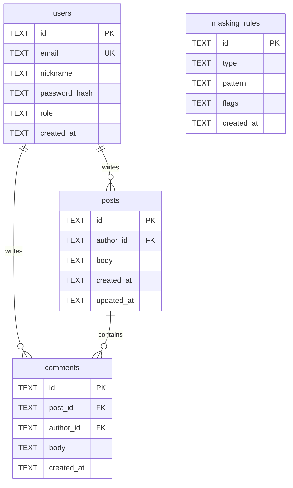

# note-demo 설계와 데이터 구조

구현 기준: 2026-10-27. Python + Flask + Jinja2, SQLite, 빌드 없는 JavaScript/CSS. 서버 렌더링과 같은 출처 fetch를 함께 사용합니다.

## 화면 구성

| 화면·영역 | 접근 권한 | 입력 | 주요 동작 |
| --- | --- | --- | --- |
| `/` 상단 | 전체 | 없음 | 로그인·가입 또는 현재 사용자·로그아웃, 관리자 메뉴 |
| `/signup` | 전체, 주 사용자는 비로그인 | 이메일·닉네임·비밀번호 | 이메일 정규화·중복·필수값 검사, user 역할 가입 |
| `/login` | 전체 | 이메일·비밀번호 | 해시 비교, 세션 갱신 |
| `/forgot-password` | 전체 | 이메일 | 형식 검사, 실제 메일을 보내지 않는 목업 안내 |
| `/` 목록·페이징 | 전체 | 페이지 이동 | 최신순 10개, 마스킹 후 10개 grapheme 미리보기 |
| `/` 작성 | 로그인 | 본문만 최대 5,000자 | 사용자 ID는 세션에서 결정 |
| `/` 상세 hidden 영역 | 전체 | 글 선택·닫기 | 같은 body의 영역에 상세·댓글 표시 |
| `/` 수정·삭제 | 본인 글 작성자 | 원문 편집·삭제 확인 | 서버 소유권 검사, 글 삭제 시 댓글 정리 |
| `/` 댓글 | 읽기 전체 / 쓰기 로그인 | 본문 최대 1,000자 | 단일 단계, 작성순 조회 |
| `/admin` | 관리자 | 유형·패턴·옵션·삭제 확인 | 규칙 조회·추가·삭제 |

팝업이나 상세 페이지로 이동하지 않습니다. Jinja 자동 이스케이프, JS textContent를 사용하며 원문을 hidden 데이터나 일반 조회 JSON에 싣지 않습니다. 본인 글 수정용 API에서만 원문을 반환합니다.

## ERD

규칙은 서버의 공통 표시 함수에 적용됩니다. 글이나 댓글에 규칙 FK를 저장하지 않습니다. 관리자 역할은 users.role로 구분하며 별도 관리자 테이블은 없습니다. 가입·댓글·글은 서버의 현재 사용자 ID를 사용하고 입력으로 받은 author_id나 role은 사용하지 않습니다.

## 테이블 구조

실행 가능한 정의는 `app/schema.sql`입니다. 모든 컬럼은 `NOT NULL`이고 DB 기본값이 ‘없음’인 컬럼은 앱이 직접 값을 제공합니다. UUID는 UUID4 문자열, 날짜·시간은 UTC ISO 8601 문자열입니다. 생성 시 글의 updated_at은 created_at과 같습니다.

### users

| 컬럼 | SQLite 타입 | NULL | DB 기본값 | 키·제약 | 설명 |
| --- | --- | --- | --- | --- | --- |
| id | TEXT | 불가 | 없음 | PK | UUID |
| email | TEXT | 불가 | 없음 | UNIQUE | 서버에서 앞뒤 공백 제거·소문자화, 최대 254자·형식 검사 |
| nickname | TEXT | 불가 | 없음 | CHECK trim 길이 1~40 | 화면 작성자명, 서버에서 공백 제거 |
| password_hash | TEXT | 불가 | 없음 | 해시만 저장 | Werkzeug PBKDF2-SHA256 600,000회, 평문·브라우저 저장소 사용 안 함 |
| role | TEXT | 불가 | `'user'` | CHECK user/admin | 일반 가입은 user 고정, 관리자 CLI만 admin 생성 |
| created_at | TEXT | 불가 | 없음 | UTC ISO | 가입 시각 |

비밀번호는 서버에서 6~128자·공백만 여부를 검사합니다. 일반 사용자 조회·세션에는 해시를 포함하지 않습니다. 이메일 인증이나 실제 비밀번호 재설정은 구현하지 않습니다.

### posts

| 컬럼 | SQLite 타입 | NULL | DB 기본값 | 키·제약 | 설명 |
| --- | --- | --- | --- | --- | --- |
| id | TEXT | 불가 | 없음 | PK | 글 UUID |
| author_id | TEXT | 불가 | 없음 | FK users.id | 작성자, 기본 참조 삭제 정책 NO ACTION |
| body | TEXT | 불가 | 없음 | CHECK trim 길이 1~5,000 | 원문, 서버에서도 공백·길이 검사 |
| created_at | TEXT | 불가 | 없음 | UTC ISO | 작성 시각 |
| updated_at | TEXT | 불가 | 없음 | UTC ISO | 수정 시각, 수정 때 생성 시각은 유지 |

### comments

| 컬럼 | SQLite 타입 | NULL | DB 기본값 | 키·제약 | 설명 |
| --- | --- | --- | --- | --- | --- |
| id | TEXT | 불가 | 없음 | PK | 댓글 UUID |
| post_id | TEXT | 불가 | 없음 | FK posts.id, ON DELETE CASCADE | 연결 글 삭제 시 댓글 함께 삭제 |
| author_id | TEXT | 불가 | 없음 | FK users.id | 댓글 작성자 |
| body | TEXT | 불가 | 없음 | CHECK trim 길이 1~1,000 | 원문, 서버에서도 공백·길이 검사 |
| created_at | TEXT | 불가 | 없음 | UTC ISO | 작성 시각 |

### masking_rules

| 컬럼 | SQLite 타입 | NULL | DB 기본값 | 키·제약 | 설명 |
| --- | --- | --- | --- | --- | --- |
| id | TEXT | 불가 | 없음 | PK | 규칙 UUID |
| type | TEXT | 불가 | 없음 | CHECK keyword/regex | 키워드 또는 정규식 |
| pattern | TEXT | 불가 | 없음 | CHECK trim 길이 1~200 | 탐지 패턴 |
| flags | TEXT | 불가 | `''` | keyword이면 빈 문자열 CHECK | regex의 i/m/s 조합, 정렬·중복 제거 정책은 서버 검사 |
| created_at | TEXT | 불가 | 없음 | UTC ISO | 규칙 등록 시각 |

추가 UNIQUE: `(type, pattern, flags)`. flags는 서버에서 정렬해 저장하며 중복 옵션 입력은 거부합니다. 키워드는 공백을 포함한 원문 패턴으로 검색하므로 임의 trim하지 않되 공백만 있는 패턴은 거부합니다. 정규식 유효성·시간 제한과 최대 200개 규칙은 서버가 검사합니다.

### 인덱스·정합성

| 이름 | 컬럼·순서 | 용도 |
| --- | --- | --- |
| posts_created | created_at DESC, id DESC | 최신순 페이징 |
| comments_post_created | post_id, created_at, id | 글별 댓글 작성순 조회 |
| SQLite 자동 인덱스 | PK 및 이메일·규칙 UNIQUE | 식별·중복 차단 |

요청별 연결에서 외래 키를 활성화합니다. SQL은 `?` 매개변수 바인딩을 사용합니다. 글 수 COUNT와 LIMIT/OFFSET으로 페이지를 계산하며 최소 1페이지, 최대 유효 페이지로 보정합니다. 쓰기 트랜잭션은 짧게 유지하고 DB 잠금 대기는 3초입니다. DB 오류 시 내용을 숨긴 503 안내를 반환합니다.

## 요청과 권한

| 요청 | 접근 | 응답·변경 |
| --- | --- | --- |
| GET /api/posts?page=N | 전체 | 마스킹된 미리보기·페이지 정보 |
| POST /api/posts | 로그인 + CSRF | 글 생성 |
| GET /api/posts/ID | 전체 | 마스킹된 본문·댓글·본인 여부 |
| GET /api/posts/ID/edit | 본인 + 로그인 | 수정용 원문, no-store |
| PATCH /api/posts/ID | 본인 + CSRF | 본문 변경 |
| DELETE /api/posts/ID | 본인 + CSRF | 글·댓글 삭제 |
| POST /api/posts/ID/comments | 로그인 + CSRF | 댓글 생성 |
| POST /api/rules | 관리자 + CSRF | 규칙 추가 |
| DELETE /api/rules/ID | 관리자 + CSRF | 규칙 삭제 |
| POST /logout | CSRF | 세션 비우기 |

읽기 API는 원문을 반환하지 않지만 안전한 문자열로서 HTML처럼 보이는 본문을 포함할 수 있습니다. 클라이언트는 이를 HTML로 실행하지 않고 textContent로 표시합니다. 모든 동적 응답은 Cache-Control: no-store입니다. 로그인 세션 쿠키는 서명되어 있으며 암호화 저장소가 아니므로 사용자 ID와 CSRF·flash 관련 값 외 비밀을 넣지 않습니다. 역할은 매 요청 DB에서 읽습니다.

## 저장·배포 수명 주기

- 기본 위치: 프로젝트 `instance/note_demo.sqlite3`의 절대 경로. 정적 공개·Git·배포 ZIP에서 제외합니다.
- 최초 설치: `init-config` → `init-db` → `create-admin`. 고정 기본 비밀번호는 없습니다.
- 초기 규칙 시드는 스키마 생성 트랜잭션에서 한 번 수행합니다. 재초기화 요청은 user_version=1일 때 데이터를 유지합니다.
- 요청에서 DB가 없으면 mode=rw 연결이 실패하고 새 DB를 만들지 않습니다. 손상 DB는 자동 덮어쓰기하지 않습니다.
- 재시작·Reload는 앱만 다시 구성하며 스키마·데이터 초기화를 수행하지 않습니다.
- 스키마 변경은 [변경 원칙](../migrations/readme.md), 운영 명령은 [실행·배포 안내](../readme.md)를 따릅니다.
