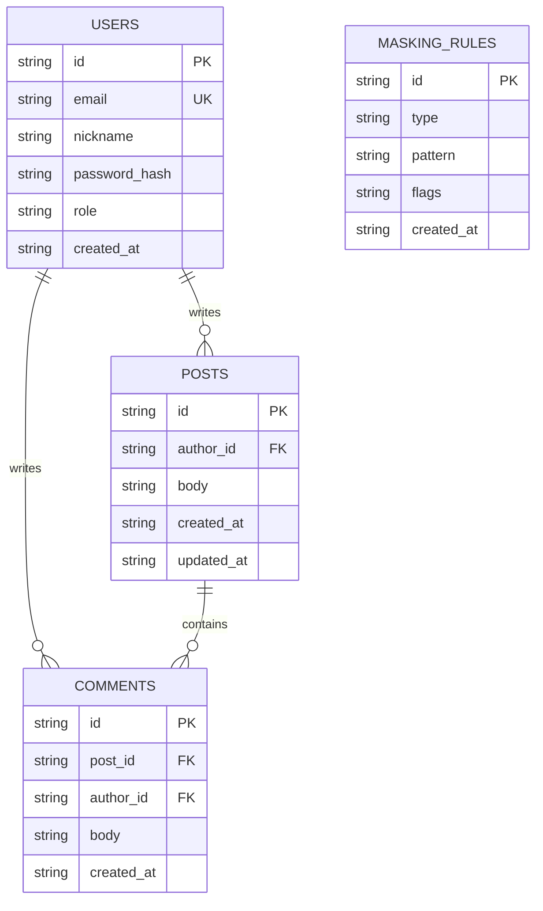

# note-demo 구현 계획

- 작성일: 2026-10-27 (Asia/Seoul)
- 상태: **구현·로컬 검증 및 PythonAnywhere 무료 HTTPS 배포 완료**
- 기준 문서: [prompt.md](prompt.md), [agent-prompt.md](agent-prompt.md)
- 진행 범위: 사용자 승인에 따라 애플리케이션 구현·자동 테스트·브라우저 검증 및 실행·배포 문서 작성을 수행했다. 결과는 `docs/verification.md`, 실제 명령은 `readme.md`를 따른다.

## 1. 목표와 구현 범위

목업 회원가입·로그인으로 사용자를 구분하는 간단한 방명록을 만든다. 본문만 작성하고 목록에서 약 10글자를 보여 주며, 글을 선택하면 현재 body의 숨김 영역에 전체 본문과 댓글을 펼친다.

| 구분 | 이번 구현 |
| --- | --- |
| 계정 | 이메일·닉네임·비밀번호 회원가입, 로그인, 로그아웃 |
| 비밀번호 찾기 | 실제 발송 없는 목업 입력 화면과 안내 |
| 방명록 | 본문 작성, 최신순 목록, 페이지당 10개, 상세 펼침·닫기 |
| 소유권 | 본인 글 수정·삭제, 처리 함수에서도 사용자 ID 검사 |
| 댓글 | 로그인 사용자 작성, 글별 조회, 단일 단계 |
| 마스킹 | 키워드·정규식, 목록·상세·댓글 공통 적용 |
| 관리 | 관리자 전용 규칙 조회·추가·삭제 및 영속 저장 |
| 문서 | 최소 화면 구성, ERD, 테이블 구조, 실행 방법, 규칙 출처, 검증 결과 |

SNS 로그인, 실제 비밀번호 재설정, 대댓글, 댓글 수정·삭제는 이번 범위에서 제외한다. 이메일 소유 확인 등은 없는 데모 계정 기능을 제공하되, 공개 배포되는 점을 반영해 비밀번호는 평문 대신 해시로 저장한다. 이는 원본의 목업 범위를 유지하면서 저장 방식을 보완한 결정이다.

## 2. 확정 기술 및 배포 방식

사용자의 배포 대상은 **PythonAnywhere 무료 계정**이다. 기존 프런트엔드 중심 제안을 다음 Python 웹 애플리케이션 구성으로 변경한다.

| 항목 | 선택 | 선택 이유 |
| --- | --- | --- |
| 서버 | Python + Flask, WSGI | PythonAnywhere의 기본 웹 앱 배포 흐름에 맞춤 |
| 화면 | Jinja2 + HTML/CSS + 기본 JavaScript | Node.js 빌드 없이 제공하며 상세 펼침 등 필요한 동작만 JS 사용 |
| 저장 | SQLite + Python 표준 sqlite3 | 신규 무료 계정에서도 별도 DB 서버 없이 데이터 영속 저장 |
| 로그인 | Flask의 서명된 세션 쿠키 | 사용자 ID만 세션에 저장하고 매 요청 DB에서 사용자·역할 확인 |
| 비밀번호 | Werkzeug의 비밀번호 해시 생성·검증 | 평문 저장 제거, 로그인·회원가입의 단순한 데모 흐름 유지 |
| 요청 보호 | Flask-WTF CSRF 보호, 서버 권한 검사 | 폼과 fetch의 데이터 변경 요청에 일관된 검사 적용 |
| 마스킹 | Python 공통 함수 + 시간 제한을 지원하는 regex 패키지 | 서버에서 일관되게 적용하며 별도 Worker 프로세스 제거 |
| 검증 | pytest + Flask 테스트 클라이언트 + 브라우저 확인 | 실제 DB·서버 권한·화면 흐름 검증 |

라이브러리 버전은 실제 PythonAnywhere에서 선택 가능한 Python 버전과 설치 호환성을 확인해 `requirements.txt`에 고정한다. 전용 Node.js 서버, npm/Vite 빌드, localStorage·sessionStorage 기반 계정·데이터 저장, 별도 ASGI 서버, Docker, Redis·Celery·예약 작업 의존성은 이번 구성에서 제거한다. 서버의 Flask 개발용 실행 명령은 로컬 확인에만 사용하며 배포는 호스팅 WSGI로 실행한다.

### 무료 환경의 제약과 대응

- 공식 안내상 무료 계정은 웹 앱 1개·웹 워커 1개·디스크 512 MiB·웹 앱 만료 기간 1개월이다. 코드·가상환경·DB의 합계 용량을 관리하고 Web 화면에서 만료 전 연장 절차를 문서화한다.
- 신규 무료 계정에서는 MySQL을 전제로 하지 않는다. SQLite는 소규모 수업·데모에 사용하며, 짧은 쓰기 트랜잭션과 연결 종료로 잠금 충돌을 줄인다. 대규모 운영 용도로 성능을 보장하지 않는다.
- 무료 계정의 외부 HTTP(S) 요청은 허용 목록 제한을 받는다. 마스킹 자료는 개발 환경에서 조사·선별한 파일로 배포하고, 앱 실행·초기화 시 외부 API나 크롤링을 요구하지 않는다.
- 정기 수집, 외부 DB, 실제 메일 발송은 의존성에서 제외한다. CSS·JS도 프로젝트에 포함해 CDN 호출 없이 화면을 구성한다.
- 월별 앱 연장은 사용자가 호스팅 관리 화면에서 수행한다. 자동 갱신 작업을 전제로 설계하지 않는다.

공식 근거와 확인 날짜는 아래 10절에 기록한다. 실제 계정의 제공 기능과 한도는 배포 시 다시 확인한다.

## 3. 화면과 사용자 흐름

Flask가 기본 HTML을 렌더링하고 상단 메뉴와 본문 영역을 단순하게 구성한다. 회원가입·로그인·관리자는 별도 경로를 사용할 수 있지만 방명록 상세는 같은 페이지에서만 펼친다.

| 화면·영역 | 접근 | 입력·동작 |
| --- | --- | --- |
| 상단 | 전체 | 프로젝트명, 로그인 상태, 회원가입·로그인 또는 로그아웃, 관리자 메뉴 |
| 회원가입 | 비로그인 | 이메일·닉네임·비밀번호, 중복 및 필수값 검사 |
| 로그인 | 비로그인 | 이메일·비밀번호, 실패 안내, 비밀번호 찾기 이동 |
| 비밀번호 찾기 | 비로그인 | 이메일 입력, 실제 이메일을 보내지 않는다는 안내 |
| 방명록 목록 | 전체 | 마스킹된 본문 10글자와 말줄임표, 작성자·시각, 페이지 이동 |
| 글 작성 | 로그인 | 제목 없는 본문 입력, 공백 입력 거부 |
| 숨김 상세 영역 | 전체 | 글 선택 시 펼침, 전체 본문·댓글, 닫기 |
| 글 수정·삭제 | 작성자 | 상세 영역 안에서 원문 편집, 삭제는 영역 내 확인 단계 |
| 댓글 작성 | 로그인 | 현재 선택한 글에 댓글 작성 |
| 규칙 관리 | 관리자 | 유형·패턴·옵션 입력, 규칙 목록, 추가·삭제 및 오류 안내 |

상세 영역은 DOM에 `hidden` 상태로 두고 글 선택 시 fetch로 서버에서 마스킹된 본문·댓글을 받아 채운 뒤 해제한다. 원문은 목록 HTML이나 읽기용 JSON에 숨겨 전달하지 않는다. 본인 글의 수정용 원문은 서버에서 소유권을 확인한 전용 요청으로만 제공한다. 상세용 모달·팝업·별도 페이지는 만들지 않는다. 다른 글 선택 시 내용과 댓글을 교체하고 삭제된 글의 상세는 닫는다. 한국어 안내, 키보드 조작, 모바일 폭에서도 읽기 쉬운 단순한 배치를 제공한다.

조회는 GET, 데이터 변경은 POST 또는 적절한 변경 메서드를 사용하고 CSRF 토큰을 검사한다. 로그아웃도 POST로 처리한다. 모든 쓰기 요청에서 현재 로그인 사용자를 서버가 결정하고, 수정·삭제 소유권 및 관리자 역할도 서버에서 검사한다.

## 4. 데이터 관계 및 SQLite 테이블 설계

다음 구조를 실제 SQLite 스키마로 구현했다. `app/schema.sql` 및 `docs/design.md`에 컬럼별 NULL 허용·기본값·제약조건·인덱스를 기록했다. DB는 명시적 CLI 초기화로 생성하며 배포 ZIP에 로컬 DB를 포함하지 않는다.



| 테이블 | 필드·형식 | 주요 제약·처리 |
| --- | --- | --- |
| users | id: UUID 문자열, email/nickname/password_hash: 문자열, role: user 또는 admin, created_at: ISO 시각 | 이메일 정규화 후 UNIQUE, 일반 가입 역할은 user 고정, role CHECK |
| posts | id/author_id: UUID 문자열, body: 문자열, created_at/updated_at: ISO 시각 | 작성자 존재 검사, 공백 본문 거부, 생성 시 두 시각 동일 |
| comments | id/post_id/author_id: UUID 문자열, body: 문자열, created_at: ISO 시각 | 외래 키로 글·작성자 참조, 공백 댓글 거부, post_id에 ON DELETE CASCADE |
| masking_rules | id: UUID 문자열, type: keyword 또는 regex, pattern/flags: 문자열, created_at: ISO 시각 | 유형·패턴·정규화한 옵션 조합 중복 방지, 빈 패턴 거부 |

모든 필드는 NOT NULL로 계획한다. `flags`는 기본값 빈 문자열을 허용하며 키워드 규칙에서는 빈 문자열로 고정한다. role 기본값은 user다. ID와 생성 시각은 앱에서 생성한다. 테이블 컬럼 타입은 TEXT를 사용하고 이메일, 역할, 본문과 규칙의 제약을 SQL 및 서비스에 반영한다. 비밀번호는 `password_hash`에 해시만 저장하며 세션·조회 응답·로그에 담지 않는다.

글은 작성 시각 내림차순, 댓글은 작성 시각 오름차순으로 정렬하고 동일 시각이면 ID로 순서를 안정화한다. 글의 `(created_at, id)`, 댓글의 `(post_id, created_at, id)` 인덱스와 이메일·규칙 중복 UNIQUE 제약을 생성한다. 페이지 조회에는 COUNT와 LIMIT/OFFSET을 사용한다. 연결마다 `PRAGMA foreign_keys = ON`을 적용하고 SQL은 매개변수 바인딩으로 실행한다.

DB는 프로젝트의 `instance/note_demo.sqlite3`에 저장하고 배포 시 절대 경로로 지정한다. 정적 파일 경로 밖에 두며 Git·배포 압축 파일에 실사용 DB를 포함하지 않는다. 요청별 연결과 짧은 트랜잭션을 사용하고 잠금 대기 상한·오류 안내를 둔다. 초기 스키마는 명시적 CLI로 적용하고 앱 재시작 때 DROP·재생성하지 않는다. 스키마 버전은 SQLite `user_version` 등으로 관리하고 변경 SQL은 순서대로 적용한다.

마스킹 규칙은 공통 표시 처리에 사용하며 글·댓글에 외래 키로 연결하지 않는다. 원문만 저장하고 마스킹 결과는 현재 규칙으로 계산한다.

## 5. 단계별 구현 순서

| 단계 | 작업 | 산출물·완료 기준 |
| --- | --- | --- |
| 0. 계획 확정 | PythonAnywhere 무료 배포 요구 반영 | 사용자 승인 완료 |
| 1. 기반·설계 | Flask 앱 팩토리, SQLite 연결·스키마, 화면 골격, 설계 문서 | 로컬 실행, 스키마 초기화, ERD·테이블·구현 일치 |
| 2. 계정·권한 | 가입·로그인·로그아웃·비밀번호 찾기 목업, 관리자 진입 방식 | 서로 다른 회원 2명으로 로그인·소유권 판단 확인 |
| 3. 방명록 | 작성·페이징·상세 펼침·본인 글 수정·삭제 | 11개 이상 글의 페이지 전환 및 마지막 페이지 삭제 정상 처리 |
| 4. 댓글 | 글별 조회·작성, 글 삭제와 댓글 정리 | 글 전환 시 댓글 혼합 없이 갱신 |
| 5. 마스킹·관리 | 초기 규칙 조사, Python 공통 마스킹, 관리자 규칙 조회·추가·삭제 | 서버 응답 전에 마스킹 적용, 규칙 변경·새로고침 반영 |
| 6. 통합 검증·문서 | 핵심 테스트, 브라우저 확인, 실행·설계·출처 문서 정리 | 아래 검증 항목별 결과 기록, 실패 수정, 미확인 항목 명시 |
| 7. 배포 준비·확인 | requirements 고정, WSGI 예제, 배포 안내, 배포 환경의 핵심 동작 확인 | 계정 사용 가능 시 HTTPS·DB 영속성·권한 확인, 미실시는 미확인으로 기록 |

초기 규칙은 최초 DB 초기화 때 한 번만 등록한다. 관리자 삭제 후 규칙이 0개가 되어도 다시 시드하지 않는다. 관리자 생성은 전용 CLI에서 비밀번호를 숨김 입력받아 수행하고 공개된 기본 비밀번호를 배포하지 않는다. 일반 가입은 user 역할만 생성한다. DB 손상 시 기존 파일을 덮어쓰지 않고 복구 안내를 제공한다. 관리자 생성과 백업·복원 절차를 README에 기록한다.

## 6. 마스킹 구현 방침

1. 구현 시점에 한국어 유해 표현 관련 공개 자료를 인터넷으로 조사하고 출처 URL·확인 날짜·이용 조건·선택 이유를 `docs/masking-sources.md`에 기록한다. 현재 계획 작성 단계에서는 조사 완료로 처리하지 않는다.
2. 키워드는 문자 그대로 검색하고 정규식 규칙만 정규식으로 해석한다. 패턴·옵션 유효성, 길이와 복잡도 제한을 검사한다.
3. 원문에서 규칙별 일치 구간을 수집·병합한 뒤 해당 부분만 가린다. 겹치는 규칙이나 반복 출현도 처리하고, 빈 문자열과 일치하는 정규식은 거부한다.
4. Python `regex` 패키지의 실행 시간 제한을 사용한다. 패턴 길이·규칙 수·본문 길이를 제한하고 전체 요청의 마스킹 시간 예산도 둔다. 시간 초과 시 해당 콘텐츠를 대체 안내로 가려 원문이 노출되지 않게 한다. 별도 브라우저 Worker나 서버의 상시 작업 프로세스를 요구하지 않는다.
5. 전체 본문을 마스킹한 뒤 글자 단위로 미리보기를 자른다. 상세와 댓글도 같은 함수를 사용하고 HTML 삽입 없이 텍스트로 렌더링한다.
6. 규칙 변경 후 해당 브라우저의 목록·열린 상세·댓글을 다시 조회해 갱신한다. 다른 사용자의 이미 열린 화면은 다음 조회·새로고침 때 반영한다. 실시간 푸시 서버는 도입하지 않는다. 본인 글 수정 폼에서는 권한 검사 후 받은 원문을 편집한다.

조사에 접근 제한이 있으면 임시 규칙과 조사 미완료 사실을 구분하여 기록한다. 오탐·누락 가능성을 문서화하고 실제로 검증하지 않은 목록을 최신 목록이라고 표시하지 않는다.

## 7. 검증 계획

| 대상 | 핵심 확인 사례 |
| --- | --- |
| 인증 | 필수값·이메일 형식·중복, 로그인 성공·실패, 로그아웃 직후 작성 권한 해제 |
| 권한 | 회원 A가 회원 B의 글을 변경하지 못함, 일반 회원의 규칙 변경을 처리 함수에서도 거부 |
| 목록 | 0·1·10·11개 이상, 마스킹 후 10글자, 최신순, 마지막 페이지의 마지막 글 삭제 |
| 상세·댓글 | body의 hidden 해제, 글 전환·닫기·삭제, 댓글 연결, 공백 거부, 줄바꿈 |
| 마스킹 | 반복·겹침·정규식 특수문자·잘못된 패턴·빈 일치·시간 초과·규칙 삭제 후 재계산 |
| 저장·초기화 | 서로 다른 브라우저의 공유 데이터 조회, 새로고침·WSGI Reload 후 데이터 유지, 외래 키·CASCADE·UNIQUE, 삭제한 초기 규칙 미복원 |
| 렌더링 | HTML 입력의 텍스트 표시, 키보드 조작, 작은 화면 배치 |
| 배포·세션 | 미로그인 쓰기 요청 거부, CSRF 누락 거부, 쿠키 설정, HTTPS, WSGI import, 정적 파일, DB 절대 경로, debug 비활성화 |
| 문서·실행 | Python 테스트, 의존성 설치, 실제 화면 확인, ERD·스키마·구현 일치, 무료 한도·연장 절차 기록 |

검증 결과는 `docs/verification.md`에 명령·결과 및 수동 확인 내용을 기록한다. 아직 수행하지 않은 테스트를 통과로 표시하지 않는다.

## 8. 예상 파일 구성

```text
note-demo (현재 디렉터리)
├── prompt.md                 # 원본 설계 보존
├── agent-prompt.md           # 실행용 요구사항
├── plan.md                   # 피드백을 반영하는 구현 계획
├── requirements.txt          # 배포용 Python 의존성
├── requirements-dev.txt      # 테스트 등 개발용 의존성
├── wsgi.py                   # WSGI application 진입점
├── app/
│   ├── __init__.py           # create_app과 설정
│   ├── db.py                 # 요청별 SQLite 연결·CLI
│   ├── schema.sql            # 테이블·인덱스·제약조건
│   ├── auth.py               # 회원가입·로그인·권한
│   ├── guestbook.py          # 글·댓글 요청 처리
│   ├── admin.py              # 규칙 관리
│   ├── masking.py            # 서버 마스킹·시간 제한
│   ├── templates/            # Jinja2 화면
│   ├── static/               # 빌드 없는 CSS·JavaScript
│   └── data/                 # 초기 규칙과 출처 식별자
├── instance/                 # DB·비밀 설정, Git 및 정적 공개 제외
├── migrations/               # 향후 스키마 변경 SQL
├── tests/                    # 임시 SQLite DB를 이용한 검증
├── docs/
│   ├── design.md             # 화면 구성·ERD·테이블 구조
│   ├── masking-sources.md
│   └── verification.md
├── .gitignore
└── README.md
```

## 9. PythonAnywhere 배포 절차와 완료 기준

1. 코드와 초기 규칙 파일을 업로드한다. 사용자명·홈 경로·도메인은 실제 계정 정보를 사용하며 임의로 확정하지 않는다.
2. Bash 콘솔에서 Web 앱과 동일한 Python 버전의 가상환경을 만들고 `requirements.txt`를 설치한다. Node.js 설치나 프런트엔드 빌드 단계는 없다.
3. 비밀 설정은 저장소 밖 파일 또는 WSGI에서 명시적으로 로드하는 환경 설정으로 전달한다. 콘솔에서만 설정한 환경변수가 Web 앱에 자동 전달된다고 가정하지 않는다. 안정적인 `SECRET_KEY`와 DB 절대 경로를 설정한다.
4. CLI로 DB 스키마·최초 규칙·관리자 계정을 준비한다. 기존 DB가 있으면 백업 후 필요한 변경만 적용한다.
5. Web 메뉴에서 무료 도메인의 웹 앱을 만들고 Manual configuration을 선택한다. 가상환경 경로와 Python 버전을 일치시킨다.
6. PythonAnywhere가 제공하는 WSGI 설정 파일에서 프로젝트 경로를 추가하고 앱의 `application`을 가져오게 한다. import 중 `app.run()`이나 초기화·시드 작업이 실행되지 않게 한다.
7. `/static/`만 `app/static`에 매핑한다. 프로젝트 루트·instance·DB·설정 파일은 정적으로 공개하지 않는다.
8. HTTPS에서 세션 쿠키의 Secure·HttpOnly·SameSite 설정을 확인하고 debug를 비활성화한다. Reload 후 로그인·글·댓글·규칙 변경·서버 권한·DB 유지와 정적 파일을 확인한다.
9. 로그에서 비밀번호·세션 비밀 등이 출력되지 않는지 확인한다. DB 백업은 쓰기 중 단순 파일 복사 대신 SQLite 백업 API 등 일관된 방식으로 수행하도록 문서화한다.
10. Web 화면의 만료일과 연장 방법, 디스크 사용량 점검 방법을 README에 기록한다.

사용자 승인에 따라 코드 작성과 로컬 검증, 배포용 ZIP 및 실행·배포 안내를 완료했다. 이후 PythonAnywhere 계정에 실제 배포하고 https://mjlee.pythonanywhere.com/ 에서 화면을 확인했다. 서버 Python 3.13.1, 가상환경·의존성·SQLite·WSGI·정적 파일·HTTPS·Reload를 적용했다. 정확한 실행 명령과 검증 범위는 `readme.md` 및 `docs/verification.md`를 따른다.

## 10. 조사 근거와 피드백 반영 내역

다음 공식 자료를 2026-10-27에 확인했다. 호스팅 제약과 배포 방식에 대한 조사이며 초기 마스킹 규칙 조사는 구현 단계 작업으로 남아 있다.

- [무료 계정 기능](https://help.pythonanywhere.com/pages/FreeAccountsFeatures/): 웹 앱·워커·디스크·만료 기간 및 구계정 추가 기능
- [DB 지원](https://help.pythonanywhere.com/pages/KindsOfDatabases): SQLite 제공, 신규 무료 계정의 MySQL 미제공, SQLite의 운영 성능 한계
- [외부 인터넷 제한](https://help.pythonanywhere.com/pages/403ForbiddenError): 무료 계정 외부 요청의 허용 목록
- [Flask 배포](https://help.pythonanywhere.com/pages/Flask/): 가상환경, Manual configuration, WSGI 설정
- [정적 파일 매핑](https://help.pythonanywhere.com/pages/StaticFiles/): URL과 정적 디렉터리 매핑
- [웹 앱의 전역 상태](https://help.pythonanywhere.com/pages/GlobalStateAndWebApps): 전역 변수 대신 영속 저장을 사용하는 근거
- [Flask 공식 Quickstart](https://flask.palletsprojects.com/en/stable/quickstart/): 템플릿·세션·로컬 개발 서버
- [regex 패키지 공식 설명](https://pypi.org/project/regex/): 정규식 처리의 timeout 지원

| 날짜 | 변경 | 상태 |
| --- | --- | --- |
| 2026-10-27 | 원본 설계와 실행용 프롬프트를 기반으로 구현 계획 작성 | 사용자 피드백 대기 |
| 2026-10-27 | PythonAnywhere 무료 배포 피드백 반영: Flask·SQLite·WSGI로 변경, Vite·브라우저 저장소·Worker 제거, 배포 절차와 서버 권한·해시 저장 추가 | 최종본 |
| 2026-10-27 | 사용자 승인 후 코드·문서·테스트 작성, 브라우저 흐름 확인, 배포 ZIP 준비 | 로컬 검증 완료, 원격 배포 미확인 |
| 2026-10-27 | 비밀번호 최소 길이를 6자로 변경, 6자 가입·로그인·관리자 생성 검증 및 전체 테스트 28개 통과, 배포 ZIP 갱신 | PythonAnywhere 로그인 대기 |
| 2026-10-27 | mjlee.pythonanywhere.com 무료 앱에 Python 3.13.1·SQLite·WSGI·HTTPS 배포, 실제 공개 화면 확인 | 배포 완료 |
