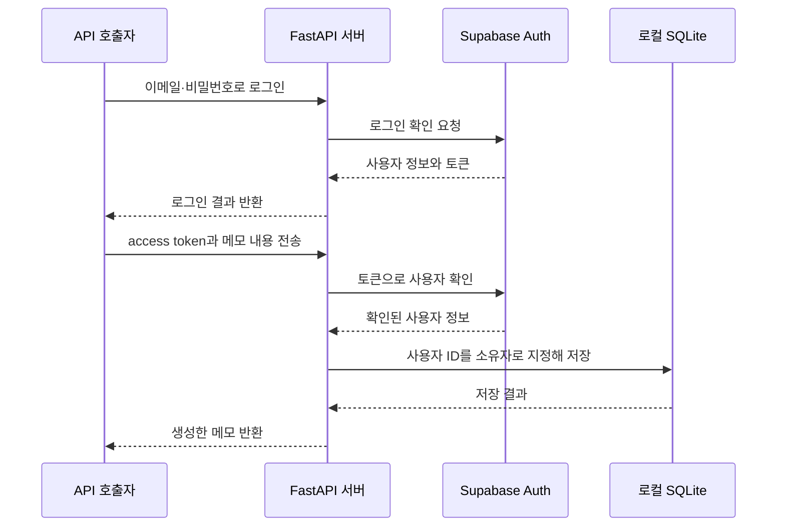

# Day 13 소스코드 해설 — 로그인하고 내 메모만 보는 서비스

대상: [main.py](main.py), [main2.py](main2.py), [main3.py](main3.py)

이 문서는 **어떤 서비스를 만들려는지 → 기능의 의미 → 사용하는 기술 → 주요 함수와 문법** 순서로 설명합니다. 비전공자를 위한 비유와 주석을 함께 넣었습니다. 코드 예시는 개념을 설명하는 발췌본이며, 오류 코드와 과거 오류 해결 과정은 다루지 않습니다.

## 1. 무엇을 구현하는 코드인가?

전체 목적은 **회원으로 가입하고 로그인한 사람이 자신의 메모만 저장하고 볼 수 있는 API 서버**를 만드는 것입니다.

Day12가 **데이터 저장·조회**를 배웠다면, Day13은 **누가 요청했는지 확인하고 그 사람의 데이터만 제공하는 방법**으로 확장한 수업입니다.

일기장 보관소에 비유하면 다음과 같습니다.

- 회원가입: 보관소에 이용자로 등록하기
- 로그인: 등록된 이용자인지 확인받기
- 토큰: 확인을 마쳤다는 유효기간 있는 출입증 받기
- 현재 사용자 확인: 출입증이 누구의 것인지 확인하기
- 메모 저장: 확인된 이용자의 이름표를 붙여 메모 보관하기
- 소유권 검사: 다른 사람의 보관함은 열지 못하게 하기

여기서 API 서버는 화면 뒤에서 요청을 처리하는 프로그램입니다. 이 세 파일에는 쇼핑몰 같은 사용자 화면이 없고, `/docs`라는 API 시험 화면에서 기능을 확인할 수 있습니다.

### 파일별로 기능이 확장되는 순서

| 파일 | 구현 목적 | API 주소 |
|---|---|---|
| `main.py` | 이메일 회원가입과 로그인 | `POST /auth/signup`, `POST /auth/login` |
| `main2.py` | 로그인 후 토큰으로 현재 사용자 확인 | `POST /auth/login`, `GET /me` |
| `main3.py` | 인증된 사용자의 개인 메모 저장·조회 | `POST /auth/login`, `GET /me`, `POST /notes`, `GET /notes`, `GET /notes/{note_id}` |

세 파일은 각각 `app`을 가진 **별도의 학습용 서버**입니다. `main3.py`를 실행한다고 `main.py`의 회원가입 경로도 자동으로 생기는 것은 아닙니다. 먼저 가입한 계정을 다른 파일의 로그인 기능에서 사용하는 식으로 학습합니다.

### 현재 구현 범위

- 구현됨: 회원가입, 로그인, 토큰 반환, 현재 사용자 확인, 메모 생성·목록·상세 조회, 본인 데이터 접근 제한
- 아직 없음: 토큰 갱신 API, 로그아웃 API, 메모 수정·삭제, 관리자 역할 관리

로그인 응답에 `refresh_token`이 포함되어도 이 코드가 자동 갱신까지 구현한 것은 아닙니다. `auto_refresh_token=False`로 SDK의 자동 갱신도 꺼두었습니다.

## 2. 기능은 어떤 순서로 동작할까?



중요한 점은 메모를 받을 때 **사용자가 주장하는 이름이 아니라, 토큰으로 확인한 사용자 ID**를 사용한다는 것입니다.

회원가입은 `main.py`, 개인 메모는 `main3.py`에서 학습합니다. 위 흐름은 파일별 기능을 합쳐 설명한 것이며, 한 파일이 모든 단계를 제공한다는 뜻은 아닙니다. 이 문서는 소스 분석에 근거하며 실제 로그인·DB 실행 검증 결과가 아닙니다.

## 3. 구현한 기능의 정의와 개념

### 3-1. 회원가입: 새 계정 만들기

사용자가 이메일과 비밀번호를 보내면 서버가 입력 형식을 검사하고 Supabase Auth에 계정 생성을 요청합니다.

```python
supabase.auth.sign_up({
    'email': str(body.email),
    'password': body.password.get_secret_value(),
})
# Supabase Auth에 가입 요청
# 이메일 확인을 사용하는 프로젝트라면 받은 메일에서 인증을 완료
```

`EmailStr`의 형식 검사와 이메일 인증은 다릅니다. 전자는 주소가 이메일 모양인지 검사하고, 후자는 사용자가 그 메일함을 이용할 수 있는지 확인하는 과정입니다.

### 3-2. 로그인: 등록한 계정인지 확인하기

```python
result = supabase.auth.sign_in_with_password({
    'email': str(body.email),
    'password': body.password.get_secret_value(),
})

session = result.session  # 로그인 토큰과 만료 정보
user = result.user        # 사용자 ID와 이메일 등의 정보
```

로그인은 매번 새 계정을 만드는 작업이 아닙니다. 이미 있는 계정의 인증 정보를 확인하고 이후 요청에 사용할 증표를 받는 작업입니다.

### 3-3. 토큰: 유효기간이 있는 출입증

| 값 | 의미 | 쉬운 비유 |
|---|---|---|
| `access_token` | 인증이 필요한 요청에 사용하는 토큰 | 출입증 |
| `refresh_token` | 새 토큰을 발급받는 데 사용하는 값 | 출입증 재발급에 사용하는 증표 |
| `token_type` | 토큰을 전달하는 방식. 일반적으로 Bearer | 출입증 사용 방식 |
| `expires_in` | 발급 시점 기준 유효기간, 초 단위 | 발급 후 몇 초간 유효한지 |
| `expires_at` | 만료 시각, Unix timestamp | 출입증의 만료 날짜·시각 |

JWT는 access token에 사용하는 토큰 형식입니다. JWT 내용을 읽는 것만으로는 믿을 수 있는 출입증인지 알 수 없습니다. 이 코드에서는 Supabase Auth에 토큰을 전달해 사용자를 확인합니다.

JWT는 기본적으로 내용을 숨긴 암호문이 아닙니다. **내용을 읽는 것과 유효성을 검증하는 것은 다른 작업**입니다.

### 3-4. 현재 사용자 확인: 출입증 주인 확인하기

요청할 때 access token을 헤더에 넣습니다. 헤더는 요청의 내용 외에 부가 정보를 담는 부분입니다.

```http
Authorization: Bearer ACCESS_TOKEN
```

```python
result = supabase.auth.get_user(token)
# 토큰을 Supabase Auth에 전달해 사용자 정보 확인

return CurrentUser(id=result.user.id, email=result.user.email)
# 현재 API가 필요한 사용자 ID와 이메일만 반환
```

`HTTPBearer`는 헤더에서 토큰을 꺼내는 역할입니다. 토큰이 유효한지 확인하는 `get_user()`와 역할이 다릅니다.

`Bearer`는 **이 토큰을 제시한 사람에게 토큰의 인증을 적용하는 방식**입니다. 출입증을 남이 가져가도 사용할 수 있는 것처럼 토큰을 다른 사람에게 알려주면 안 됩니다. 이후 요청에서는 비밀번호 대신 access token을 제시합니다.

### 3-5. 내 메모만 접근하기: 소유권 검사

| 구분 | 묻는 질문 | 예시 |
|---|---|---|
| 인증 | 누구인가? | 토큰으로 A 사용자 확인 |
| 인가·권한 검사 | 이 데이터를 볼 수 있는가? | A에게 A의 메모만 제공 |

A와 B가 모두 로그인했더라도 A가 B의 메모를 읽을 수 있어서는 안 됩니다.

학교에 비유하면 **학생증으로 학생을 확인하는 것이 인증**, **자기 사물함만 열게 하는 것이 인가**입니다. 로그인 성공과 모든 데이터에 접근할 권한은 같은 뜻이 아닙니다.

메모 생성 시 소유자를 서버에서 정합니다.

```python
note = Note(
    id=str(uuid4()),     # 새 메모를 구분하는 고유 ID
    owner_id=user.id,    # 인증된 사용자의 ID
    content=body.content,
)
# 요청 JSON에서 owner_id를 받아 그대로 믿지 않음
```

메모를 조회할 때는 메모 ID와 소유자 ID를 함께 검사합니다.

```python
row = db.execute(
    'SELECT id, owner_id, content FROM notes WHERE id = ? AND owner_id = ?',
    (note_id, user.id),
).fetchone()
# 메모 번호를 알아도 다른 사람의 메모라면 조회 결과에 포함되지 않음
```

**화면에서 숨기는 것뿐 아니라 서버의 SQL 조건에서도 소유권을 제한하는 것이 핵심입니다.** 이 예제의 제한은 FastAPI와 SQLite 쿼리에서 수행하며 Supabase DB의 사용자별 정책을 설정하는 코드는 아닙니다.

## 4. 기능 구현에 사용하는 기술

| 기술 | 정의 | 이 코드에서 하는 일 |
|---|---|---|
| Python | 프로그램을 작성하는 언어 | 요청 처리·인증·DB 작업 작성 |
| FastAPI | Python으로 API를 만드는 프레임워크 | 주소별 함수 연결, 입력·응답 처리 |
| Uvicorn | FastAPI 앱을 실행하는 서버 프로그램 | HTTP 요청을 받아 앱에 전달 |
| HTTP | 클라이언트와 서버가 요청·응답을 주고받는 규칙 | 로그인·메모 조회 요청 전달 |
| JSON | 이름과 값으로 데이터를 표현하는 형식 | 이메일·비밀번호·메모 전달 |
| Pydantic | 데이터 구조를 정의하고 값을 검증하는 라이브러리 | 이메일 형식·문자열 길이 검사 |
| Supabase Auth | 계정 인증과 토큰을 관리하는 서비스 | 회원가입·로그인·사용자 확인 |
| Supabase SDK | Python에서 Supabase를 호출하는 도구 모음 | `sign_up()`, `get_user()` 등 제공 |
| HTTPX | HTTP 통신용 라이브러리 | Supabase 통신 설정·연결 관리 |
| python-dotenv | `.env`를 환경변수로 읽는 라이브러리 | 프로젝트 주소·키 설정 읽기 |
| SQLite | 파일에 데이터를 저장하는 DB | `main3.py`의 메모 보관 |
| SQL | DB 데이터를 저장·조회하는 언어 | 메모 추가와 본인 메모 검색 |
| OpenAPI·Swagger UI | API 구조 설명 규격과 시험 화면 | `/docs`에서 요청 보내보기 |

역할을 연결하면 **FastAPI는 업무 접수 창구, Pydantic은 신청서 검사 담당자, Supabase Auth는 신분 확인 기관, HTTPX는 통신 수단, SQLite는 기록 보관소**입니다. Uvicorn은 이 창구가 실제 HTTP 요청을 받도록 실행하는 서버입니다.

### 인증 저장소와 메모 저장소는 다름

```text
Supabase Auth → 계정·비밀번호 인증·토큰 관리
로컬 SQLite  → 메모 ID·소유자 ID·메모 내용 저장
```

Supabase를 사용한다고 모든 데이터를 Supabase DB에 저장하는 것은 아닙니다. `main3.py`의 메모는 `NOTES_DB`에 지정한 로컬 파일에 저장합니다.

Day12에서는 `psycopg`로 PostgreSQL에 SQL을 보냈지만, Day13에서는 인증은 Auth API로 요청하고 메모 SQL은 SQLite에서 실행합니다. **사용자 ID가 외부 인증 계정과 로컬 메모를 연결하는 이름표**가 됩니다.

## 5. 설정과 입력 데이터를 다루는 문법

### 환경변수: 설정을 코드 밖에서 읽기

```python
load_dotenv(override=False, interpolate=False)
# override=False: 이미 설정된 환경변수 우선
# interpolate=False: ${...} 형태를 다른 값으로 치환하지 않음

supabase_url = os.getenv('SUPABASE_URL', '').strip().rstrip('/')
# getenv(이름, 기본값): 이름으로 설정 조회
# strip(): 양쪽 끝의 공백 제거
# rstrip('/'): 오른쪽 끝의 / 제거
```

`main3.py`는 아래 경로로 프로젝트 최상위의 `.env`를 지정합니다.

```python
env_path = Path(__file__).resolve().parent.parent / '.env'
# 현재 파일 → day13 폴더 → 프로젝트 최상위 폴더 → .env
```

프로젝트의 publishable key는 연결할 프로젝트를 위한 API 키입니다. 로그인한 사용자를 나타내는 access token이나 DB 비밀번호와는 다릅니다.

```text
프로젝트 URL·publishable key → 어느 인증 서비스를 사용할까?
사용자 access token          → 그 서비스에 로그인한 누구일까?
```

### Pydantic 모델: 입력 양식과 검사 규칙

```python
class LoginRequest(BaseModel):
    model_config = ConfigDict(extra='forbid')  # 정하지 않은 추가 항목은 받지 않음
    email: EmailStr                           # 이메일 형식 검사
    password: SecretStr = Field(min_length=1)  # 빈 비밀번호를 받지 않음
```

| 문법 | 의미 |
|---|---|
| `class LoginRequest(BaseModel):` | BaseModel을 바탕으로 새 데이터 모델 정의 |
| `email: EmailStr` | email의 타입을 표시 |
| `model_config = ...` | 실제 설정값을 대입 |
| `Field(min_length=1)` | 필드의 세부 검증 조건 지정 |
| `int \| None` | 정수 또는 None 허용. 기본값이 없으면 항목은 필수 |

Python의 타입 힌트 자체가 모든 값을 자동 검사하는 것은 아닙니다. Pydantic이 모델의 타입 정보를 읽어 검증합니다.

```python
password.get_secret_value()
# SecretStr로 감싼 실제 문자열을 꺼냄
# SecretStr은 출력 시 가려주는 기능이며 암호화나 해시 저장 기능은 아님
```

회원가입은 새 비밀번호의 길이를 검사하고, 로그인은 기존 비밀번호를 확인하기 위해 빈 값만 거절하도록 정의했습니다.

예를 들어 `SecretStr('abcdefgh')`를 출력하면 `**********`처럼 보이지만, `get_secret_value()`로 꺼낸 값은 원래 문자열입니다. 인증 서비스에 전송할 때 실제 문자열을 사용합니다.

## 6. 주요 함수와 메서드 빠르게 보기

직접 작성한 함수와 라이브러리가 제공하는 메서드를 구분하면 코드를 읽기 쉽습니다. 함수는 작업을 수행하는 코드 묶음이고, 메서드는 객체나 클래스에 속한 함수입니다.

### 직접 작성한 주요 함수

| 함수 | 위치 | 받는 값 → 하는 일 → 결과 |
|---|---|---|
| `signup(body)` | `main.py` | 가입 입력 → Supabase 가입 요청 → 안내 메시지 |
| `login(body, response)` | 세 파일 | 로그인 입력 → Auth 로그인 → 토큰·사용자 정보 |
| `make_client(http_client)` | `main2.py`, `main3.py` | HTTP 클라이언트 → 공통 연결 설정 → Supabase 클라이언트 |
| `token_response(result, response)` | `main2.py`, `main3.py` | 로그인 결과 → 필요한 항목 추출 → TokenResponse |
| `verified_user(token)` | `main2.py`, `main3.py` | 토큰 → Auth에 사용자 확인 → CurrentUser |
| `me(...)` | `main2.py`, `main3.py` | 인증 정보 → 현재 사용자 반환 |
| `require_token(credentials)` | `main3.py` | 헤더 추출 결과 → 토큰 존재 확인 → 토큰 문자열 |
| `get_current_user(credentials)` | `main3.py` | 토큰 추출·사용자 확인 연결 → CurrentUser |
| `get_db()` | `main3.py` | DB 연결 생성 → API에 전달 → 처리 후 연결 정리 |
| `create_note(body, user, db)` | `main3.py` | 내용·현재 사용자·DB → 소유자 지정 후 저장 → 새 메모 |
| `list_notes(user, db)` | `main3.py` | 현재 사용자·DB → 본인 메모 검색 → 메모 목록 |
| `read_note(note_id, user, db)` | `main3.py` | 메모 ID·현재 사용자·DB → 소유권 조건 조회 → 메모 한 개 |

공통 보조 함수인 `handler_validation_error()`·`validation_error()`는 입력 검사 결과에서 위치와 종류만 골라 응답합니다. `raise_auth_error()`는 인증 처리 실패를 API 응답으로 바꿉니다. 비밀번호 같은 입력 원문을 응답에 넣지 않도록 하는 목적도 있습니다.

### 라이브러리의 주요 함수·메서드

| 호출 문법 | 역할 |
|---|---|
| `create_client(url, key, options=...)` | Supabase 기능을 호출할 객체 생성 |
| `ClientOptions(...)` | SDK 동작 설정 객체 생성 |
| `httpx.Client(timeout=10.0)` | 통신 단계별 대기 제한이 있는 HTTP 클라이언트 생성 |
| `supabase.auth.sign_up({...})` | 회원가입 요청 |
| `supabase.auth.sign_in_with_password({...})` | 이메일·비밀번호로 로그인 |
| `supabase.auth.get_user(token)` | 토큰으로 사용자 확인 |
| `sqlite3.connect(notes_db)` | SQLite 파일 연결 |
| `db.execute(SQL, 값들)` | SQL 실행 |
| `.fetchone()` / `.fetchall()` | 조회 결과 한 행 / 전체 행 가져오기 |
| `db.commit()` / `db.close()` | 변경 확정 / 연결 닫기 |
| `uuid4()` | 메모에 사용할 무작위 UUID 생성 |

`create_client()`로 클라이언트를 만드는 것 자체가 로그인은 아닙니다. 실제 회원가입·로그인 요청은 `auth`의 메서드를 호출할 때 수행합니다.

## 7. 함수 문법을 실제 코드로 읽기

### `def`, 매개변수, `return`

```python
def verified_user(token: str):
    # def: 함수 정의
    # token: 받을 값의 이름
    # : str: 문자열 타입 표시
    ...
    return CurrentUser(id=result.user.id, email=result.user.email)
    # return: 결과를 호출한 곳에 돌려주고 함수 종료
```

`: str`은 매개변수의 타입 표시이고, `def ...:`의 마지막 콜론은 함수 본문 시작을 나타냅니다. 들여쓰기로 본문의 범위를 정합니다.

### 데코레이터: 주소와 함수 연결

```python
@app.post('/auth/login', response_model=TokenResponse)
def login(body: LoginRequest, response: Response):
    ...
```

- `@app.post(...)`: 이 주소의 POST 요청을 아래 함수에 연결
- `body`: 검증된 요청 본문
- `response`: 헤더를 설정할 수 있도록 FastAPI가 제공하는 응답 객체
- `response_model`: 반환 데이터의 구조를 검사하고 문서에 표시

`Response`는 실제 HTTP 응답을 제어하는 객체이고, `TokenResponse`는 반환할 데이터의 구조를 정한 모델입니다.

```python
response.headers['Cache-Control'] = 'no-store'
# main2.py·main3.py에서는 토큰 응답을 캐시에 저장하지 않도록 지시
```

### 딕셔너리와 키워드 인자

```python
{'email': str(body.email)}
# 딕셔너리: 이름과 값을 묶는 자료형

create_client(supabase_url=supabase_url, supabase_key=supabase_key)
# 왼쪽: 함수가 받는 인자 이름 / 오른쪽: 전달할 값이 든 변수
```

### `with`: 사용 후 자원 정리

```python
with httpx.Client(timeout=10.0) as http_client:
    result = make_client(http_client).auth.get_user(token)
# 블록을 벗어나면 HTTP 연결 등의 자원을 정리
```

`timeout=10.0`은 전체 API 처리가 반드시 10초 안에 끝난다는 의미가 아닙니다. 통신 단계의 대기 제한입니다.

`ClientOptions(persist_session=False, auto_refresh_token=False)`는 SDK의 세션 저장과 자동 갱신을 끄는 설정입니다. Supabase가 세션을 만들지 않는다는 뜻은 아닙니다.

### `try`, `except`, `raise`: 실패했을 때의 처리 정하기

```python
try:
    # 외부 인증 서비스에 요청
    ...
except AuthApiError as exc:
    raise_auth_error(exc)
```

- `try`: 실패할 수 있는 작업을 실행합니다.
- `except ... as exc`: 해당 종류의 오류가 나면 오류 정보를 `exc`로 받아 처리합니다.
- `raise`: 현재 작업을 중단하고 예외를 발생시킵니다. 실제 보조 함수에서는 `HTTPException`을 발생시켜 FastAPI가 오류 응답을 만들게 합니다.

예를 들어 인증 서비스에 연결되지 않는 문제와 비밀번호가 틀린 문제를 구분해 처리합니다. 입력 검증용 예외 처리 함수는 원문 전체 대신 오류 위치·종류만 반환해 비밀번호가 응답에 섞이지 않게 합니다.

### `Annotated`와 `Depends`: 공통 준비 작업 맡기기

```python
def me(user: Annotated[CurrentUser, Depends(get_current_user)]):
    return user
# CurrentUser: 결과 타입
# Depends(...): 이 함수를 먼저 실행하고 결과를 user에 넣어달라는 요청
```

`main3.py`에서 실제 실행 순서는 다음과 같습니다.

```text
HTTPBearer가 헤더에서 토큰 추출
→ get_current_user() 실행
→ require_token()으로 토큰 존재 확인
→ verified_user()로 Auth에 사용자 확인
→ 확인된 CurrentUser를 me() 또는 메모 함수에 전달
```

`Depends(get_current_user)`처럼 함수 자체를 넘깁니다. `get_current_user()`처럼 미리 실행해 넣는 것과 다릅니다.

### `yield`와 `finally`: DB를 빌려주고 돌려받기

```python
def get_db():
    conn = sqlite3.connect(notes_db, check_same_thread=False)
    try:
        yield conn      # API 함수에 DB 연결 전달
    finally:
        conn.close()    # 처리가 끝나면 정리
```

비유하면 `yield`는 도서관에서 책을 빌려주는 지점이고, `finally`는 사용이 끝난 뒤 회수하는 절차입니다. SQLite의 `check_same_thread=False`는 다른 스레드에서 연결을 사용할 수 있게 하는 설정이며 동시 쓰기를 자동으로 안전하게 만드는 설정은 아닙니다.

### SQL의 `?`와 튜플: SQL과 값을 분리

```python
db.execute(
    'INSERT INTO notes (id, owner_id, content) VALUES (?, ?, ?)',
    (note.id, note.owner_id, note.content),
)
db.commit()  # 저장 변경 확정
```

`?`에는 다음 인자로 전달한 값이 순서대로 들어갑니다. 사용자 입력을 SQL 문자열에 직접 이어 붙이지 않는 방식입니다. 값이 하나인 튜플은 `(user.id,)`처럼 쉼표를 붙입니다.

```python
rows = db.execute(
    'SELECT id, owner_id, content FROM notes WHERE owner_id = ?',
    (user.id,),
).fetchall()

return [dict(row) for row in rows]
# 각 DB 행을 딕셔너리로 바꿔 리스트에 모으는 리스트 컴프리헨션
```

`get_db()`는 `sqlite3.Row`를 사용하므로 행을 열 이름으로 읽거나 `dict(row)`로 바꿀 수 있습니다. SQLite 연결의 `with`만으로 연결이 닫히는 것은 아니며, 코드에서는 `closing(...)`이나 `finally`로 연결을 닫습니다.

## 8. 메모 한 개가 저장되는 예시

A가 로그인한 뒤 다음 내용을 보냈다고 가정합니다.

```json
{"content": "오늘은 토큰과 사용자 권한을 배웠다."}
```

1. `NoteInput`이 내용의 길이와 빈 문자열 여부를 검사합니다. 앞뒤 공백은 제거합니다.
2. `Depends(get_current_user)`가 토큰으로 A의 사용자 ID를 확인합니다.
3. `uuid4()`로 메모 ID를 만듭니다.
4. 서버가 `owner_id`를 A의 ID로 지정합니다.
5. SQLite에 저장하고 `commit()`으로 확정합니다.
6. 메모 ID·소유자 ID·내용을 응답합니다.

개념적으로 저장된 표는 다음과 같습니다. 실제 ID는 긴 UUID 문자열입니다.

| id | owner_id | content |
|---|---|---|
| 메모-1 | 사용자-A | 오늘은 토큰과 사용자 권한을 배웠다. |
| 메모-2 | 사용자-B | 내일 읽을 책 목록 |

A의 `/notes` 조회에는 첫 번째 행만, B의 조회에는 두 번째 행만 포함됩니다. 이름이 같은 사람이 있어도 사용자 ID로 구분합니다.

## 9. 실행하면서 읽는 순서와 핵심 정리

`day13` 폴더에서 한 번에 파일 하나를 선택해 실행합니다.

```bash
python -m uvicorn main:app --reload
# main.py의 app 실행

# 서버를 Ctrl+C로 종료한 뒤 다음 파일 선택
# python -m uvicorn main2:app --reload
# python -m uvicorn main3:app --reload
```

`파일이름:객체이름` 형식이며, `/docs`에서 제공되는 API를 확인합니다. `main3.py`는 `NOTES_DB`에 지정한 파일을 사용하며 상대 경로면 명령을 실행한 폴더를 기준으로 합니다. 세 파일은 같은 Supabase 프로젝트 설정을 사용해야 같은 계정으로 시험할 수 있습니다.

소스를 읽을 때는 **모델 → 경로 데코레이터 → API 함수 → 공통 인증 함수 → 메모 SQL** 순서로 따라가면 이해하기 쉽습니다.

꼭 기억할 내용은 다음 여섯 가지입니다.

1. **회원가입은 계정 생성, 로그인은 계정 확인입니다.**
2. **토큰은 이후 요청에서 사용하는 인증 증표이며 검증이 필요합니다.**
3. **인증은 누구인지 확인하고, 인가는 접근 가능한 작업·데이터를 제한합니다.**
4. **Pydantic은 데이터 검사, FastAPI는 요청 처리, Supabase Auth는 인증, SQLite는 메모 저장을 담당합니다.**
5. **메모의 소유자는 사용자 입력 대신 인증된 사용자 ID로 정합니다.**
6. **조회할 때도 소유자 조건을 넣어야 다른 사람의 데이터가 섞이지 않습니다.**

## 10. 대화에서 직접 질문한 개념 보충

이 부분은 대화에서 질문한 내용을 복습하는 문답입니다. 오류의 원인·오류 코드·설치 실패·수정 방법에 관한 질문은 제외하고, 코드의 의미와 문법을 묻는 질문만 정리했습니다.

### 10-1. `load_dotenv()`와 `os.getenv()`는 각각 무엇을 하는가?

```python
import os
from dotenv import load_dotenv

load_dotenv(override=True)   # .env의 내용을 환경변수로 불러오기
print(os.getenv('host', '')) # host를 조회하고 출력. 없으면 빈 문자열
```

- `import os`: 환경변수를 읽는 등의 운영체제 관련 기능을 가져옵니다.
- `from dotenv import load_dotenv`: `.env`를 읽는 함수를 가져옵니다.
- `load_dotenv(...)`: 파일에 적힌 설정을 현재 프로그램의 환경변수에 등록합니다.
- `os.getenv('host', '')`: `host` 값을 읽습니다. 없다면 기본값 `''`을 사용합니다.
- `print(...)`: 결과를 화면에 출력합니다.

비유하면 `.env`는 설정을 적은 종이이고, `load_dotenv()`는 종이를 읽어 프로그램에 옮겨 적는 작업, `getenv()`는 옮겨둔 설정을 찾아보는 작업입니다.

### 10-2. `override=True`가 기존 값을 덮어쓴다는 것은 무슨 뜻인가?

이미 환경변수에 값이 있는데 `.env`에도 같은 이름의 값이 있을 때, **어느 쪽을 사용할지** 정하는 것입니다.

```dotenv
# .env에 다음 값이 있다고 가정
host=파일에_적힌_주소
```

아래 두 예시는 각각 기존 값을 다시 설정하고 비교합니다.

```python
os.environ['host'] = '먼저_설정한_주소'
load_dotenv(override=False)
print(os.getenv('host'))  # 먼저_설정한_주소

os.environ['host'] = '먼저_설정한_주소'
load_dotenv(override=True)
print(os.getenv('host'))  # 파일에_적힌_주소
```

| 상태 | `override=False` | `override=True` |
|---|---|---|
| 기존 값과 파일 값이 모두 있음 | 기존 값 유지 | 파일 값 사용 |
| 기존 값은 없고 파일 값만 있음 | 파일 값 사용 | 파일 값 사용 |

이때 바뀌는 것은 **현재 Python 프로세스의 환경변수**입니다. `.env` 파일 내용이나 컴퓨터의 영구 설정을 고치는 기능은 아닙니다.

### 10-3. 예시의 ‘기존 서버’는 내 컴퓨터의 실제 호스트인가? 어떻게 확인하는가?

```python
os.environ['host'] = '기존서버'
```

여기서 `'기존서버'`는 설명을 위해 넣은 문자열입니다. `host`라는 이름을 썼다고 실제 컴퓨터 주소가 자동으로 저장되지는 않습니다.

```python
# .env를 불러오기 전의 환경변수 확인
print(os.getenv('host'))  # 설정된 문자열, 없으면 None

load_dotenv(override=False)

# 파일을 불러온 후의 값 확인
print(os.getenv('host'))
```

실제 컴퓨터의 호스트 이름은 다른 기능으로 확인합니다.

```python
import socket

print(socket.gethostname())  # 현재 컴퓨터의 호스트 이름
```

| 구분 | 뜻 |
|---|---|
| 환경변수 `host` | 사용자가 직접 정한 설정 이름과 그 값 |
| 컴퓨터 호스트 이름 | 네트워크에서 컴퓨터를 식별하는 이름 |
| Supabase DB host | 데이터베이스에 연결할 서버 주소 |
| `SUPABASE_URL` | Supabase API에 연결할 프로젝트 주소 |

**환경변수 이름만 보고 그 값이 자동으로 정해진다고 생각하지 않는 것이 핵심입니다.**

### 10-4. Supabase 라이브러리를 설치한다는 것은 무엇인가?

외부 라이브러리 설치는 다른 사람이 만들어둔 기능을 내 Python 환경에서 사용할 수 있도록 준비하는 작업입니다.

```bash
# 현재 python에 연결된 pip로 Supabase 라이브러리 설치
python -m pip install supabase
```

설치 후 코드에서 필요한 기능을 가져옵니다.

```python
from supabase import Client, create_client, ClientOptions
```

**설치와 import는 다릅니다.** 설치는 환경에 도구를 준비하는 작업이고, import는 코드에서 그 도구를 불러오는 작업입니다. 가상환경을 사용하면 해당 환경에 설치한 라이브러리를 사용합니다.

### 10-5. `Client`, `create_client`, `ClientOptions`는 모두 클래스인가?

종류가 서로 다릅니다.

| 이름 | 종류 | 쉽게 말하면 |
|---|---|---|
| `supabase` | 패키지 | 관련 도구를 모은 도구함 |
| `Client` | 클래스 | Supabase 클라이언트의 설계도 |
| `create_client` | 함수 | 사용할 클라이언트를 만들어주는 작업 |
| `ClientOptions` | 클래스 | 클라이언트의 설정을 담을 설계도 |

```python
options = ClientOptions(persist_session=False)
# 설정 객체를 만듦

supabase: Client = create_client(
    supabase_url,
    supabase_key,
    options=options,
)
# create_client()가 반환한 객체를 supabase에 저장
# : Client는 저장할 객체의 타입을 표시
```

클래스와 함수 모두 괄호를 붙여 호출할 수 있으므로, 괄호가 있다는 사실만으로 종류를 구분하지는 않습니다.

### 10-6. 왜 `model_config`에는 `=`, `email`에는 `:`를 쓰는가?

```python
model_config = ConfigDict(extra='forbid')  # 설정값을 대입
email: EmailStr                           # 받을 데이터의 타입을 표시
```

`=`는 “이 값을 넣어라”, `:`는 “이 항목은 이런 타입이다”라는 역할입니다.

```python
name: str = '홍길동'
# name은 문자열 타입이며 실제 값은 '홍길동'

model_config: ConfigDict = ConfigDict(extra='forbid')
#             타입         실제 대입할 설정값
```

`model_config: ConfigDict()`는 설정값을 대입하는 문장이 아닙니다. 타입 자리에는 `ConfigDict`를 적고, 설정 객체를 만들어 넣으려면 `= ConfigDict(...)`를 사용합니다.

```python
password: SecretStr = Field(min_length=8, max_length=128)
# : SecretStr → 받을 값의 타입
# = Field(...) → Pydantic이 읽을 필드 설정을 대입
```

여기서 `Field(...)`는 비밀번호 자체의 값이 아닙니다. 비밀번호에 적용할 규칙을 담습니다. 기본값을 따로 주지 않은 이 필드는 입력이 필요합니다.

### 10-7. ‘설정값’이 추상적인데, 구체적으로 무엇을 말하는가?

이 코드의 설정값은 **데이터를 받을 때 어떤 규칙으로 처리할지 정한 값**입니다.

```python
class SignupRequest(BaseModel):
    model_config = ConfigDict(extra='forbid')
    email: EmailStr
    password: str
```

위 모델은 `email`, `password`만 정했습니다. 다음처럼 `nickname`이 추가되었을 때 어떻게 처리할지 `extra`가 결정합니다.

```python
# 입력 데이터 예시. 실제 가입에는 메일을 받을 수 있는 주소 사용
values = {
    'email': 'user@example.com',
    'password': 'abcdefgh',
    'nickname': '소소',
}
```

| 설정 | `nickname`을 처리하는 방식 |
|---|---|
| `extra='forbid'` | 정한 항목이 아니므로 허용하지 않음 |
| `extra='ignore'` | 무시하고 email·password만 사용 |
| `extra='allow'` | 추가 항목도 보관 |

비유하면 신청서가 “이메일·비밀번호 두 칸만 작성”하도록 되어 있고, 추가 메모를 받지 않을지·무시할지·함께 보관할지 정하는 규칙입니다.

**데이터는 사용자가 보내는 내용이고, 설정은 그 내용을 다루는 방식입니다.**

### 10-8. `.rstrip('/')`과 `.rsplit('/')`의 차이는 무엇인가?

둘 다 문자열 메서드지만 결과가 다릅니다.

```python
url = 'https://example.com/'

print(url.rstrip('/'))
# 'https://example.com' → 끝의 / 제거, 결과는 문자열

print(url.rsplit('/'))
# ['https:', '', 'example.com', ''] → /로 나누기, 결과는 리스트
```

| 메서드 | 할 일 | 반환 타입 |
|---|---|---|
| `rstrip('/')` | 오른쪽 끝에 이어진 `/`를 모두 제거 | `str` |
| `rsplit('/')` | `/`를 구분자로 문자열을 나눔 | `list` |

```python
print('a/b/c'.rsplit('/', 1))
# ['a/b', 'c'] → 오른쪽부터 한 번 나눔
```

`rsplit()`은 나누는 횟수를 생략하면 모든 구분자에서 나눕니다. Supabase 연결 주소를 문자열로 유지하면서 끝의 `/`만 정리하려면 `rstrip('/')`을 사용합니다.

### 10-9. 긴 회원가입 함수는 어떻게 나눠 읽으면 되는가?

대화에서 질문한 `signup()`은 다음 다섯 작업으로 나누면 이해하기 쉽습니다.

```text
① 검증된 입력 받기
② 외부 통신에 사용할 객체 준비
③ Supabase 클라이언트 생성
④ 이메일·비밀번호로 가입 요청
⑤ 안내 메시지 반환
```

```python
@app.post('/auth/signup', response_model=SignupResponse)
def signup(body: SignupRequest):
    # ① body에는 검사된 입력이 들어옴
    with httpx.Client(timeout=10.0) as http_client:
        # ② 통신 객체 준비 → ③ Supabase 기능을 호출할 객체 생성
        supabase = create_client(
            supabase_url,
            supabase_key,
            options=ClientOptions(
                persist_session=False,
                auto_refresh_token=False,
                httpx_client=http_client,
            ),
        )

        # ④ 실제 가입 요청. 비밀번호는 전송할 때 원문을 꺼냄
        supabase.auth.sign_up({
            'email': str(body.email),
            'password': body.password.get_secret_value(),
        })

    # ⑤ API가 반환할 메시지 생성
    return SignupResponse(message='가입 요청을 처리했습니다.')
```

위 코드는 정상 처리 흐름만 발췌한 예시입니다. `with`는 통신 객체의 사용 범위를 정하고, `ClientOptions`는 SDK의 동작을 정하며, 실제 가입은 `sign_up()` 호출에서 진행됩니다.

이후 기능은 **로그인으로 토큰 받기 → 토큰으로 사용자 확인 → 확인한 ID로 본인 메모만 저장·조회**로 이어집니다. 긴 코드도 이처럼 “입력·준비·실행·결과” 단위로 나누면 읽기 쉬워집니다.
