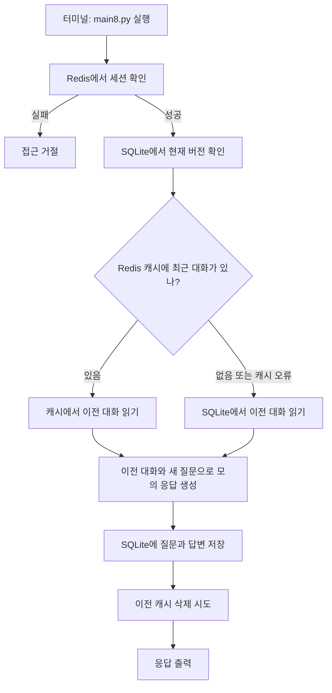

# Day14 학습 안내: Redis로 사용자를 구분하고 대화를 기억하기

이 자료는 `day14`의 실제 Python 파일과 기존 `readme6.md`~`readme8.md`를 읽고 작성했습니다. 파일 이름이 아니라 **현재 구현된 동작**을 기준으로 설명합니다.

## 무엇을 만드는 수업인가요?

최종 목표는 **사용자를 구분하고, 이전 대화를 기억하며, 자주 읽는 대화 기록을 빠르게 가져오는 터미널 대화 프로그램**입니다. 실제 AI 모델을 호출하지 않고 규칙으로 응답하는 모의 프로그램입니다. 웹사이트나 FastAPI 서버는 아직 구현하지 않습니다.

예를 들어 민수가 “내 이름은 민수”라고 입력한 다음 “내 이름이 뭐야?”라고 물으면, 이전 기록에서 이름을 찾습니다. 프로그램을 종료해도 SQLite에 저장한 대화는 남고, 다시 실행했을 때 복원할 수 있습니다.

## 읽는 순서

지금까지의 질문을 한 파일에서 복습하려면 **[00. 전체 질문 통합 정리](00_전체질문통합정리.md)**부터 읽으세요. Redis·Docker 첫 개념 질문부터 모든 명령어, UUID, Python 코드 흐름, 세션, FastAPI, 분석 결과 재사용, 데이터센터까지 포함하며 오류 해결 질문은 제외했습니다.

1. [01. 개념과 도구](01_개념과도구.md): Docker, Redis, 세션, 캐시, SQLite를 왜 쓰는지
2. [02. 파일별 기능과 실행 흐름](02_파일별설명.md): 각 코드가 추가하는 기능과 실습 명령
3. [03. 주요 함수와 문법](03_함수와문법.md): Python·Redis·SQL 문법 빠르게 찾아보기
4. [04. 실행 방법과 오류 해결](04_실행과오류해결.md): 환경 준비부터 통합 실습까지
5. [05. 질문으로 이해하는 실제 서비스 활용](05_질문으로이해하는서비스활용.md): Redis 사용 시점, 로그인 유지, FastAPI 세션, 채용 적합도 재사용, 서버와 데이터센터

00번은 대화 전체의 질문을 모은 통합본이고, 05번은 실제 서비스 설계를 더 자세히 설명한 자료입니다. 두 문서에서 오류 관련 질문은 제외했습니다. 기존 04번의 실행·오류 해결 자료는 별도로 유지합니다.

## 파일별 학습 지도

| 소스 파일 | 만들기 위한 기능 | 생활 속 비유 |
|---|---|---|
| [docker_explain.py](../docker_explain.py) | Redis와 Docker 개념 메모 | 도구 설명서 |
| [main.py](../main.py) | 문자열 저장·조회·만료·삭제 | 유효기간이 있는 메모 |
| [main2.py](../main2.py) | String 저장과 Hash 프로필 조작 | 이름·등급이 적힌 회원 카드 |
| [main2_teacher.py](../main2_teacher.py) | String·Hash·List 비교, 자료형 오류, 정리 | 용도에 맞는 서랍 고르기 |
| [main3.py](../main3.py) | 세션 생성·조회·로그아웃 | 유효기간이 있는 입장권 |
| [main4.py](../main4.py) | 세션별 최근 대화와 문맥 재사용 | 입장권마다 다른 대화 메모장 |
| [main5.py](../main5.py) | SQLite 원본에서 Redis 캐시 만들기 | 원본 장부와 책상 위 복사본 |
| [main6.py](../main6.py) | 원본에 대화 추가, 버전별 캐시 갱신 | 개정판 번호를 붙인 복사본 |
| [main7.py](../main7.py) | 캐시 장애 시 원본 조회, 세션 장애 시 거절 | 복사본은 대체하고 입장권은 확인 |
| [main8.py](../main8.py) | 세션·원본·캐시·모의 응답 통합 | 사용자를 구분하는 대화 서비스의 기초 |

`main.py`~`main8.py`는 각각 별도로 실행합니다. 앞 파일을 자동으로 호출하는 구조가 아닙니다. Redis 키의 `lesson03`, `lesson04` 같은 접두사도 달라서 **main3에서 만든 세션을 main8에서 사용할 수 없습니다.**

## 최종 구조

SQLite는 보관할 원본, Redis 캐시는 다시 만들 수 있는 사본, Redis 세션은 사용자 확인 정보입니다. **같은 Redis를 써도 캐시와 세션의 역할은 다릅니다.**

> 학습 범위: 가상 사용자로 로컬에서 실행하는 실습입니다. 실제 비밀번호 로그인, 브라우저 쿠키, 웹 API, 실제 LLM 호출은 포함하지 않습니다.
