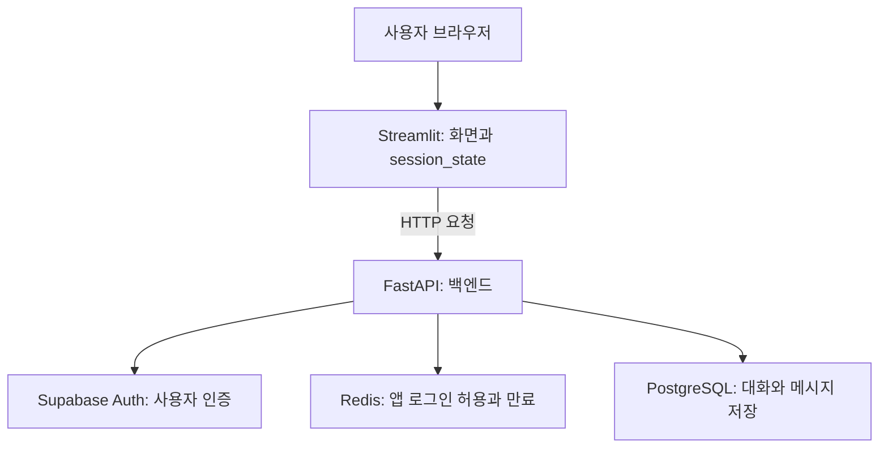

# 전체 구조와 차시별 개념

## 1. 무엇을 만드는 코드일까?

예를 들어 민지는 수학 복습 내용을, 준호는 여행 계획을 저장한다고 생각해 봅시다. 둘이 같은 웹사이트를 써도 민지는 자기 복습 기록만, 준호는 자기 여행 계획만 봐야 합니다. 로그아웃했다가 다시 로그인해도 저장한 글은 남아 있어야 합니다.

Day18 코드는 이런 **계정별 메모형 대화 서비스**의 기본 기능을 단계별로 만듭니다. 말풍선 모양이라고 해서 AI 챗봇인 것은 아닙니다. 이 코드에서 사용자가 입력한 글은 저장되지만 AI가 답을 만들지는 않습니다.

| 필요한 기능 | 쉬운 뜻 | 활용 예 |
| --- | --- | --- |
| 로그인 | 서비스가 사용자를 확인하기 | 학생별 학습 노트 |
| 상태 유지 | 화면을 다시 그려도 필요한 값을 기억하기 | 선택한 대화 유지 |
| 대화 조회 | 저장소에서 내 기록 가져오기 | 지난 상담 기록 읽기 |
| 대화 선택 | 여러 기록 묶음 중 하나 고르기 | 수학 노트와 영어 노트 전환 |
| 메시지 저장 | 입력을 오래 남기는 저장소에 기록하기 | 다음 날 다시 읽기 |
| 계정 전환 | 이전 사용자의 화면 상태를 정리하고 새 사용자로 바꾸기 | 공용 PC에서 계정 바꾸기 |
| 중복 방지 | 같은 저장 요청이 반복돼도 한 번만 기록하기 | 통신이 끊겼다가 재시도하기 |

## 2. 화면부터 저장소까지의 연결

**UI**는 사용자가 보고 조작하는 화면입니다. 여기서는 Streamlit이 만듭니다. **백엔드**는 화면의 요청을 받고 로그인 확인·조회·저장 등을 처리하는 프로그램입니다. 여기서는 FastAPI로 만듭니다.

식당에 비유하면 UI는 주문대, 백엔드는 주문을 확인하는 직원, DB는 주문 장부입니다. 화면에서 “저장”을 눌렀다고 장부에 기록된 것은 아닙니다. 직원이 실제로 기록을 마쳐야 저장이 끝납니다.



여기서 **HTTP**는 프로그램끼리 요청과 응답을 주고받는 통신 방식입니다. **API**는 “이 주소에 이런 내용을 보내면 이런 작업을 해 준다”는 약속입니다. 예를 들어 `GET /me`는 현재 사용자를 알려 달라는 약속입니다.

이 구조를 쓰면 화면을 바꿔도 인증·저장 규칙을 백엔드에서 공통으로 사용할 수 있습니다. 현재 코드에서는 브라우저가 직접 DB에 접속하지 않고, Streamlit 서버가 백엔드를 호출합니다.

## 3. 세 보관함은 목적이 다르다

**세션**은 한 사용자가 서비스를 사용하는 동안 이어지는 상태의 범위입니다. 이 코드에는 서로 다른 목적의 세션과 저장소가 함께 있습니다.

| 보관 위치 | 담는 것 | 생활 속 비유 | 언제 쓰는가 |
| --- | --- | --- | --- |
| `st.session_state` | 토큰, 선택한 대화 ID, 화면용 메시지, 미확정 저장 | 작업 중 펼쳐 놓은 메모 | 같은 Streamlit 세션의 재실행 사이 값 유지 |
| Redis | 토큰 해시에 대응하는 사용자 ID, 남은 유효시간 | 시간이 지나면 만료되는 출입 허가 목록 | 지금 이 앱에 들어와도 되는지 판단 |
| PostgreSQL | 대화 소유자, 제목, 메시지 내용 | 오래 보관하는 장부 | 로그아웃 후에도 기록 유지 |

`session_state`는 영구 저장소가 아닙니다. 일반적인 브라우저 새로고침으로 연결이 새로 만들어지거나 서버를 재시작하면 유지된다고 기대하면 안 됩니다. 별도 탭도 보통 별도 세션입니다. 반면 DB에 저장한 문장은 다시 로그인해서 조회할 수 있습니다.

또한 Redis가 멀쩡해도 Streamlit의 토큰을 잃으면 현재 화면은 다시 로그인해야 할 수 있습니다. 반대로 화면에 토큰 문자열이 남아 있어도 Redis 허가가 만료되면 보호된 기능을 사용할 수 없습니다.

## 4. 1차시: 화면을 다시 그려도 메시지 남기기

소스: [lesson01/main.py](../lesson01/main.py)

### 개념: 재실행과 상태

Streamlit은 버튼 클릭이나 입력 제출 같은 조작을 하면 보통 스크립트를 위에서 아래로 다시 실행해 화면을 그립니다. 일반 변수는 그때 다시 만들어집니다. 서버 프로그램 자체가 매번 재시작되는 것은 아닙니다.

```python
messages = []
```

이 코드가 매번 실행되면 빈 목록으로 돌아갑니다. 종이를 새로 꺼내는 것과 같습니다. 이전 메시지를 유지하려면 다음처럼 세션 보관함을 사용합니다.

```python
if "messages" not in st.session_state:
    st.session_state["messages"] = []
```

- `if 조건:`은 조건이 맞을 때 아래 들여쓴 코드를 실행합니다.
- `not in`은 해당 이름이 보관함에 없는지 확인합니다.
- `[]`는 빈 리스트입니다. 리스트는 여러 값을 순서대로 담는 그릇입니다.
- 첫 실행에서만 초기화하므로 재실행 때 기존 목록을 덮어쓰지 않습니다.

### 입력과 출력 문법

```python
text = st.chat_input("메시지를 입력하세요")
if text:
    cleaned = text.strip()
    if cleaned:
        st.session_state["messages"].append(
            {"role": "user", "content": cleaned}
        )

for message in st.session_state["messages"]:
    with st.chat_message(message["role"]):
        st.text(message["content"])
```

`st.chat_input(안내문)`은 제출된 문자열을 돌려줍니다. 제출이 없는 실행에서는 `None`입니다. `None`은 “값이 없음”을 나타냅니다. `strip()`은 앞뒤 공백을 제거합니다. 공백만 입력했으면 빈 문자열이 되므로 저장하지 않습니다.

`append(값)`는 리스트 끝에 한 개를 추가합니다. `{ "role": ..., "content": ... }`는 이름과 값을 짝지어 담는 **딕셔너리**입니다. `for`는 저장한 메시지를 하나씩 꺼냅니다. `with st.chat_message(...)` 안에서 출력한 내용은 해당 말풍선에 들어갑니다.

`role="user"`는 말풍선의 발화자 종류입니다. 민지의 계정 ID라는 뜻은 아닙니다.

**활용과 장점:** 설문 입력 중간값, 선택한 메뉴, 임시 장바구니 등 화면 재실행 사이에 필요한 정보를 기억할 때 활용할 수 있습니다. 다만 다음 날까지 반드시 남겨야 하는 데이터라면 DB 저장이 필요합니다.

## 5. 2차시: 로그인 결과를 세션에 보관하기

소스: [lesson02/main.py](../lesson02/main.py)

### 개념: 인증과 토큰

**인증**은 “이 사람이 누구인가”를 확인하는 것입니다. **토큰**은 인증 후 발급받아 이후 요청에 제출하는 증표입니다. 놀이공원에 처음 입장할 때 신분을 확인하고 손목띠를 받는 것과 비슷합니다.

매 요청마다 비밀번호를 보내는 대신 발급받은 토큰을 보냅니다. 토큰도 인증에 사용할 수 있으므로 다른 사람에게 보여주지 않습니다.

```python
result = api("POST", "/auth/login", {
    "email": email.strip(), "password": password
})
st.session_state["access_token"] = result["access_token"]
st.session_state["user"] = {
    "id": result["user_id"], "email": result["email"]
}
```

`api()`는 이 프로젝트에서 직접 만든 함수입니다. Python 기본 함수가 아닙니다. `POST`는 여기서 로그인 처리를 요청하는 방식입니다. 응답에서 토큰과 사용자 정보를 꺼내 보관합니다. 비밀번호에는 `strip()`을 쓰지 않으므로 원래 비밀번호의 공백이 임의로 바뀌지 않습니다.

### 개념: 폼으로 한 번에 제출하기

```python
with st.form("login_form", clear_on_submit=True):
    email = st.text_input("이메일")
    password = st.text_input("비밀번호", type="password")
    submitted = st.form_submit_button("로그인")
```

**폼**은 관련 입력을 묶어 제출 버튼으로 한 번에 전달하는 영역입니다. 이메일과 비밀번호를 다 쓴 뒤 인증을 요청하도록 만들 수 있습니다.

`clear_on_submit=True`는 제출 후 입력칸을 기본값으로 되돌립니다. 이미 받은 로그인 결과까지 지우는 것은 아닙니다. `type="password"`는 글자를 가려 보여 주는 설정이며, 그 자체로 암호화하는 기능은 아닙니다.

이후 `GET /me`를 호출해 서버가 확인한 사용자 정보를 표시합니다. 로컬에 토큰이 있다는 사실과 서버가 그 토큰을 허용한다는 사실은 다릅니다.

**활용과 장점:** 개인 페이지, 사내 도구, 계정별 메모 화면에서 인증 결과를 재실행 사이에 유지할 수 있습니다. 2차시는 로그인 폼이 계속 보이며, 폼을 숨기는 분기는 3차시에 추가됩니다.

## 6. 3차시: 로그인 상태에 따라 화면 나누기

소스: [lesson03/main.py](../lesson03/main.py)

### 개념: 조건부 화면과 실행 흐름

```python
if not st.session_state["access_token"]:
    # 로그인 폼 처리
    st.stop()

# 이 아래에는 로그인한 사람의 화면을 배치
```

토큰이 없으면 로그인 폼을 보여 주고 현재 실행을 멈춥니다. `st.stop()`은 뒤쪽 화면 코드가 실행되지 않게 하며 서버 전체를 종료하지는 않습니다. 로그인 성공 후 `st.rerun()`을 호출하면 처음부터 다시 실행하여 로그인된 화면으로 넘어갑니다.

**왜 필요한가:** 미로그인 사용자에게 개인 화면을 그리지 않고, 로그인한 사용자에게는 로그인 폼을 숨기기 위해서입니다. 다만 화면을 숨기는 것만으로 데이터 접근이 보호되지는 않습니다. 백엔드의 인증·소유권 검사가 함께 필요합니다.

### 개념: 로그아웃은 화면과 서버를 함께 정리하기

`logout_and_clear()`는 서버의 `/auth/logout`을 호출하고 `clear_private()`로 화면의 개인 상태를 지운 뒤 재실행합니다. 딕셔너리의 `pop(key, None)`은 값을 꺼내면서 키를 삭제하며, 키가 없어도 기본값 `None`을 반환합니다.

```python
st.session_state.pop("access_token", None)
st.session_state.pop("user", None)
st.rerun()
```

실제 함수는 서버 통신과 안내문까지 처리합니다. 서버 연결을 확인하지 못한 경우에도 로컬 정보는 정리합니다. 서버 쪽 로그아웃 범위는 이 앱의 해당 토큰에 대한 Redis 등록이며, 다른 앱과 기기의 Supabase 세션까지 모두 종료하는 기능은 아닙니다.

**활용과 장점:** 공용 PC에서 이전 사용자 정보가 남지 않도록 하고, 로그인 전후 화면을 분명하게 구분할 수 있습니다.

## 7. 4차시: DB에서 읽은 내 기록을 말풍선에 연결하기

소스: [lesson04/main.py](../lesson04/main.py)

### 개념: 조회와 데이터 바인딩

**조회**는 저장소에서 필요한 데이터를 읽는 일입니다. **데이터 바인딩**은 읽어 온 값을 화면의 표시나 선택과 연결하는 일입니다. 장부에서 읽은 내 주문 내역을 화면에 보여 주는 과정이라고 생각하면 됩니다.

```python
rooms = api("GET", "/conversations")
selected_id = rooms[0]["id"]
st.session_state["messages"] = []
st.session_state["messages"] = api(
    "GET", f"/conversations/{selected_id}/messages"
)
```

실제 코드는 목록을 `session_state["conversations"]`에도 보관하며 빈 목록을 먼저 검사합니다. `rooms[0]`은 첫 번째 대화이고, `f"...{변수}..."`는 변수 값을 문자열에 넣는 **f-string**입니다.

이 차시에서는 첫 대화만 선택합니다. DB 이력으로 목록을 **교체**해야 이전 대화의 메시지가 새 대화에 섞이지 않습니다. 1차시처럼 기존 화면 목록에 계속 `append()`하면 DB 재조회 결과가 중복되거나 서로 다른 대화가 섞일 수 있습니다.

**활용과 장점:** 주문 내역, 지난 상담, 학습 기록처럼 로그인할 때마다 저장된 최신 기록을 보여 줄 수 있습니다.

## 8. 5차시: 같은 제목의 대화도 ID로 구분하기

소스: [lesson05/main.py](../lesson05/main.py)

### 개념: 사람이 읽는 이름과 고유 식별자

**ID**는 대상을 구별하는 고유한 값입니다. 동명이인 두 사람을 학번으로 구분하듯, 제목이 모두 ‘학습 메모’여도 대화 ID로 구분할 수 있습니다. 이 코드의 대화 ID는 긴 고유 식별자 형식인 UUID입니다.

```python
labels = {}
for room in rooms:
    labels[room["id"]] = room["title"] + " · " + room["id"][:8]
ids = list(labels)

def room_label(room_id):
    return labels[room_id]

selected_id = st.selectbox(
    "대화 선택", ids,
    format_func=room_label,
    key="selected_id",
)
```

`list(labels)`는 딕셔너리의 키인 ID들을 리스트로 만듭니다. `[:8]`은 앞 8글자를 잘라 보여 주는 문법입니다. 실제 조회에는 잘린 8글자가 아니라 전체 ID를 사용합니다.

`st.selectbox(제목, 선택후보, format_func=표시함수, key=상태이름)`에서 `format_func`는 화면의 표시만 바꿉니다. 반환값은 원래 후보인 전체 ID입니다. `room_label`처럼 함수를 다른 함수에 넘겨 나중에 호출하게 하는 방식을 콜백이라고 부릅니다. 괄호 없이 함수 이름을 전달하는 이유입니다.

`key="selected_id"`는 선택 위젯과 세션 상태를 연결합니다. 실제 코드는 위젯을 만들기 전에 선택 ID가 현재 목록에 있는지 검사하고, 없으면 첫 ID로 초기화합니다.

**활용과 장점:** 같은 이름의 파일, 상품, 고객을 정확하게 선택할 수 있습니다. 단, ID를 안다고 접근 권한이 생기는 것은 아닙니다. 서버는 소유자도 검사합니다.

## 9. 6차시: 저장한 뒤 다시 읽고, 중복 저장 막기

소스: [lesson06/main.py](../lesson06/main.py)

### 개념: 화면에 표시한 것과 실제 저장한 것

입력 직후 말풍선에 추가하면 저장에 성공한 것처럼 보일 수 있습니다. 이 코드는 서버의 저장 성공 응답을 확인한 뒤 DB에서 다시 조회합니다. 그래서 확인된 기록을 표시할 수 있습니다.

### 개념: pending과 요청 ID

**pending**은 결과가 아직 확정되지 않은 저장 한 건입니다. 택배를 접수했지만 접수 확인을 받지 못한 상태와 비슷합니다. **요청 ID**는 그 한 번의 저장에 붙이는 접수번호입니다.

```python
st.session_state["pending"] = {
    "conversation_id": selected_id,
    "request_id": str(uuid4()),
    "content": cleaned,
}
```

`uuid4()`는 새 UUID를 생성합니다. 처음 제출할 때 한 번 만들고, 같은 건을 재시도할 때에는 기존 ID를 그대로 사용합니다. 재시도마다 ID를 새로 만들면 서버는 서로 다른 저장으로 볼 수 있습니다.

실제 흐름은 다음과 같습니다.

1. 입력을 검사한 뒤 `pending`에 대화 ID·내용·요청 ID를 보관합니다.
2. `POST /conversations/{id}/messages`로 저장을 요청합니다.
3. 성공 응답을 받으면 `pending=None`으로 비우고 재실행합니다.
4. DB에서 메시지 목록을 다시 읽어 화면에 표시합니다.
5. 결과를 확인하지 못한 경우에는 기존 `pending`을 유지하고 사용자의 확인/재시도를 기다립니다.

### 개념: 멱등성 — 같은 요청을 반복해도 결과는 한 번

예를 들어 서버는 “복습하자”를 저장했는데 응답만 중간에 끊길 수 있습니다. 사용자가 같은 요청 ID로 재시도하면 DB는 새 행을 추가하지 않고 기존 저장 결과를 돌려줍니다. 이런 성질을 **멱등성**이라고 합니다.

내용이 같은 두 문장을 각각 새로 제출하면 요청 ID가 다르므로 두 건으로 저장될 수 있습니다. 문장의 중복을 막는 기능이 아니라 같은 요청의 중복 처리를 막는 기능입니다.

```python
text = st.chat_input("저장할 메시지", disabled=pending is not None)
```

`disabled=True`는 새 입력을 막습니다. 미확정 한 건을 먼저 처리하게 하여 여러 저장이 뒤섞이지 않게 합니다. 다른 대화를 선택했을 때도 pending의 원래 대화 ID를 검사하므로 엉뚱한 대화에 재전송하지 않습니다.

**활용과 장점:** 주문 접수, 예약, 결제 요청 같은 시스템에서도 같은 원리가 유용합니다. 다만 이 실습의 저장 로직만으로 실제 결제 시스템이 완성되는 것은 아닙니다.

## 10. 7차시: 로그인 수명과 상황별 상태 관리

소스: [lesson07/main.py](../lesson07/main.py)

### 개념: TTL

**TTL(Time To Live)**은 앞으로 유효하게 남아 있는 시간입니다. 도서관 이용권의 만료까지 남은 시간이라고 생각하면 됩니다.

```python
profile = api("GET", "/me")
st.caption(f"로그인 세션 남은 시간: {profile['ttl']}초 (조회 시점)")
```

`ttl`은 조회한 순간의 남은 초입니다. 화면에서 자동으로 숫자가 줄어드는 타이머가 아닙니다. 다시 실행하면 최신 값을 받습니다. 조회 자체는 수명을 연장하지 않습니다.

이 차시의 핵심은 상황에 맞게 상태를 유지하거나 정리하는 것입니다. 인증이 유효하지 않으면 개인 상태를 지우고 재로그인을 안내합니다. 일시적인 서버·통신 문제라면 토큰과 미확정 저장을 바로 버리지 않고 복구 후 확인하게 합니다. 찾을 수 없는 대화의 이전 메시지도 그대로 표시하지 않게 처리합니다.

**왜 필요한가:** 잠깐 통신이 안 된 것을 로그아웃과 똑같이 취급하면 입력 중인 내용을 잃을 수 있습니다. 반대로 만료된 로그인 상태를 계속 신뢰하면 개인 화면의 상태가 실제 권한과 어긋납니다. 이 부분은 이전 오류 상담을 옮긴 것이 아니라 7차시 소스에 구현된 상태 관리 개념입니다.

## 11. 8차시: 사용자가 바뀌면 화면의 개인 상태도 바꾸기

소스: [lesson08/main.py](../lesson08/main.py)

### 개념: 사용자 경계

**사용자 경계**는 A의 선택·메시지·미확정 저장이 B의 화면으로 넘어가지 않도록 구분하는 기준입니다. 카페 공용 태블릿에서 손님이 바뀌면 이전 손님의 주문서를 치우는 것과 같습니다.

```python
if st.session_state.get("bound_user_id") != profile["id"]:
    for key in ("conversations", "selected_id", "messages", "pending"):
        st.session_state.pop(key, None)
    st.session_state["bound_user_id"] = profile["id"]
```

`bound_user_id`는 현재 화면 데이터를 어느 사용자에게 연결해 두었는지 기억합니다. 서버가 방금 확인한 사용자와 다르면 기존 개인 화면 상태를 정리합니다.

**활용과 장점:** A→B→A로 바꾸어도 사용자의 기록이 섞이지 않습니다. UI 정리에 더해 서버의 `owner_id` 검사도 함께 있어야 합니다. A가 로그아웃한다고 A의 DB 기록까지 지우지는 않으므로, 다시 A로 로그인하면 기록을 읽을 수 있습니다.

## 12. 한 번의 사용 흐름으로 복습하기

민지가 로그인하면 Supabase Auth가 계정을 확인합니다. 백엔드는 토큰에 대응하는 앱 허가를 Redis에 등록하고 토큰을 반환합니다. Streamlit은 이를 세션 상태에 보관합니다.

민지가 ‘학습 메모’를 고르면 전체 대화 ID로 조회합니다. 백엔드는 토큰과 Redis 등록을 확인하고 그 대화의 소유자가 민지인지 확인한 뒤 DB 기록을 반환합니다.

민지가 “분수 복습”을 제출하면 요청 ID를 붙여 저장합니다. 성공을 확인한 뒤 DB 기록을 다시 읽어 말풍선으로 그립니다. 로그아웃하면 화면의 개인 상태와 해당 앱 허가는 정리되지만 DB 문장은 남습니다. 준호가 로그인하면 준호의 대화만 조회합니다.
