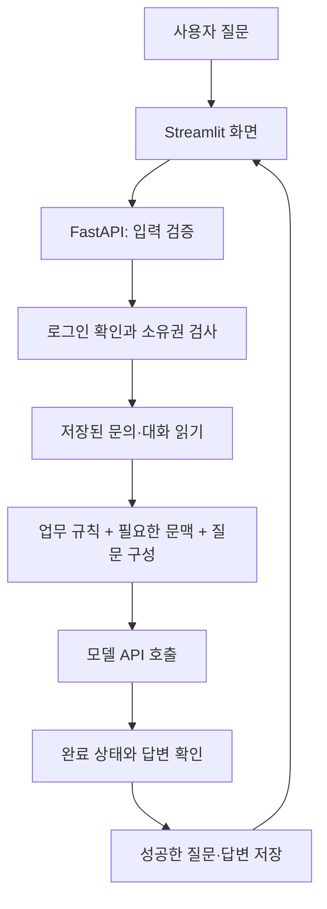

# day19 학습 정리 — AI 상담에서 사용자별 대화 서비스까지

분석 기준: 2026-11-15 현재 `day19`의 파이썬 소스, 각 차시 README, requirements.txt. 아래 코드는 개념 설명용 발췌·축약 예제이며, 완성된 실행 파일은 링크한 원본을 참고한다. 기존 실습 소스는 변경하지 않았다.

## 1. 이번 폴더에서 무엇을 배웠나?

핵심은 **AI에게 질문하는 방법에서 출발해, 문맥을 구성하고 상태를 저장하며 사용자별 접근과 재시도를 관리하는 방법**이다.

현재 폴더에는 서로 다른 두 구성이 함께 있다. 예전 대화에서 설명한 `lesson01`과 지금 파일의 내용도 다르므로, 현재 소스를 기준으로 구분해야 한다.

| 범위 | 실제 구현 | 모델 호출 방식 | 핵심 설정 |
| --- | --- | --- | --- |
| 1~4차시 | 사내 IT 헬프데스크, 문의 카드, 상담 이력, 인계 메모 | Groq 주소로 `client.responses.create()` 호출 | `GROQ_API_KEY`, `GROQ_MODEL` |
| 5~8차시 | 사용자별 일반 대화, 최근 문맥, DB 복원, 재시도, 학습 목표 | `LLM_BASE_URL` 주소로 `client.chat.completions.create()` 호출 | `LLM_BASE_URL`, `LLM_MODEL`, `LLM_API_KEY` |

현재 최상위 [README](README.md), [TODAY_GUIDE](TODAY_GUIDE.md), [BACKEND_GUIDE](BACKEND_GUIDE.md)는 1~4차시 Groq 구성 중심이다. 그 문서의 “로컬 모델 서버가 필요 없다”는 설명을 5~8차시에 그대로 적용하면 안 된다. 5~8차시는 설정한 모델 API가 실행·접속 가능한 상태여야 한다.

### 차시별 기능과 반드시 볼 함수

| 차시 | 파일 | 구현한 기능·배운 점 | 읽을 위치 |
| --- | --- | --- | --- |
| 1 | [lesson01/main.py](lesson01/main.py) | 터미널에서 문의 한 건을 받고, 정해진 형식의 상담 초안을 출력 | `INSTRUCTIONS`, `ask_groq()`, `main()` |
| 2 | [lesson02/main.py](lesson02/main.py) | 문의 카드 + 성공한 대화 + 현재 질문을 결합. 화면 재실행에도 상태 유지. 인계 메모 별도 생성 | `case_message()`, `build_input()`, `handoff_question()`, `st.session_state` |
| 3 | [lesson03/main.py](lesson03/main.py), [backend03/main.py](backend03/main.py) | 문의를 서버의 Redis에 저장하고 ID로 다시 열기. 요청 검증과 중복 처리 | `TicketInput`, `TurnInput`, `build_input()`, `run_turn()` |
| 4 | [lesson04/main.py](lesson04/main.py), [backend04/main.py](backend04/main.py) | 로그인, 세션 만료, 내 문의 목록, 문의 소유권 검사 | `require_user()`, `checked_ticket()`, `list_tickets()` |
| 5 | [lesson05/main.py](lesson05/main.py), [backend05/main.py](backend05/main.py) | 저장한 이력과 AI에게 보낼 이력을 분리. 최근 두 턴만 전달하는 실습 | `build_messages()`, `context_key()`, `/chat` |
| 6 | [lesson06/main.py](lesson06/main.py), [backend06/main.py](backend06/main.py) | PostgreSQL에 대화·턴 저장, 대화 목록 조회와 전체 기록 복원 | `load_history()`, `read_history()`, `require_room()`, `init_db()` |
| 7 | [lesson07/main.py](lesson07/main.py), backend06 | 실패한 질문과 요청 번호를 보관해 같은 요청 재시도 | `pending`, `handle_chat_error()`, `request_id` |
| 8 | [lesson08/main.py](lesson08/main.py), [backend08/main.py](backend08/main.py) | 대화별 학습 목표 저장과 프롬프트 반영 | `ConversationInput.goal`, `build_system_message()`, `build_messages()` |

### 보조 파일

- [ai_test.py](ai_test.py): Groq Responses API를 한 번 호출하는 최소 실험 코드. `.env`를 직접 로드하지 않고 `os.environ["GROQ_API_KEY"]`를 읽으므로 실행 환경에 키가 이미 있어야 한다.
- [lesson02/test_history.py](lesson02/test_history.py): 중첩 리스트의 참조 동작을 확인하는 짧은 실험. 자동 검증용 assertion이 있는 테스트는 아니다.
- `backend07`은 없으며, 7차시는 `backend06`을 재사용한다.
- 각 backend는 별도 앱이다. 번호 순서대로 모두 동시에 켜는 구조가 아니다.

## 2. 데이터가 이동하는 전체 흐름



이 그림은 서버를 사용하는 인증 차시의 공통 흐름이다. 1차시는 터미널에서 직접, 2차시는 Streamlit에서 직접 모델을 호출한다. 3차시는 아직 로그인 없이 고정 소유자 `"local"`로 동작한다.

서버가 여러 개라는 말을 역할로 구분하면 이해하기 쉽다.

| 구성 요소 | 맡은 일 | 예시 |
| --- | --- | --- |
| 화면 서버 | 브라우저에 UI 표시 | Streamlit, 보통 8501 포트 |
| 앱 API 서버 | 인증, 검증, 저장, 모델 호출 조율 | FastAPI + Uvicorn, 보통 8000 포트 |
| 모델 API | 입력을 바탕으로 답변 생성 | 1~4차시 Groq, 5~8차시 설정한 `LLM_BASE_URL` |
| Redis | 만료 가능한 문의·대화 또는 로그인 등록 보관 | `REDIS_URL` |
| Supabase Auth | 로그인 및 토큰으로 사용자 확인 | `SUPABASE_URL` |
| PostgreSQL | 대화 목록과 성공한 턴 장기 보관 | `SUPABASE_DB_URL` |

Supabase Auth와 PostgreSQL은 같은 Supabase 프로젝트를 쓸 수 있지만 역할과 접속 정보가 다르다. Auth의 publishable key는 DB 비밀번호가 아니다.

## 3. 꼭 기억해야 할 개념과 정의

### 3.1 프롬프트, instructions, input, messages

**프롬프트**는 모델에 전달하는 지시와 자료다. 현재 질문뿐 아니라 업무 규칙, 문의 카드, 이전 대화, 목표가 포함될 수 있다.

1~4차시의 Responses API 코드는 다음 요소를 구분한다.

```python
response = client.responses.create(
    model=MODEL,
    instructions=instructions,  # 답변 규칙
    input=inputs,               # 이번 요청에 사용할 자료·대화
    reasoning={"effort": "low"},
    max_output_tokens=1600,
)
answer = response.output_text
```

- `instructions`: 상담 범위, 출력 제목, 확인되지 않은 사실을 단정하지 않는 등의 규칙.
- `input`: 문자열 한 개 또는 대화 항목 목록. 2~4차시는 문의 카드와 이력을 포함한다.
- `output_text`: 반환된 답변 텍스트.
- `response.status`: 이 코드에서는 `"completed"`인지 검사한다.
- `response.id`: 모델 응답 식별자. 우리 앱의 `request_id`와 별개다.
- `max_output_tokens`: 출력 토큰 수의 상한. 파이썬 문자열의 글자 수와 같지 않다.

5~8차시는 Chat Completions 방식이다.

```python
result = client.chat.completions.create(model=LLM_MODEL, messages=messages)
answer = result.choices[0].message.content if result.choices else None
```

`messages`는 보통 다음과 같은 딕셔너리들의 리스트다.

```python
messages = [
    {"role": "system", "content": "한국어로 간결하게 답하세요."},
    {"role": "user", "content": "나는 반복문을 공부해."},
    {"role": "assistant", "content": "for문부터 연습해 보세요."},
    {"role": "user", "content": "예제 하나 알려줘."},
]
```

`system`은 규칙, `user`는 사용자 입력, `assistant`는 이전 AI 답변을 나타낸다. **`OpenAI`라는 SDK 클래스 이름만 보고 실제 호출 서비스가 OpenAI라고 판단하면 안 된다.** 현재 1~4차시는 Groq 주소를 지정한다. 두 API 방식의 인자와 응답 필드를 섞지 말아야 한다.

### 3.2 멀티턴과 문맥

**턴(turn)**은 이 수업에서 성공한 질문 하나와 답변 하나의 쌍이다. 두 턴은 보통 메시지 네 개다. 문의 카드나 system 메시지는 별도다.

**멀티턴**은 이전 질문·답변을 참고해 이어서 대화하는 방식이다. 현재 코드는 매번 필요한 이력을 직접 구성해 API에 보낸다. 화면에 기록이 보인다는 사실만으로 모델이 그 내용을 받은 것은 아니다.

2차시의 핵심은 다음 한 줄이다.

```python
return [case_message(case)] + history + [{"role": "user", "content": question}]
```

문의 카드가 고정 배경이고, `history`가 변하는 상담 이력이다. 인계 메모는 별도 상태인 `handoff`에 저장한다. 새 상담이 성공하면 오래된 인계 메모를 지워 다시 만들도록 한다.

모델이 출력 형식을 지키라는 지시를 받았더라도 파이썬이 그 형식을 검증한 것은 아니다. `completed` 상태 검사와 실제 답변의 정확성·업무 적합성 평가는 구분해야 한다.

### 3.3 저장한 이력, 화면 이력, 모델 문맥은 다르다

| 구분 | 목적 | 관련 코드 |
| --- | --- | --- |
| 저장 이력 | 나중에 다시 조회할 기록 | Redis의 JSON, PostgreSQL의 turns |
| 화면 이력 | 사용자가 볼 말풍선 | `load_history()`, `st.chat_message()` |
| 모델 문맥 | 이번 답변 생성에 필요한 입력 | `build_input()`, `build_messages()` |

예를 들어 DB에 열 턴을 저장해도, 화면에는 전체 열 턴을 표시하고 AI에게는 최근 두 턴만 보낼 수 있다.

```python
recent = history[-4:]  # 최근 메시지 4개 = 질문·답변 2쌍
```

`history[-4:]`는 새 리스트를 반환하며 원본 리스트를 삭제하지 않는다. 다만 리스트 안 딕셔너리까지 깊게 복사하지는 않는다.

5차시 backend는 Redis에 최근 100개 메시지, 즉 최대 50턴을 남기도록 `updated[-100:]`을 저장한다. AI 입력까지 최근 두 턴으로 줄이는 것은 별도 실습이다. 6·8차시 backend는 이미 `history[-4:]`로 모델 문맥을 제한한다. 최근 내용만 보내면 오래된 정보를 모델이 참고하지 못할 수 있다는 대가가 있다.

### 3.4 상태와 영구 저장

**상태(state)**는 실행 사이에 유지해야 하는 값이다. 문의 카드, 선택한 대화, 로그인 토큰, 미확정 질문 등이 해당한다.

| 저장 위치 | 유지 범위 | 현재 사용처 |
| --- | --- | --- |
| 일반 지역 변수 | 함수 호출·실행 흐름 안 | `inputs`, `question`, `answer` |
| `st.session_state` | 같은 Streamlit 세션의 재실행 사이 | 카드, 화면 선택, 토큰, pending |
| Redis | 별도 서버에 저장, TTL·서버 저장 정책에 영향받음 | 3~4차시 문의, 5차시 대화, 4차시 이후 로그인 등록 |
| PostgreSQL | 커밋된 행을 DB에 보관 | 6~8차시 대화와 턴 |

`st.session_state`는 DB가 아니다. 페이지 새로고침·연결 종료 이후 복구까지 보장하지 않는다. Redis도 이 수업의 TTL이 있는 데이터를 영구 기록으로 볼 수 없다. DB 기록은 화면 세션이 끝나도 남지만, 삭제 정책과 DB 운영 상태의 영향을 받는다.

### 3.5 TTL과 로그인 수명

**TTL(Time To Live)**은 키가 만료되기까지 남은 시간이다.

```python
client.set(key, value, ex=1800)  # 1800초 후 만료
remaining = client.ttl(key)
```

- 3~4차시 문의 기록: 생성·성공 저장 때 1800초로 설정. 단순 조회는 연장하지 않는다.
- 5차시 대화 기록: 성공 저장 때 3600초로 설정.
- 로그인 등록: `min(설정한 세션 수명, 원래 토큰의 남은 수명)`을 사용.
- `ttl()` 결과 `-2`: 키가 없음. `-1`: 만료 시간이 지정되지 않음.

Redis의 `GET`이나 `/me` 조회 자체가 로그인 수명을 늘리지는 않는다. 로그인 등록의 TTL과 대화 기록의 TTL은 서로 다른 정책이다.

### 3.6 인증과 인가

**인증(authentication)**은 “누구인가?”를 확인하는 과정이다. **인가(authorization)**는 “이 문의·대화를 볼 권한이 있는가?”를 확인하는 과정이다.

현재 인증 흐름은 다음과 같다.

1. 이메일·비밀번호로 Supabase Auth에 로그인한다.
2. access token을 받고, 토큰 해시를 키로 하는 로그인 등록을 Redis에 저장한다.
3. UI가 요청 헤더에 `Authorization: Bearer 토큰`을 넣는다.
4. `require_user()`가 Redis 등록과 Auth의 `get_user(token)` 결과를 모두 확인한다.
5. 검증된 사용자 ID로 문의 소유권 또는 DB의 `owner_id` 조건을 검사한다.

```python
headers = {"Authorization": "Bearer " + token}
```

UUID를 안다고 접근할 수 있어서는 안 된다. 4차시 `checked_ticket()`은 소유자가 다르면 404를 반환한다. 6·8차시 `require_room()`은 SQL에서 대화 ID와 소유자 ID를 함께 검사한다.

`hashlib.sha256(token.encode()).hexdigest()`는 Redis 키에 토큰 원문을 쓰지 않기 위한 해시다. **해싱은 토큰 검증이나 암호화가 아니다.** 현재 로그아웃은 이 앱의 Redis 등록을 제거하며 다른 앱·기기의 모든 Supabase 세션을 종료하는 동작은 아니다.

### 3.7 멱등성, 미확정 요청, 재시도

**멱등성(idempotency)**은 같은 요청을 반복해도 의도한 처리 결과가 중복되지 않도록 하는 성질이다. 질문 문자열만 비교하면 같은 질문을 새로 한 것인지 재전송인지 알 수 없으므로 `request_id`를 사용한다.

| 식별자 | 의미 |
| --- | --- |
| `ticket_id` / `conversation_id` | 어느 문의·대화인가? |
| 사용자 ID | 누구의 데이터인가? |
| `request_id` | 어느 질문 전송 시도 묶음인가? |
| `response.id` / `response_id` | 모델 API가 만든 어느 응답인가? |

```python
pending = {
    "conversation_id": selected_id,
    "question": question,
    "request_id": str(uuid4()),
}
# 재시도할 때는 이 딕셔너리를 그대로 다시 보낸다.
```

통신 오류가 났다고 서버가 반드시 실패한 것은 아니다. 서버가 저장을 끝냈지만 응답만 도착하지 않았을 수도 있다. 같은 요청 번호를 보내면 서버가 저장된 결과를 반환하도록 한다.

- 같은 요청 번호 + 같은 질문: 저장된 결과 반환, `replayed=True`.
- 같은 요청 번호 + 다른 질문: 409 충돌.
- 성공 응답 확인 후: `pending` 제거.
- 재시도 가능한 실패: 질문과 요청 번호 보관.
- 3~4차시 UI는 일부 요청 거절 상태를 별도로 처리하고 수정할 질문을 표시한다.

3~4차시는 Redis 턴 목록에서 요청 번호를 찾는다. 6·8차시는 DB 조회와 `UNIQUE(conversation_id, request_id)` 제약을 함께 사용한다. 이 장치는 저장 중복을 줄이지만, 외부 모델 호출까지 모든 장애에서 정확히 한 번만 실행됨을 보장하지는 않는다.

### 3.8 트랜잭션과 동시성

**트랜잭션**은 여러 저장 작업을 하나의 성공·실패 단위로 묶는 것이다. **동시성 제어**는 여러 요청이 같은 데이터를 바꿀 때 덮어쓰기나 중복을 막는 것이다.

Redis 구현은 `WATCH → 읽기 → 모델 호출 → MULTI → 쓰기 → EXEC`를 사용한다. 읽은 뒤 다른 요청이 키를 변경하면 `WatchError`가 발생하고 409를 반환한다. 이를 낙관적 동시성 제어로 이해하면 된다. 모델 호출 뒤 충돌할 수도 있으므로 불필요한 모델 호출까지 완전히 막는 것은 아니다.

PostgreSQL 구현은 대화 행에 `SELECT ... FOR UPDATE`를 사용한다. 같은 대화의 요청을 직렬화하고, 성공한 질문·답변을 한 행으로 저장한다. 현재 구현에서는 모델 응답을 기다리는 동안에도 DB 트랜잭션과 행 잠금이 유지된다.

```python
with connect_db() as conn:
    # 정상 종료하면 커밋, 예외 발생하면 롤백
    conn.execute(sql, params)
```

모든 `with`가 커밋을 의미하는 것은 아니다. PostgreSQL 연결의 문맥 관리자가 그렇게 동작하고, HTTP 클라이언트의 `with`는 주로 연결 자원 정리를 맡는다.

## 4. 기능을 구현하려면 무엇을 사용하나?

### 외부 패키지

설치 이름과 `import` 이름이 다를 수 있다. 아래는 현재 requirements와 import를 기준으로 한 역할 정리다.

| 만들 기능 | 패키지·도구 | 소스에서 쓰는 문법 |
| --- | --- | --- |
| `.env` 로드 | `python-dotenv` | `from dotenv import load_dotenv` |
| 모델 API 호출 | `openai` | `OpenAI(...)`, `client.responses.create(...)` |
| 웹 화면·입력 폼 | `streamlit` | `st.form()`, `st.chat_input()`, `st.chat_message()` |
| 화면의 임시 상태 | Streamlit | `st.session_state`, `st.rerun()`, `st.stop()` |
| UI에서 백엔드 호출 | `httpx` | `httpx.request()`, `raise_for_status()`, `.json()` |
| API 경로 정의 | `fastapi` | `FastAPI()`, `@app.get`, `@app.post` |
| API 서버 실행 | `uvicorn` | `python -m uvicorn main:app` |
| 요청 필드 검증 | `pydantic` | `BaseModel`, `Field`, `ConfigDict`, `SecretStr` |
| Redis 읽기·쓰기 | `redis` | `Redis.from_url()`, `get()`, `set()`, `pipeline()` |
| 이메일·비밀번호 로그인 | `supabase` | `create_client()`, `.auth.sign_in_with_password()` |
| PostgreSQL 직접 접속 | `psycopg[binary]` | `psycopg.connect()`, `execute()`, `Jsonb()` |

`pip install redis`는 Redis에 접속하는 파이썬 라이브러리를 설치한다. Redis 서버 자체가 시작되는 것은 아니다. `openai` 패키지 설치도 로컬 모델 서버 설치·실행을 뜻하지 않는다.

### 파이썬 기본 제공 모듈

| 모듈 | 역할 | 예 |
| --- | --- | --- |
| `os` | 환경변수 읽기 | `os.getenv("API_BASE_URL", "")` |
| `uuid` | 식별자 생성과 형식 변환 | `uuid4()`, `UUID(text)` |
| `json` | 파이썬 자료와 JSON 문자열 변환 | `json.dumps()`, `json.loads()` |
| `hashlib` | 해시 계산 | `sha256(...).hexdigest()` |
| `time` | 현재 시각으로 남은 만료 시간 계산 | `expires_at - time.time()` |
| `typing` | 타입·검증 정보를 표현 | `Literal`, `Annotated` |
| `argparse` | 터미널 인자 해석 | `parser.add_argument("command", choices=["init"])` |

이 모듈들은 별도로 `pip install`하지 않는다.

## 5. 소스를 읽기 위한 기본 파이썬 문법

### 5.1 import, 함수, 인자, return

```python
import os
import streamlit as st       # 별칭
from uuid import uuid4       # 모듈에서 필요한 이름만 가져오기

def build_messages(history, question):
    current = [{"role": "user", "content": question}]
    return history + current

messages = build_messages([], "안녕하세요")
```

`def`는 함수를 정의한다. `history`, `question`은 매개변수이며 호출 시 실제 값인 인자를 받는다. `return`은 값을 돌려주고 함수를 끝낸다. 들여쓰기는 함수·조건문의 범위를 정한다.

```python
def ask_groq(inputs, instructions=INSTRUCTIONS):
    ...
```

`instructions=INSTRUCTIONS`는 생략 가능한 기본 인자다. `ask_groq(inputs, instructions="인계 메모를 작성하세요")`처럼 이름을 붙여 바꾸면 키워드 인자다. `...`는 여기서 본문을 생략했다는 표시이며, 그대로는 API 호출 기능이 없다.

### 5.2 리스트와 딕셔너리

```python
message = {"role": "user", "content": "질문"}  # 딕셔너리: 키와 값
history = []                                 # 리스트: 순서 있는 항목
history.append(message)                      # 항목 하나 추가
history.extend([
    {"role": "assistant", "content": "답변"},
    {"role": "user", "content": "후속 질문"},
])                                           # 각 항목을 펼쳐 추가

role = message["role"]                       # 없으면 KeyError
label = message.get("label", "기본값")        # 없으면 기본값
removed = message.pop("label", None)         # 제거하면서 반환
```

`append([a, b])`는 리스트 하나를 넣고, `extend([a, b])`는 항목 두 개를 넣는다. `append()`와 `extend()`는 원본을 바꾸고 `None`을 반환하므로 `history = history.append(...)`라고 쓰지 않는다.

```python
combined = history + current  # 두 리스트를 연결한 새 리스트
last_turn = history[-2:]      # 마지막 질문·답변
recent = history[-4:]         # 최근 두 턴
short_id = ticket_id[:8]      # 문자열 앞 8글자
```

### 5.3 변수 참조: 왜 history를 바꾸면 session_state도 바뀔까?

```python
history = st.session_state["history"]
history.extend([question_message, answer_message])
```

여기서 `history`와 `st.session_state["history"]`는 같은 리스트를 가리킨다. 따라서 `extend()`로 리스트를 바꾸면 상태에도 반영된다.

[test_history.py](lesson02/test_history.py)의 동작도 같은 원리다.

```python
test = [{"kor": 100}, ["철희", "미애"]]
names = test[1]
names.append("철수")
print(test)  # [{'kor': 100}, ['철희', '미애', '철수']]
```

반면 `names = ["다른 이름"]`은 `names`가 새 리스트를 가리키게 할 뿐, `test[1]`을 교체하지 않는다. `dict(SYSTEM_MESSAGE)`는 딕셔너리를 얕게 복사한다. 현재처럼 값이 문자열인 메시지의 `content`를 새로 지정할 때 원본 전역 메시지를 바꾸지 않도록 쓸 수 있다.

### 5.4 문자열, 조건문, 반복문

```python
question = question.strip()             # 앞뒤 공백 제거
base = base.rstrip("/")                 # 끝의 / 제거
valid = base.startswith(("http://", "https://"))
is_turn = path.endswith("/turns")

if not question or len(question) > 1000:
    raise ValueError("질문 길이를 확인하세요.")

for message in history:
    print(f"{message['role']}: {message['content']}")
```

`not`은 부정, `or`는 둘 중 하나, `and`는 둘 다 참인 조건이다. 빈 문자열·빈 리스트·`None`은 조건문에서 거짓으로 취급된다. `f"...{변수}..."`는 문자열 안에 값을 넣는 f-string이다.

```python
pending = st.session_state.get("pending")
if pending is not None:
    print("확인 중인 질문이 있습니다.")
```

`is None`은 값이 없음을 나타내는 `None`인지 확인한다. `if pending:`은 빈 딕셔너리까지 거짓으로 본다는 차이가 있다.

### 5.5 컴프리헨션, 펼치기, 튜플

```python
labels = {room["id"]: room["title"] for room in rooms}
ids = list(labels)  # 딕셔너리 키들을 리스트로 변환
errors = [{"loc": e["loc"], "type": e["type"]} for e in exc.errors()]
result = {**user, "ttl": 120}  # user의 키·값을 펼치고 ttl 추가
```

`{키: 값 for 항목 in 목록}`은 딕셔너리 컴프리헨션, `[표현식 for 항목 in 목록]`은 리스트 컴프리헨션이다. 반복문으로 자료를 만드는 과정을 짧게 쓴 문법이다. 기존 소스의 다음 코드는 생성기 표현식에서 조건에 맞는 첫 항목을 찾는다.

```python
room = next(room for room in rooms if room["id"] == selected_id)
```

일치 항목이 없으면 `StopIteration`이 발생한다. 현재 UI는 선택 ID가 목록에 있는지 먼저 조정한다.

```python
params = (conversation_id,)  # 원소 하나인 튜플: 쉼표가 필요
```

SQL 매개변수에서 자주 보이는 문법이다. `(conversation_id)`는 괄호로 감싼 값일 뿐 튜플이 아니다.

### 5.6 예외 처리와 성공 시에만 저장

```python
try:
    response = ask_groq(inputs)
except (APIError, ValueError):
    print("실패: 기록은 유지합니다.")
else:
    history.append({"role": "assistant", "content": response.output_text})
```

`try`는 실패할 수 있는 작업, `except`는 해당 오류 처리, `else`는 예외 없이 끝났을 때의 작업이다. `raise`는 예외를 발생시킨다. `raise HTTPException(...) from None`은 앞선 예외의 연결 표시를 생략하는 문법이다.

실제 실습은 성공한 **질문과 답변을 함께** 저장한다. 요청 실패나 빈 답변을 성공한 턴으로 저장하면 다음 모델 문맥도 잘못된다.

### 5.7 with와 프로그램 진입점

```python
with httpx.Client(timeout=10.0) as client:
    response = client.get(url)
```

`with`는 문맥 관리자의 시작·종료 처리를 이용한다. HTTP 연결·DB 연결 등을 정리할 때 쓴다. `as client`는 그 객체를 사용할 변수 이름이다.

```python
if __name__ == "__main__":
    main()
```

파일을 직접 실행했을 때만 `main()`을 호출한다. 다른 파일에서 import할 때 이 블록은 실행되지 않는다. 단, 블록 바깥의 환경변수 검사 같은 최상위 코드는 import 시에도 실행된다.

## 6. 패키지별 핵심 문법을 실제 기능에 연결하기

### 6.1 환경변수와 dotenv

```python
load_dotenv(".env", override=False, interpolate=False)
model = os.getenv("GROQ_MODEL", "openai/gpt-oss-20b").strip()
key = os.environ["GROQ_API_KEY"]
```

- `os.getenv(이름, 기본값)`: 항목이 없으면 기본값을 사용한다. 값이 빈 문자열인 경우까지 기본값으로 바꾸지는 않는다.
- `os.environ[이름]`: 항목이 없으면 `KeyError`다.
- `override=False`: 이미 프로세스 환경에 설정된 값은 `.env`로 덮어쓰지 않는다.
- `interpolate=False`: `.env` 값 안의 변수 치환을 하지 않는다.
- `load_dotenv(".env")`: 현재 작업 폴더 기준 상대 경로다.
- `load_dotenv()`처럼 경로를 생략한 코드는 dotenv의 파일 탐색을 사용한다. 두 경우를 같다고 가정하지 않는다.

`.env` 수정 후에도 기존 환경변수가 우선할 수 있고, 실행 중인 backend는 보통 재시작해야 새 설정을 읽는다. 실제 비밀값은 학습 문서에 복사하지 않는다.

### 6.2 Streamlit: 화면 재실행과 상태

```python
if "history" not in st.session_state:
    st.session_state["history"] = []

st.button("화면 다시 실행")
question = st.chat_input("질문을 입력하세요")
for message in st.session_state["history"]:
    with st.chat_message(message["role"]):
        st.text(message["content"])
```

일반적인 위젯 상호작용은 스크립트를 위부터 다시 실행한다. 단, `st.form()` 안의 입력은 제출할 때 묶어서 처리한다.

- `st.rerun()`: 현재 실행을 중단하고 처음부터 다시 실행.
- `st.stop()`: 이번 실행의 아래쪽 코드를 중단.
- `st.chat_input()`: 전송한 시점의 문자열을 받음. 타이핑 중 초안을 매번 반환하는 함수는 아님.
- `st.expander()`: 상세 입력·문맥을 접어서 표시.
- `st.selectbox(..., key="selected_id")`: 선택값을 세션 상태의 키와 연결.

매번 `st.session_state["history"] = []`를 실행하면 대화가 지워진다. 현재 2차시는 문의 카드를 처음 만들 때 이력을 초기화하는 구조이며, 예전 `ensure_history()` 실습 코드와 다르다.

### 6.3 HTTPX: 요청·JSON·상태 코드

```python
response = httpx.request(
    "POST", API_BASE_URL + "/chat",
    json=payload, headers=headers, timeout=150.0,
)
response.raise_for_status()
data = response.json()
```

`json=payload`는 딕셔너리를 JSON 요청 본문으로 보낸다. `.json()`은 응답 JSON을 파이썬 자료로 읽는다. `raise_for_status()`는 실패 상태 응답을 예외로 바꿔 오류 처리로 넘긴다.

| 상태 | 이 코드에서 읽는 의미 |
| --- | --- |
| 200 / 201 | 요청 성공 / 문의 생성 성공 |
| 401 | 로그인 정보·토큰·세션 확인 필요 |
| 403 | 이메일 확인 등 허용 조건 미충족 |
| 404 | 문의·대화가 없거나 해당 계정에서 접근할 수 없음 |
| 409 | 요청 번호 충돌, 동시 변경, 턴 제한 등 |
| 422 | 필드·길이·UUID 등의 입력 검증 실패 |
| 429 | 인증 서비스의 요청 한도 등 |
| 502 | 백엔드가 모델 호출을 완료하지 못함 |
| 503 | Redis·DB·인증 서비스 등 연결·상태 문제 |

`httpx.RequestError`는 연결·타임아웃 등 통신 오류, `HTTPStatusError`는 `raise_for_status()`로 확인한 HTTP 상태 오류다. 파이썬 화면 코드가 백엔드를 호출하는 현재 구조에서는 브라우저 JavaScript가 직접 호출하는 경우와 CORS 조건도 다르다.

### 6.4 FastAPI, Pydantic, 의존성 주입

```python
class TurnInput(BaseModel):
    model_config = ConfigDict(extra="forbid", str_strip_whitespace=True)
    request_id: UUID
    question: str = Field(min_length=1, max_length=1000)

@app.post("/tickets/{ticket_id}/turns")
def chat(ticket_id: UUID, body: TurnInput):
    return run_turn(ticket_id, body, "local")
```

- `class X(BaseModel)`: Pydantic 모델을 상속해 입력 구조 정의.
- `question: str`: 타입 힌트. 일반 파이썬 함수의 타입 힌트만으로 자동 검증되는 것은 아니며, 여기서는 Pydantic·FastAPI가 해석한다.
- `Field(...)`: 길이·기본값 등의 검증 조건.
- `extra="forbid"`: 선언하지 않은 필드 거절.
- `str_strip_whitespace=True`: 해당 모델의 문자열 앞뒤 공백 제거.
- `Literal["VPN", "화상회의"]`: 허용할 값 제한.
- `body.model_dump()`: 검증된 모델을 딕셔너리로 변환.
- `@app.post(...)`: 아래 함수를 HTTP 경로에 등록하는 데코레이터.

```python
def history(user: Annotated[dict, Depends(require_user)]):
    ...
```

**의존성 주입**은 필요한 값을 프레임워크가 준비해 함수에 전달하는 방식이다. FastAPI가 `require_user()`를 실행한 결과를 `user`에 넣는다. `Annotated`는 타입과 함께 부가 정보를 붙인다. `HTTPAuthorizationCredentials | None`의 `|`는 두 타입 중 하나임을 뜻한다.

`SecretStr`은 출력 표현에서 비밀번호를 가리는 데 도움을 주며 암호화 저장 기능은 아니다. 실제 비밀번호가 필요할 때 `.get_secret_value()`로 꺼낸다. 현재 코드는 검증 오류 응답에서도 원본 입력값을 빼고 위치와 오류 종류만 반환한다.

소스의 `async def`는 코루틴 함수 정의다. 현재 Redis·DB·모델 처리는 주로 동기 `def`와 동기 클라이언트를 사용한다. `async`라는 단어만 붙인다고 동기 I/O가 자동으로 비동기가 되지는 않는다.

### 6.5 Redis: JSON 저장과 키 설계

```python
client = Redis.from_url(REDIS_URL, decode_responses=True)
text = json.dumps(ticket, ensure_ascii=False)
client.set(key, text, ex=1800)
raw = client.get(key)
ticket = json.loads(raw) if raw else None
```

`decode_responses=True`는 문자열 응답을 `bytes` 대신 `str`로 받도록 한다. `json.dumps()`는 직렬화, `json.loads()`는 역직렬화다. `ensure_ascii=False`는 한글을 JSON 문자열에 그대로 표현하도록 한다.

- 문의 키: `kdt:groq:helpdesk:ticket:{ticket_id}`. 저장된 `owner_id`를 따로 검사한다.
- 문의 목록 키: `kdt:groq:helpdesk:index:{owner_id}`. `sadd()`로 ID를 집합에 넣고 `smembers()`로 읽는다.
- 5차시 대화 키: `kdt:multiturn:context:{user_id}:{conversation_id}`. 사용자·대화 단위로 구분한다.

키 이름에 사용자 ID를 넣는 설계와, 실제 요청자의 인증을 검사하는 일은 둘 다 필요하다.

### 6.6 PostgreSQL: 테이블과 안전한 SQL 매개변수

6·8차시의 저장 구조는 다음과 같다.

| 테이블 | 주요 컬럼 | 의미 |
| --- | --- | --- |
| `kdt_multiturn.conversations` | `id`, `owner_id`, `title`, `created_at` | 대화 목록과 소유자 |
| 위 테이블의 8차시 확장 | `goal` | 대화별 학습 목표 |
| `kdt_multiturn.turns` | `conversation_id`, `request_id`, `question`, `answer`, `context_json` | 성공한 턴과 당시 모델 입력 |

기본 키는 행 식별, 외래 키는 행 간 관계, UNIQUE는 중복 조합 금지를 뜻한다. `owner_id`는 `auth.users(id)`를 참조한다. `context_json`은 당시 모델에 보낸 자료를 확인하기 위한 JSONB 컬럼이다.

```python
row = conn.execute(
    "SELECT id, title FROM kdt_multiturn.conversations WHERE id = %s AND owner_id = %s",
    (conversation_id, UUID(user_id)),
).fetchone()
```

`%s` 자리에 실제 값을 문자열로 직접 끼워 넣지 않고 별도 매개변수로 전달한다. 사용자 입력을 f-string으로 SQL에 붙이지 않는다. `fetchone()`은 한 행, `fetchall()`은 전체 행을 가져온다. `dict_row`는 결과를 컬럼 이름으로 읽게 하고, `Jsonb(messages)`는 파이썬 자료를 JSONB 매개변수로 전달한다.

`init_db()`의 `CREATE ... IF NOT EXISTS`는 없는 스키마·테이블을 준비한다. 기존 테이블의 모든 구조 차이를 자동으로 고치는 것은 아니다. 8차시는 별도의 `ALTER TABLE ... ADD COLUMN IF NOT EXISTS goal`도 실행한다.

## 7. 현재 실습 코드에서 미완성인 부분

아래는 학습 과제로 남겨진 현재 동작과 바꿀 개념이다. 이 문서를 만들면서 소스를 수정한 것은 아니다.

| 위치 | 현재 동작 | 완성할 동작 |
| --- | --- | --- |
| backend05 `build_messages()` | 전체 `history` 전달 | 최근 두 턴인 `history[-4:]` 전달 |
| lesson06 `load_history()` | `data[-2:]`만 반환해 마지막 한 턴만 표시 | 서버가 준 전체 `data` 반환 |
| lesson07 `handle_chat_error()` | `pending = None`으로 미확정 질문 삭제 | 재시도를 위해 pending 유지 |
| backend08 `build_system_message(goal)` | `dict(SYSTEM_MESSAGE)`만 반환 | DB에서 읽은 목표를 system 내용에 반영 |

개념을 적용하면 다음처럼 바뀐다.

```python
# 5차시: 저장 이력을 지우지 않고 모델 입력만 줄이기
def build_messages(history, question):
    current = [{"role": "user", "content": question}]
    return [SYSTEM_MESSAGE] + history[-4:] + current

# 6차시: 화면에서 전체 저장 기록 표시하기
def load_history(conversation_id):
    return api("GET", f"/conversations/{conversation_id}/messages")

# 7차시: 실패해도 같은 request_id로 재시도하기
def handle_chat_error():
    st.session_state["error"] = "실패했습니다. 같은 질문을 다시 보낼 수 있습니다."
    st.rerun()

# 8차시: 전역 SYSTEM_MESSAGE를 직접 바꾸지 않고 목표 포함하기
def build_system_message(goal):
    message = dict(SYSTEM_MESSAGE)
    if goal.strip():
        message["content"] += "\n이 대화의 학습 목표: " + goal.strip()
    return message
```

8차시의 목표는 사용자가 입력한 데이터다. 목표 문자열을 system 메시지에 붙였다고 업무 규칙 준수나 안전한 입력 처리가 자동으로 보장되는 것은 아니다.

## 8. 실행 방법과 환경을 헷갈리지 않는 법

이 절은 현재 소스에서 확인한 실행 구조를 설명한다. 이 문서 작성 중 패키지 설치·서버 실행·외부 API 요청은 하지 않았다.

### 8.1 공통 준비

```bash
conda activate py313_arm
cd /Users/imijeong/Downloads/AIO_4_class/day19
```

requirements가 있는 각 폴더에서 다음처럼 설치한다. 버전은 해당 파일의 고정값을 따른다.

```bash
cd lesson02
python -m pip install -r requirements.txt
```

`python -m pip`는 현재 `python`에 연결된 pip를 사용한다. `ModuleNotFoundError`가 나면 실행하는 가상환경과 그 환경의 패키지 설치를 먼저 확인한다. `requirements.txt`의 `==`는 버전 고정 문법이다.

### 8.2 차시별 필요한 설정

| 실행 폴더 | 필요한 설정·외부 구성 |
| --- | --- |
| lesson01, lesson02 | `GROQ_API_KEY`, `GROQ_MODEL` — Groq 직접 호출 |
| lesson03, lesson04 | `API_BASE_URL` — 해당 FastAPI 주소 |
| backend03 | `GROQ_API_KEY`, `GROQ_MODEL`, `REDIS_URL` |
| backend04 | backend03 설정 + `SUPABASE_URL`, `SUPABASE_PUBLISHABLE_KEY`, `SESSION_TTL_SECONDS` |
| lesson05~lesson08 | `API_BASE_URL` — 해당 FastAPI 주소 |
| backend05 | `SUPABASE_URL`, `SUPABASE_PUBLISHABLE_KEY`, `REDIS_URL`, `SESSION_TTL_SECONDS`, `LLM_BASE_URL`, `LLM_MODEL`, `LLM_API_KEY` |
| backend06, backend08 | backend05 설정 + `SUPABASE_DB_URL` |

`GROQ_MODEL`은 현재 1~4차시 코드에 기본값이 있고, backend04 세션 수명은 기본 1800초다. 표는 설정할 항목을 명확히 적기 위한 목록이다. 실제 키나 DB URI는 기존 `.env`에서 관리하고 덮어쓰지 않는다.

UI의 `API_BASE_URL` 예시는 `http://127.0.0.1:8000`이다. 이것은 앱 서버 주소다. `LLM_BASE_URL`은 모델 API 주소로, 서로 역할이 다르다. 각 실행 폴더의 `.env`를 명시적으로 준비하면 상대 경로 혼동을 줄일 수 있다.

### 8.3 실행 명령

1차시는 `lesson01` 폴더에서 다음을 실행한다. 현재 코드는 문의 한 건 처리 후 끝나며, 이전 버전처럼 `종료`까지 반복하는 루프가 없다.

```bash
python main.py
```

2차시는 `lesson02` 폴더에서 실행한다.

```bash
python -m streamlit run main.py --server.port 8501
```

3차시부터는 별도 터미널에서 **해당 backend 폴더**로 이동해 API를 먼저 실행한다.

```bash
python -m uvicorn main:app --host 127.0.0.1 --port 8000
```

`main:app`은 현재 폴더의 `main.py` 안에 있는 `app` 객체다. Uvicorn은 FastAPI 앱을 실행하는 ASGI 서버다. API 문서는 `http://127.0.0.1:8000/docs`에서 확인한다. 이후 다른 터미널의 해당 lesson 폴더에서 Streamlit을 실행한다.

6·8차시 backend는 설정과 DB 연결을 준비한 뒤 초기화를 한 번 수행한다.

```bash
python main.py init
python -m uvicorn main:app --host 127.0.0.1 --port 8000
```

7차시는 backend06을 그대로 사용한다. 서버를 교체할 때는 같은 8000 포트를 쓰는 이전 backend를 먼저 종료한다. 1~4차시 Groq 코드 때문에 로컬 모델을 새로 다운로드할 필요는 없다. 5~8차시에서 로컬 모델 API를 쓴다면 이미 보관된 모델 파일로 서버를 실행해도 된다.

## 9. 스스로 설명할 수 있어야 할 질문

1. 대화 기록이 화면에 보이는데 AI가 기억하지 못한다면 어느 함수를 확인할까?
   - `build_input()` 또는 `build_messages()`. 실제 모델 입력에 기록이 있는지 본다.
2. `history[-4:]`는 네 턴인가?
   - 네 메시지다. 질문·답변이 교대로 있다면 두 턴이다.
3. Streamlit에서 리스트를 지역 변수로 받았는데 왜 세션 기록도 바뀔까?
   - 같은 리스트를 참조한 뒤 `extend()`로 원본을 바꾸었기 때문이다.
4. 로그인했으면 모든 문의 ID를 열어도 될까?
   - 아니다. 인증 뒤에도 문의 소유권을 검사해야 한다.
5. Redis에 기록이 있는데 왜 PostgreSQL도 배웠을까?
   - TTL이 있는 임시 기록과 장기 보관할 대화 목록·턴을 구분하기 위해서다.
6. 재시도할 때 왜 `uuid4()`를 다시 호출하면 안 될까?
   - 새 요청 번호가 되므로 이전 요청과 같은 요청임을 서버가 식별하지 못한다.
7. API 타임아웃이면 DB 저장도 반드시 실패했을까?
   - 아니다. 저장은 성공하고 응답 수신만 실패했을 수 있다.
8. 목표를 DB에 저장하면 AI가 자동으로 참고할까?
   - 아니다. 목표를 읽어 이번 모델 입력에 포함해야 한다.
9. 모델의 응답 ID가 있으면 별도 대화 저장이 필요 없을까?
   - 현재 코드는 그 ID로 이력을 자동 복구하지 않는다. 앱의 저장·조회가 별도로 필요하다.
10. 패키지를 설치하면 모델 서버나 Redis 서버도 자동으로 켜질까?
    - 아니다. 클라이언트 라이브러리 설치와 서버 실행을 구분해야 한다.

추천 복습 순서는 `lesson02`의 입력 목록과 리스트 참조 → `backend03`의 검증·Redis → `backend04`의 인증·소유권 → `backend05`의 슬라이싱 → `backend06`의 DB 저장 → `lesson07`의 pending → `backend08`의 목표 반영이다.
