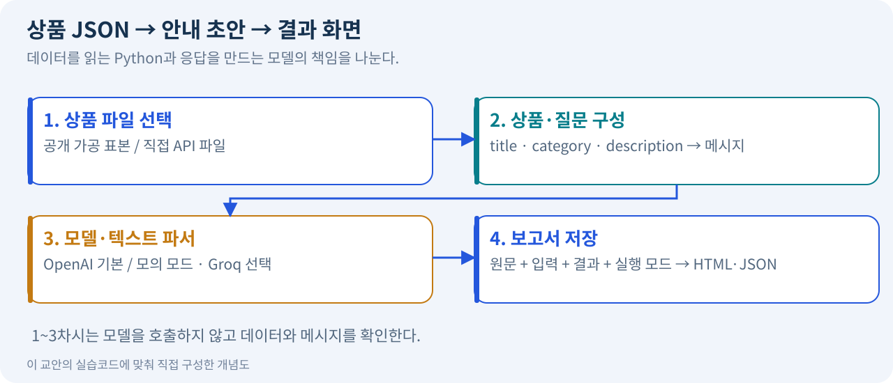

# 1차시. 환경 구축과 상품 데이터의 입력 구조

> 패키지를 설치하고, 오늘 사용할 데이터가 무엇인지 확인한다.



| 구성 | 시간 |
|---|---:|
| 서비스 구조와 데이터 소개 | 10분 |
| Python·패키지·자료형 이론 | 15분 |
| 가상환경·패키지 설치 | 15분 |
| 상품 확인·결과 화면 저장 | 10분 |

## 오늘 만들 프로젝트

상품 설명을 보고 고객 질문에 답하는 **상품 안내 초안 서비스**를 만든다. 예를 들어 가방에 15인치 노트북을 넣을 수 있는지 묻는 고객에게 상품 설명에서 근거를 찾아 한국어로 안내한다. 그러나 상품 설명에 재고·배송일·반품 정책이 없으면 답을 만들지 않고 추가 확인이 필요하다고 알려야 한다.

서비스의 처리 경로는 상품 JSON 읽기 → 상품 선택 → 메시지 구성 → 모델 호출 → 텍스트 추출 → 결과 화면 저장이다. LangChain은 이 경로를 구성하는 도구이고, 자연어를 생성하는 주체는 선택한 공급자의 모델이다. 이번에는 검색 엔진·RAG·Function Calling을 추가하지 않는다. 선택할 상품은 Python이 명시적으로 고른다.

## 실행 환경과 프레임워크의 역할

| 부품 | 하는 일 | 이번 설치/파일 |
|---|---|---|
| Python | JSON을 읽고 함수를 실행 | Python 3.11 이상 가정 |
| LangChain Core | 메시지·템플릿·체인·파서 | `langchain-core==1.8.1` |
| OpenAI 통합 | 모델 요청과 응답 연결 | `langchain-openai==1.8.0` |
| 환경 설정 | 로컬 키와 모델 ID 읽기 | `python-dotenv==1.2.4`, `.env` |
| 업무 데이터 | 설명의 근거 | `data/products_public_derived.json` |
| 화면 생성 보조 | 실제 실행 결과를 HTML로 저장 | `app/report.py` |

LangChain은 기능별 패키지로 나뉜다. 템플릿·LCEL 수업에서는 Core와 OpenAI 통합을 사용한다. 상위 에이전트용 `langchain` 패키지나 LangGraph가 아직 필요하지 않다. 패키지 설치는 모델 다운로드가 아니다. 원격 API를 쓰려면 별도의 키·모델 접근 권한·네트워크가 필요하다.

## 이번 상품 데이터의 범위를 정확하게 읽기

기관 안내 목록의 D01은 Fake Store API다. 현재 제작 환경에서는 원본 API가 보안 확인/403으로 막혀 직접 응답을 확보하지 못했다. 실행 가능한 교안에는 Fake Store에서 데이터를 가져왔다고 명시한 공개 프로젝트의 **가공 상품 파일 20개**를 고정해 포함했다. 이 파일을 공식 API의 최신 응답이라고 부르지 않는다.

가공 파일에는 `title`, `category`, `description`, `price`, `image`가 있고 공식 상품 id와 rating은 없다. 따라서 원문 행 번호로 `row-001` 같은 **로컬 추적 id**를 부여한다. 이 값은 API id가 아니다. 가격은 공개 가공본에서 바뀌었을 수 있고 통화도 확인되지 않아 모델 맥락에서 제외한다. 상품 사진은 내려받지 않으며 보고서에 이미지 URL 텍스트만 남긴다.

| 필드 | 자료형 | 수업에서의 사용 |
|---|---|---|
| title | str | 원문 상품명 |
| category | str | 원문 분류 |
| description | str | 특징·호환성 답변 근거 |
| price | number | 원문 보존만 함. 현재가·통화로 안내하지 않음 |
| image | str | 원문 URL 보존만 함. 사진 파일 배포 안 함 |
| record_id | str | 수업에서 부여한 추적 id |

원본 API를 수집할 수 있는 학생 환경에서는 `python -m app.fetch_products`를 실행해 `data/products_live.json`을 저장하고 이후 명령에 `--data data/products_live.json`을 붙인다. 이미 브라우저에서 응답을 저장했다면 `python -m app.fetch_products --import-file 저장한파일.json`을 사용한다. 가져온 파일의 출처는 독립 검증된 API 직접 수집과 구분해 기록한다. 보안 확인을 우회하지 않는다.

## JSON과 Python 자료형

JSON은 데이터 교환 형식이고 Python 객체 그 자체가 아니다. `json.loads()` 또는 `json.load()`로 읽으면 JSON 배열은 `list`, 객체는 `dict`, 문자열은 `str`가 된다. 이번 상품 목록은 `list[dict]`다. 상품 하나를 고른 뒤에는 `product["title"]`처럼 키로 값에 접근한다. 파일 인코딩은 한국어와 BOM 가능성을 고려해 `utf-8-sig`로 읽는다.

데이터를 읽었다는 사실과 모델이 답변을 생성했다는 사실은 다르다. 1~3차시는 모델 호출 없이 데이터와 프롬프트 구조를 익힌다. 보고서에도 ‘모델 호출 없음’으로 표시된다.

## 설치와 첫 실행

프로젝트 루트는 `app`, `sessions`, `requirements.txt`가 있는 폴더다. Windows CMD에서는 다음을 차례로 실행한다.

```bat
python -m venv .venv
.venv\Scripts\activate.bat
python -m pip install -r requirements.txt
python -m pip check
python -m sessions.s01
```

PowerShell 활성화는 `.\.venv\Scripts\Activate.ps1`, Linux/macOS는 `source .venv/bin/activate`다. PowerShell에서 활성화가 막히면 실행 정책을 바꾸지 않고 `.\.venv\Scripts\python.exe -m sessions.s01`처럼 직접 실행할 수 있다. 명령 시작 위치는 계속 프로젝트 루트다.

출력에서 상품 수 20, 취득 방식 `public_derived_file`, `row-001`의 상품명을 확인한다. 화면 생성 보조 모듈은 미리 제공되며 이번 학습의 대상은 아니다. 그 안에 모델 호출이 숨겨져 있지 않고 이미 나온 결과만 저장한다.
## 1차시 결과 화면 열기·캡처

실행 후 프로젝트 루트에서 `reports/s01_report.html`을 브라우저로 연다. Windows CMD는 `start reports\s01_report.html`, PowerShell은 `Start-Process .\reports\s01_report.html`을 사용할 수 있다. 다른 OS에서는 파일을 더블클릭해 연다.

상품 원문·로컬 추적 id·처리 결과·데이터 취득/모델 실행 배지가 함께 읽히는 영역을 캡처한다. `evidence/U2-01_s01_D01_result.png`는 제안 저장명이다. HTML/JSON은 실행 결과이고 PNG는 실제 화면을 열어 캡처해 저장하는 파일이다. 모델 호출이 없는 차시나 모의 실행을 원격 API 성공 증빙으로 바꾸지 않는다.

## 차시 실행 코드

`sessions/s01.py`

```python
from importlib.metadata import version
from app.catalog import read_catalog, data_info
from app.cli import parser
from app.report import save_report

def main():
    args = parser().parse_args()
    records = read_catalog(args.data)
    print("langchain-core", version("langchain-core"))
    print("상품 수:", len(records), "/ 데이터 방식:", data_info(args.data)["acquisition"])
    first = records[0]
    print(first["record_id"], first["title"])
    save_report(1, records, [{"record_id": first["record_id"], "fields": list(first["raw"]),
                            "status": "data_loaded_no_model"}], args.data)

if __name__ == "__main__": main()

```
