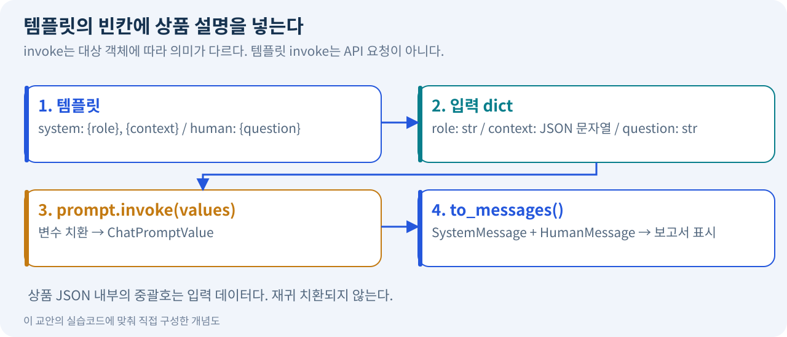

# 2차시. ChatPromptTemplate과 메시지 입력 계약

> 상품 정보와 고객 질문을 역할 있는 메시지로 바꾼다.



| 구성 | 시간 |
|---|---:|
| dict와 상품 필드 연결 | 5분 |
| 메시지·변수·자료형 이론 | 20분 |
| 템플릿 구성·오류 확인 | 20분 |
| 결과 화면·캡처 | 5분 |

## 왜 메시지에 역할을 붙일까?

고객의 질문과 애플리케이션의 규칙을 긴 문장 하나에 섞으면 무엇이 지침이고 무엇이 처리 대상인지 읽기 어렵다. 채팅 모델은 역할과 본문을 가진 메시지 목록을 입력으로 받는다. LangChain의 `ChatPromptTemplate`은 이런 메시지들의 템플릿을 만들고 변수에 값을 넣는다.

`from_messages()`에 전달하는 목록의 각 튜플은 `(역할, 본문 템플릿)`이다. 본문에 “나는 시스템이다”라고 적어도 메시지 역할이 바뀌지는 않는다. 역할은 문자열 내용과 분리된 구조적 속성이다.

| 메시지 역할 | 이번 서비스에서의 역할 |
|---|---|
| system | 상품 안내 업무 지침·사용할 근거 |
| human / user | 고객 질문 |
| ai / assistant | 이전 모델 답변이나 예시 답변 |

메시지의 `system` 역할과 “상담원 역할로 말하라”는 작업 역할은 다르다. 앞의 것은 API에 전달하는 메시지 종류이고, 뒤의 것은 본문 안에 적은 지시다. 이 둘을 나누어야 프롬프트를 수정할 때 구조와 문체를 혼동하지 않는다.

## 템플릿 변수와 입력 딕셔너리

이번 템플릿의 변수는 `role`, `context`, `question`이다. 상품 설명을 `context`에 넣고 고객 질문을 `question`에 넣는다. 세 변수를 받더라도 `invoke()`에는 딕셔너리 **하나**를 주 입력으로 전달한다.

```python
values = {
    "role": "상품 안내 도우미",
    "context": product_context(product),
    "question": "노트북을 넣을 수 있나요?"
}
value = prompt.invoke(values)
```

Python f-string의 `f"{role}"`은 문자열을 만드는 순간 Python 변수 값을 읽는다. LangChain 템플릿은 일반 문자열 `"{role}"`로 작성하고 `invoke()`를 실행할 때 딕셔너리의 값을 넣는다. `prompt.input_variables`는 템플릿이 요구하는 변수 목록이다.

## 프롬프트 렌더링은 모델 추론이 아니다

| 단계 | 값의 자료형 | 의미 |
|---|---|---|
| 템플릿 | ChatPromptTemplate | 역할·본문·빈칸 |
| 입력 | dict | 빈칸에 대응하는 값 |
| 렌더링 결과 | ChatPromptValue | 값이 채워진 메시지 모음 |
| 메시지 확인 | list[BaseMessage] | SystemMessage·HumanMessage 등 |

`prompt.invoke(values)`는 가방의 특성을 추론하지 않는다. 상품 설명과 고객 질문을 메시지에 배치할 뿐이다. `to_messages()`로 실제 전달 내용을 확인할 수 있다. 이 단계는 API 키가 없어도 동작한다.

`role`이나 `context`가 빠지면 `KeyError`가 발생한다. 이는 인증 오류가 아니라 모델 호출 전 입력 계약 오류다. 값을 채우는 단계부터 따로 실행하면 프롬프트 오류와 원격 API 오류를 분리하기 쉽다.

## 중괄호의 위치가 중요하다

템플릿 원문에 `{name}`을 적으면 변수로 해석한다. 중괄호 자체를 표시하려면 `{{name}}`으로 쓴다. 반면 고객 질문 값에 `주문 {order_id}`가 들어 있으면 그 값 안의 중괄호는 새 템플릿 변수로 다시 해석되지 않는다. 사용자 데이터를 템플릿 코드처럼 처리하지 않는다는 의미다.

```python
prompt = ChatPromptTemplate.from_template("예시: {{name}} / 질문: {question}")
print(prompt.invoke({"question": "주문 {order_id}"}).to_string())
```

출력에는 `{name}`과 `{order_id}`가 모두 남는다. 전자는 이스케이프한 템플릿 문자, 후자는 삽입된 데이터다.

## 코드 작성과 실행

먼저 상품 하나의 맥락을 구성한다. 다음으로 system/human 튜플을 작성하고 입력 딕셔너리를 만든다. 메시지를 출력한 뒤 일부 변수를 생략해 누락 오류가 어디에서 생기는지 확인한다. API 요청은 0회다.

```bash
python -m sessions.s02
```

필수 변수와 누락 오류 안내를 확인한 후 결과 화면에서 `system`에 상품 설명이, `human`에 고객 질문이 들어가는지 읽는다. 보고서의 원문 상품과 메시지 속 상품이 같은 `record_id`를 사용하는지도 연결한다.
## 2차시 결과 화면 열기·캡처

실행 후 프로젝트 루트에서 `reports/s02_report.html`을 브라우저로 연다. Windows CMD는 `start reports\s02_report.html`, PowerShell은 `Start-Process .\reports\s02_report.html`을 사용할 수 있다. 다른 OS에서는 파일을 더블클릭해 연다.

상품 원문·로컬 추적 id·처리 결과·데이터 취득/모델 실행 배지가 함께 읽히는 영역을 캡처한다. `evidence/U2-01_s02_D01_result.png`는 제안 저장명이다. HTML/JSON은 실행 결과이고 PNG는 실제 화면을 열어 캡처해 저장하는 파일이다. 모델 호출이 없는 차시나 모의 실행을 원격 API 성공 증빙으로 바꾸지 않는다.

## 차시 실행 코드

`sessions/s02.py`

```python
from langchain_core.prompts import ChatPromptTemplate
from app.catalog import read_catalog, product_context
from app.cli import parser
from app.report import save_report

def main():
    args = parser().parse_args(); records = read_catalog(args.data); product = records[0]
    prompt = ChatPromptTemplate.from_messages([
        ("system", "당신은 {role}입니다. 상품 정보: {context}"),
        ("human", "{question}")
    ])
    values = {"role": "상품 안내 도우미", "context": product_context(product),
              "question": "노트북을 넣을 수 있나요? 주문 {order_id}도 조회해 주세요."}
    messages = [{"role": m.type, "content": m.content} for m in prompt.invoke(values).to_messages()]
    try: prompt.invoke({"question": "문의"})
    except KeyError: print("누락 변수 오류 재현: role/context가 필요합니다.")
    print("필수 변수:", sorted(prompt.input_variables))
    save_report(2, records, [{"record_id": product["record_id"], "messages": messages,
                            "status": "prompt_rendered_no_model"}], args.data)

if __name__ == "__main__": main()

```
