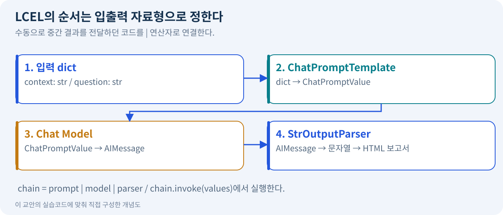

# 4차시. LCEL: 프롬프트·모델·파서 연결

> 입출력 자료형을 연결해 하나의 실행 흐름으로 만든다.



| 구성 | 시간 |
|---|---:|
| 프롬프트와 모델 경계 | 5분 |
| Runnable·합성·파서 이론 | 20분 |
| 수동 호출·LCEL 실행 | 20분 |
| 결과 저장·오류 해설 | 5분 |

## 일반 Python 호출에서 체인으로

상품 질문에 답하려면 값을 채운 메시지를 모델에 전달하고 응답에서 텍스트를 얻는다. 아래 코드는 각 단계를 변수로 나눈 형태다.

```python
prompt_value = prompt.invoke(values)
message = model.invoke(prompt_value)
answer = output_parser.invoke(message)
```

LCEL에서는 이 순서를 `chain = prompt | model | output_parser`로 표현한다. `|`는 Python의 비트 연산을 그대로 실행하는 것이 아니라 Runnable이 연산자를 재정의하여 순차 실행 객체를 만드는 문법이다. 체인을 만드는 줄에서 요청이 발생하지 않는다. `chain.invoke(values)`를 호출할 때 실제 처리가 진행된다.

Runnable은 입력을 받아 결과를 돌려주는 부품의 공통 인터페이스다. 부품마다 내부 구현은 다르지만 `invoke()`로 실행할 수 있어 조합하기 쉽다. 어떤 부품이든 마음대로 붙일 수 있는 것은 아니고 **앞의 출력 자료형을 뒤가 받을 수 있어야 한다.**

| 부품 | 입력 | 출력 |
|---|---|---|
| ChatPromptTemplate | context/question dict | ChatPromptValue |
| ChatOpenAI 또는 ChatGroq | 프롬프트·메시지 | AIMessage |
| StrOutputParser | 모델 응답 메시지 | 문자열 계열 |

검증 버전에서 파서 결과의 클래스 이름이 `TextAccessor`로 보일 수 있다. `str`의 하위 자료형이므로 문자열처럼 사용할 수 있고 `str(answer)`로 일반 문자열을 얻을 수도 있다. 클래스 이름이 다르게 표시되는 것과 계약이 깨지는 것은 구분한다.

## 모델 응답과 텍스트의 차이

`AIMessage`에는 내용뿐 아니라 공급자별 메타데이터와 토큰 사용량이 포함될 수 있다. 문장만 표시하려면 문자열 파서가 편리하다. 사용량을 기록하려면 파서 이전의 메시지를 받아야 하며, 7차시 비교 코드가 그 지점을 사용한다.

파서는 사실 검증기가 아니다. 입력 메시지가 “재고는 100개입니다”라면 `StrOutputParser`는 그 문장을 문자열로 반환할 뿐 실제 재고를 확인하지 않는다. 따라서 응답 원문을 상품 설명과 대조하고 검토용 초안으로 사용한다.

## 실제 모델과 모의 모델을 구분한다

OpenAI 기본 경로는 `ChatOpenAI`다. 선택 Groq 경로는 공식 `ChatGroq` 통합을 사용한다. 모의 모드는 LangChain의 `FakeListChatModel`에 고정 응답을 넣는다. 이때 템플릿·체인은 실제 라이브러리로 실행하지만 모델 추론은 일어나지 않는다. 모든 질문에 같은 응답이 나오므로 품질 비교나 실제 모델 성능 증거로 쓸 수 없다.

데이터의 취득 방식과 모델의 실행 방식도 다른 축이다. 공개 가공 상품을 실제 모델에 전달할 수도 있고 직접 수집한 API 상품을 모의 모델에 전달할 수도 있다. 결과 화면은 두 상태를 별도 배지로 표시한다.

## 환경 설정

`.env.example`을 `.env`로 복사하고 제공받은 키와 계정에서 사용 가능한 모델 ID를 넣는다.

```text
LLM_PROVIDER=openai
OPENAI_API_KEY=로컬에서만_실제키입력
OPENAI_MODEL=계정에서_허용된_모델_ID
LLM_TEMPERATURE=
```

위 값은 입력 위치를 설명하는 예시이며 실제 키가 아니다. temperature는 먼저 비워 두고 모델 지원을 확인한 뒤 선택한다. 모델에 따라 지원 파라미터와 출력 한도의 의미가 달라질 수 있다. API 키는 인증 정보이고 모델 ID는 호출 대상이며 둘 다 맞아야 한다.

## 실행방법

```bash
python -m sessions.s04 --mock --manual
python -m sessions.s04 --mock
```

두 명령은 동일한 고정 응답을 사용해 수동 순서와 LCEL 순서를 비교한다. 실제 모델을 호출하려면 `python -m sessions.s04`를 실행한다. 정상 실행당 요청은 1회이며 수동과 LCEL을 둘 다 실제 실행하면 총 2회다. 실제 응답이 매번 같은 문장일 필요는 없다.

401은 키, 403은 권한, 404는 모델/주소, 400은 파라미터 지원을 확인한다. 429에서는 한도·크레딧을 확인하고 기다린다. 자동 유료 전환과 자동 재시도는 사용하지 않는다. 실패하면 `--mock`으로 구조 실습을 계속할 수 있지만 원격 API 성공으로 표시하지 않는다.
## 4차시 결과 화면 열기·캡처

실행 후 프로젝트 루트에서 `reports/s04_report.html`을 브라우저로 연다. Windows CMD는 `start reports\s04_report.html`, PowerShell은 `Start-Process .\reports\s04_report.html`을 사용할 수 있다. 다른 OS에서는 파일을 더블클릭해 연다.

상품 원문·로컬 추적 id·처리 결과·데이터 취득/모델 실행 배지가 함께 읽히는 영역을 캡처한다. `evidence/U2-01_s04_D01_result.png`는 제안 저장명이다. HTML/JSON은 실행 결과이고 PNG는 실제 화면을 열어 캡처해 저장하는 파일이다. 모델 호출이 없는 차시나 모의 실행을 원격 API 성공 증빙으로 바꾸지 않는다.

## 차시 실행 코드

`sessions/s04.py`

```python
from langchain_core.output_parsers import StrOutputParser
from app.catalog import read_catalog
from app.cli import parser
from app.config import Settings
from app.providers import make_model, friendly_error
from app.prompts import get_prompt
from app.pipeline import prepare_input, sample_requests
from app.report import save_report

def main():
    p = parser(); p.add_argument("--manual", action="store_true"); args = p.parse_args()
    records = read_catalog(args.data); request = sample_requests(records)[0]
    values = prepare_input(request, records); settings = Settings.read(args.mock)
    model = make_model(settings); prompt = get_prompt(); output_parser = StrOutputParser()
    if args.manual:
        prompt_value = prompt.invoke(values)
        message = model.invoke(prompt_value)
        answer = output_parser.invoke(message)
    else:
        chain = prompt | model | output_parser
        answer = chain.invoke(values)
    print(answer)
    save_report(4, records, [{**request, "context": values["context"], "answer": answer,
                            "status": "ok", "execution": "manual" if args.manual else "LCEL"}], args.data, settings)

if __name__ == "__main__":
    try: main()
    except Exception as error: raise SystemExit(friendly_error(error))

```

### 구현 파일: app/config.py

```python
from dataclasses import dataclass
from pathlib import Path
import os
from dotenv import load_dotenv

ROOT = Path(__file__).resolve().parents[1]
load_dotenv(ROOT / ".env", override=False)

@dataclass(frozen=True)
class Settings:
    provider: str
    model: str
    max_output: int = 500
    temperature: float | None = None

    @classmethod
    def read(cls, mock=False):
        provider = "mock" if mock else os.getenv("LLM_PROVIDER", "openai").lower()
        if provider not in {"openai", "groq", "mock"}:
            raise ValueError("LLM_PROVIDER는 openai/groq/mock 중 하나여야 합니다.")
        prefix = provider.upper()
        model = "local-fixture" if provider == "mock" else os.getenv(prefix + "_MODEL", "").strip()
        if not model:
            raise ValueError(prefix + "_MODEL에 계정에서 허용된 모델 ID를 설정하세요.")
        if provider != "mock" and not os.getenv(prefix + "_API_KEY", "").strip():
            raise ValueError(prefix + "_API_KEY가 없습니다. .env를 확인하세요.")
        raw = os.getenv("LLM_TEMPERATURE", "").strip()
        temperature = float(raw) if raw else None
        if temperature is not None and not 0 <= temperature <= 2:
            raise ValueError("LLM_TEMPERATURE는 0~2 범위여야 합니다.")
        return cls(provider, model, temperature=temperature)

```

### 구현 파일: app/providers.py

```python
from app.config import Settings

MOCK_TEXT = "[모의 응답] 안녕하세요. 상품 설명과 질문을 연결하는 형식을 확인했습니다. 재고·배송·반품 정책은 별도 확인이 필요합니다. 문의별 실제 답변을 생성한 결과는 아닙니다."

def make_model(settings: Settings):
    if settings.provider == "mock":
        from langchain_core.language_models.fake_chat_models import FakeListChatModel
        return FakeListChatModel(responses=[MOCK_TEXT])
    common = dict(model=settings.model, max_tokens=settings.max_output,
                  timeout=30, max_retries=0)
    # temperature를 지원하지 않는 모델을 위해 미설정 시 전달하지 않는다.
    if settings.temperature is not None:
        common["temperature"] = settings.temperature
    if settings.provider == "openai":
        from langchain_openai import ChatOpenAI
        return ChatOpenAI(**common)
    if settings.provider == "groq":
        from langchain_groq import ChatGroq
        return ChatGroq(**common)
    raise ValueError("지원하지 않는 공급자입니다.")

def friendly_error(error):
    status = getattr(error, "status_code", None)
    if status in {400, 401, 403, 404, 429}:
        return {400: "요청 설정 오류: 모델과 파라미터 지원을 확인하세요.",
                401: "인증 오류: API 키를 확인하세요.",
                403: "권한 오류: 프로젝트와 모델 권한을 확인하세요.",
                404: "모델/주소 오류: 사용 가능한 모델 ID를 확인하세요.",
                429: "호출/토큰/크레딧 한도: 콘솔 확인 후 기다렸다가 수동 재실행하세요."}[status]
    if isinstance(error, (ValueError, KeyError, TypeError, FileNotFoundError)):
        return str(error)
    # 외부 오류 본문·헤더·키를 그대로 로그에 기록하지 않는다.
    return f"{type(error).__name__}: 연결/타임아웃/공급자 상태를 확인하세요."

```
