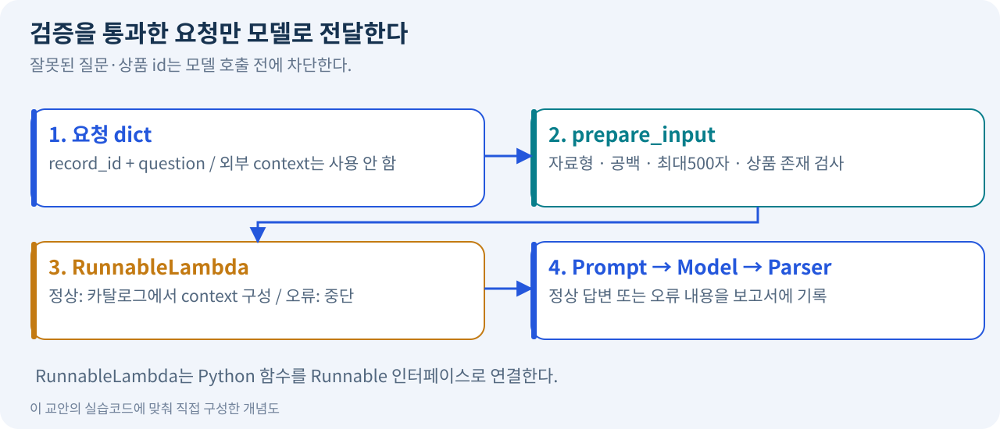

# 5차시. RunnableLambda로 상품 선택·입력 검증 연결

> 외부 입력과 신뢰하는 상품 맥락의 경계를 만든다.



| 구성 | 시간 |
|---|---:|
| 요청 계약과 오류 위치 | 5분 |
| 전처리·데이터 선택 이론 | 20분 |
| RunnableLambda 체인 구현 | 20분 |
| 실패 결과·화면 캡처 | 5분 |

## 모델에게 맡기기 전에 Python이 해야 할 일

빈 질문인지, 상품 id가 존재하는지, 문자열 길이가 적절한지는 Python이 정확하게 검사할 수 있다. 이런 확인까지 모델에게 요청하면 불필요한 호출과 불확실성이 생긴다. 확실한 규칙은 코드로 처리하고 자연어 작성은 모델에 맡긴다.

외부 요청의 계약은 `{"record_id": "row-001", "question": "질문"}`이다. 상품 맥락을 고객이 직접 넘기게 하지 않는다. `prepare_input()`이 검증된 카탈로그에서 상품을 찾아 맥락을 구성한다. 사용자가 `context`라는 키를 추가하더라도 그 값을 회사의 상품 데이터처럼 받아들이지 않는다.

| 입력 상황 | Python 처리 | 모델 호출 |
|---|---|---|
| 정상 상품 id·질문 | 상품 선택·공백 제거 | 진행 |
| 질문이 빈 문자열·공백 | 값 오류 | 없음 |
| question이 None/숫자 | 값 오류 | 없음 |
| 없는 record_id | 상품 조회 오류 | 없음 |
| 질문 500자 초과 | 길이 오류 | 없음 |

500자는 수업에서 정한 문자 수 제한이다. 500토큰을 뜻하지 않는다. 한국어 문자 수와 모델 토큰 수는 일치하지 않는다. 앞뒤 공백은 지우지만 숫자·부정 표현·문장 내부 기호를 임의로 삭제하지 않는다.

## Python 함수를 Runnable로 감싸기

`prepare_input(request, records)`는 요청과 카탈로그를 받아 `context`, `question` 딕셔너리를 반환한다. LCEL의 주 입력은 요청 하나로 유지하고 카탈로그는 함수가 만들어지는 시점의 값으로 참조한다.

```python
prepare = RunnableLambda(lambda request: prepare_input(request, records))
chain = prepare | get_prompt() | model | StrOutputParser()
```

lambda는 입력 하나를 받는 작은 래퍼다. 여기서 모델이 적절한 상품을 스스로 검색하거나 도구를 선택하는 것이 아니다. 지정한 `record_id`를 Python이 명시적으로 찾는다. 단순한 명시적 선택, 임베딩 검색, LLM 도구 선택은 서로 다른 동작이다.

전처리에서 예외가 생기면 뒤의 프롬프트·모델은 실행되지 않는다. 이렇게 하면 없는 상품에 대해 모델이 그럴듯한 답을 만드는 대신 입력 오류를 알려 줄 수 있다. 형식 검증만으로 모든 보안 요구가 충족되는 것은 아니지만, 최소한의 책임 경계를 만든다.

## 원문과 모델 맥락을 분리한다

원문은 가공 없이 보존하고, 모델에 전달할 필드만 `product_context()`에서 고른다. 이번에는 `record_id`, `title`, `category`, `description`만 쓴다. 원문 `price`, `image`를 없애는 것이 아니라 생성 근거에 포함하지 않는 것이다.

정보를 제외하면 모델의 답변 가능 범위도 좁아진다. 가격을 물었을 때 정보가 없다고 말하는 것이 올바른 동작일 수 있다. 모델이 대답을 많이 하는 것과 근거가 맞는 것은 다르다.

## 코드 작성 순서

먼저 `find_product()`로 로컬 id를 찾는다. 이어 질문을 검사하고 정리한다. 상품 필드를 JSON 문자열로 변환한 후 템플릿 변수에 대응시킨다. 마지막에 전체 함수를 RunnableLambda로 연결한다. 문제가 생기면 데이터 선택 → 프롬프트 렌더링 → 모델 호출 순서로 나눠 확인한다.

## 실행과 오류 복구

```bash
python -m sessions.s05 --mock
python -m sessions.s05 --mock --question ""
```

정상 실행은 초안을 기록한다. 빈 질문은 `status: error`와 설명을 결과 화면에 기록한다. 이 경우 실제 모드는 모델 객체를 준비하더라도 생성 요청은 발생하지 않는다. 질문을 고친 뒤 다시 실행하면 같은 경로의 보고서를 덮어쓴다. 중요한 캡처는 재실행 전에 `evidence` 폴더에 보관한다.
## 5차시 결과 화면 열기·캡처

실행 후 프로젝트 루트에서 `reports/s05_report.html`을 브라우저로 연다. Windows CMD는 `start reports\s05_report.html`, PowerShell은 `Start-Process .\reports\s05_report.html`을 사용할 수 있다. 다른 OS에서는 파일을 더블클릭해 연다.

상품 원문·로컬 추적 id·처리 결과·데이터 취득/모델 실행 배지가 함께 읽히는 영역을 캡처한다. `evidence/U2-01_s05_D01_result.png`는 제안 저장명이다. HTML/JSON은 실행 결과이고 PNG는 실제 화면을 열어 캡처해 저장하는 파일이다. 모델 호출이 없는 차시나 모의 실행을 원격 API 성공 증빙으로 바꾸지 않는다.

## 차시 실행 코드

`sessions/s05.py`

```python
from app.catalog import read_catalog
from app.cli import parser
from app.config import Settings
from app.providers import make_model, friendly_error
from app.pipeline import build_chain, sample_requests
from app.report import save_report

def main():
    p = parser(); p.add_argument("--question"); args = p.parse_args()
    records = read_catalog(args.data); request = sample_requests(records)[0]
    if args.question is not None: request["question"] = args.question
    settings = Settings.read(args.mock); chain = build_chain(make_model(settings), records)
    try:
        answer = chain.invoke(request); row = {**request, "answer": answer, "status": "ok"}
    except Exception as error:
        row = {**request, "error": friendly_error(error), "status": "error"}
    save_report(5, records, [row], args.data, settings)
    print(row)

if __name__ == "__main__":
    try: main()
    except Exception as error: raise SystemExit(friendly_error(error))

```

### 구현 파일: app/pipeline.py

```python
from langchain_core.runnables import RunnableLambda
from langchain_core.output_parsers import StrOutputParser
from app.catalog import find_product, product_context
from app.prompts import get_prompt


def prepare_input(request, records):
    if not isinstance(request, dict):
        raise TypeError("요청은 dict여야 합니다.")
    question = request.get("question")
    if not isinstance(question, str) or not question.strip():
        raise ValueError("question은 공백이 아닌 문자열이어야 합니다.")
    question = question.strip()
    if len(question) > 500:
        raise ValueError("질문은 500자 이내로 입력하세요.")
    record_id = request.get("record_id")
    if not isinstance(record_id, str):
        raise ValueError("record_id가 필요합니다.")
    product = find_product(records, record_id)
    # 고객이 넘긴 context는 사용하지 않고 카탈로그에서 직접 구성한다.
    return {"context": product_context(product), "question": question}


def build_chain(model, records, version="designed"):
    prepare = RunnableLambda(lambda request: prepare_input(request, records))
    return prepare | get_prompt(version) | model | StrOutputParser()


def sample_requests(records):
    indices = [0, 2, 8] if len(records) >= 9 else list(range(min(3, len(records))))
    questions = ["15인치 노트북을 넣을 수 있나요? 반품이 가능한가요?",
                 "어떤 활동에 적합한 상품인가요? 현재 재고가 있나요?",
                 "지원하는 운영체제는 무엇인가요? 배송일은 언제인가요?"]
    return [{"record_id": records[j]["record_id"], "question": questions[i]} for i, j in enumerate(indices)]

```
