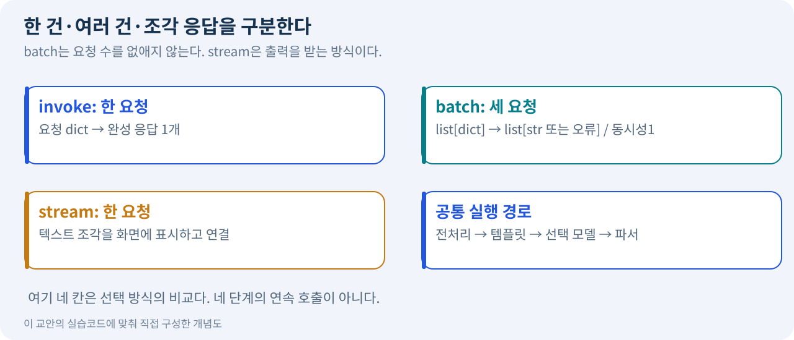

# 6차시. invoke·batch·stream과 Groq 선택 연결

> 같은 상품 안내 체인을 여러 방식으로 실행한다.



| 구성 | 시간 |
|---|---:|
| 처리 방식과 비용 개념 | 5분 |
| 일괄·스트리밍·동시성 이론 | 20분 |
| batch·stream 실습 | 20분 |
| Groq 선택·결과 캡처 | 5분 |

## 단건·일괄·스트리밍을 구분한다

한 상품 질문에 답하면 `invoke`, 여러 문의를 준비하면 `batch`, 답변 일부를 먼저 보여 주려면 `stream`을 쓴다. 이들은 서로 다른 모델을 학습시키는 기능이 아니다. 동일한 체인을 어떻게 실행하고 결과를 받는지의 차이다.

| 방식 | 입력 | 반환 | 모델 요청 수 |
|---|---|---|---|
| invoke | 요청 dict 하나 | 완성 문자열 | 보통 1 |
| batch | 요청 dict 목록 | 입력 순서에 대응하는 결과 목록 | 입력 개수만큼 |
| stream | 요청 dict 하나 | 문자열 조각 반복자 | 보통 1 |

LCEL의 batch는 공급자의 별도 할인형 Batch API가 아니다. 목록을 넘겼다고 세 문의가 요청 하나로 합쳐지지 않는다. 이번 실습은 가방·재킷·외장 드라이브의 세 상품 질문을 처리한다. 각 질문은 해당 상품의 설명만 받는다.

## 동시성과 항목별 실패

기본 batch 구현은 병렬 처리할 수 있다. 강의실에서 여러 학생이 같은 조직 한도를 사용하면 짧은 시간에 호출이 몰릴 수 있다. `max_concurrency=1`로 학생 프로그램 안의 동시 요청을 제한한다. 이것이 전체 강의실의 전역 호출 제한은 아니다.

`return_exceptions=True`를 주면 항목의 오류가 결과 목록에 예외 객체로 들어올 수 있다. 결과와 입력의 순서를 맞춰 어느 상품 질문이 실패했는지 표시한다. 다만 이미 시작한 다른 요청을 모두 취소하는 회로 차단기는 아니다. 계정 한도 오류가 나면 수업에서 추가 실행을 멈추고 상황을 확인한다.

## 스트리밍의 의미

화면에 문자열 조각이 차례로 보이면 사용자는 처리 진행을 확인할 수 있다. 전체 생성 시간이 줄거나 총비용이 줄었다는 뜻은 아니다. 청크 하나가 항상 단어·토큰 하나인 것도 아니다. 코드에서는 각 조각을 바로 출력하면서 동시에 목록에 모아, 끝났을 때 합친 문자열을 보고서에 저장한다.

전체 입력을 기다리는 RunnableLambda가 모델 뒤에 있으면 스트리밍 표시가 지연될 수 있다. 이번 전처리는 모델 앞에서 짧게 끝나므로 맥락 구성 이후 모델 출력을 받을 수 있다. 실행한 chain의 모든 구간이 스트리밍을 그대로 전달하는지 살펴야 한다.

## Groq는 명시적으로 선택한다

OpenAI 예제를 기준으로 실행한 뒤 반복 연습용으로 Groq를 선택할 수 있다. Groq와 OpenAI는 다른 키·모델 ID를 쓴다. OpenAI와 호환되는 일부 인터페이스가 있다고 모든 기능과 파라미터가 같은 것은 아니다. 공식 `ChatGroq` 통합을 사용하고 모델별 지원을 확인한다.

```bash
python -m pip install -r requirements-groq.txt
```

`.env`에 `LLM_PROVIDER=groq`, `GROQ_API_KEY`, `GROQ_MODEL`을 설정한다. OpenAI로 돌아갈 때는 `LLM_PROVIDER=openai`로 직접 바꾼다. Groq 실패 후 유료 OpenAI 호출로 조용히 바뀌지 않는다. 무료 플랜에도 요청·토큰 제한이 있으므로 실제 계정의 한도를 확인한다.

## 실행방법

```bash
python -m sessions.s06 --mock
python -m sessions.s06 --mock --stream
```

기본 명령은 세 상품의 결과, 스트리밍 명령은 첫 상품 결과를 저장한다. 둘 다 같은 `reports/s06_report.html`을 덮어쓰므로 필요한 화면은 실행 직후 캡처한다. 모의 모델은 고정 문장을 나누어 출력하며 실제 공급자의 지연과 속도를 측정하지 않는다.

`--mock`을 빼면 기본 batch는 최대 3회, stream은 1회다. 둘 다 실제 실행하면 총 4회다. 중단은 Ctrl+C이며 이미 처리된 토큰의 비용은 발생할 수 있다. 다음 차시에서는 처리 방식보다 프롬프트 설계의 차이에 집중한다.
## 6차시 결과 화면 열기·캡처

실행 후 프로젝트 루트에서 `reports/s06_report.html`을 브라우저로 연다. Windows CMD는 `start reports\s06_report.html`, PowerShell은 `Start-Process .\reports\s06_report.html`을 사용할 수 있다. 다른 OS에서는 파일을 더블클릭해 연다.

상품 원문·로컬 추적 id·처리 결과·데이터 취득/모델 실행 배지가 함께 읽히는 영역을 캡처한다. `evidence/U2-01_s06_D01_result.png`는 제안 저장명이다. HTML/JSON은 실행 결과이고 PNG는 실제 화면을 열어 캡처해 저장하는 파일이다. 모델 호출이 없는 차시나 모의 실행을 원격 API 성공 증빙으로 바꾸지 않는다.

## 차시 실행 코드

`sessions/s06.py`

```python
from app.catalog import read_catalog
from app.cli import parser
from app.config import Settings
from app.providers import make_model, friendly_error
from app.pipeline import build_chain, sample_requests
from app.report import save_report

def main():
    p = parser(); p.add_argument("--stream", action="store_true"); args = p.parse_args()
    records = read_catalog(args.data); inputs = sample_requests(records)
    settings = Settings.read(args.mock); chain = build_chain(make_model(settings), records)
    if args.stream:
        chunks = []
        for chunk in chain.stream(inputs[0]):
            print(chunk, end="", flush=True); chunks.append(chunk)
        print(); rows = [{**inputs[0], "answer": "".join(chunks), "status": "ok", "execution": "stream"}]
    else:
        outputs = chain.batch(inputs, config={"max_concurrency": 1}, return_exceptions=True)
        rows = [{**request, **({"status": "error", "error": friendly_error(output)} if isinstance(output, Exception)
                 else {"status": "ok", "answer": output}), "execution": "batch"} for request, output in zip(inputs, outputs)]
    save_report(6, records, rows, args.data, settings)

if __name__ == "__main__":
    try: main()
    except Exception as error: raise SystemExit(friendly_error(error))

```
