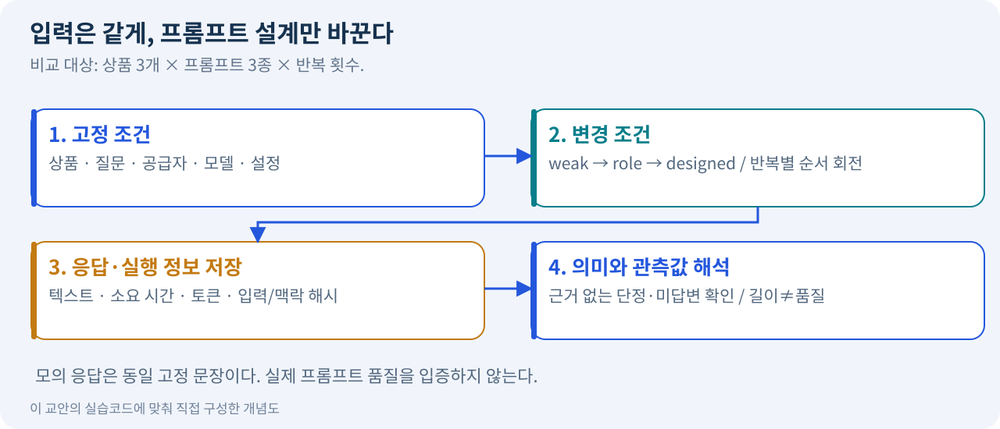

# 7차시. 동일 상품·질문으로 응답 품질 비교하기

> 출력 원문과 실행 조건을 남겨 설계 차이를 설명한다.



| 구성 | 시간 |
|---|---:|
| 비교 조건 설정 | 5분 |
| 관측값·의미 품질·사용량 이론 | 20분 |
| 3×3 비교·보고서 저장 | 20분 |
| 정책/근거 대조·캡처 | 5분 |

## 비교하려면 무엇이 같아야 할까?

한 번 받은 답변이 마음에 든다고 그 프롬프트가 항상 더 좋다고 말하기는 어렵다. 같은 상품·질문·모델·가능한 설정을 고정하고 버전만 바꿔야 해석이 쉬워진다. 이번 비교는 학생을 채점하는 활동이 아니라 애플리케이션의 실제 동작을 분석하는 개발 실습이다.

| 동일 유지 | 변경 | 함께 기록 |
|---|---|---|
| 상품 맥락·질문 3개 | weak / role / designed | 출력 원문·오류·문자 수 |
| 공급자·모델·설정 | 프롬프트 설계안 | 경과 시간·사용량·입력 해시 |

모든 버전에서 같은 상품의 같은 설명을 사용한다. `context_hash`와 `question_hash`가 같은지 확인하면 공통 조건을 추적하기 쉽다. `prompt_hash`는 실제 렌더링한 전체 메시지가 다름을 기록한다. 해시는 내용의 신원 추적에 도움을 주지만 개인 정보를 자동으로 익명화하는 장치는 아니다.

## 응답을 무엇과 대조할까?

| 상품 질문 | 원문에서 확인할 근거 | 없는 정보의 처리 |
|---|---|---|
| 가방에 15인치 노트북 수납? | 설명의 up to 15 inches | 반품 정책은 별도 확인 |
| 재킷은 어떤 활동에 적합? | 야외 활동·계절 설명 | 재고는 별도 확인 |
| 드라이브의 운영체제 지원? | 명시된 Windows 버전/포맷 | 배송일은 별도 확인 |

표는 응답을 읽을 때 대조할 근거다. 실제 모델이 반드시 이런 문장으로 답했다는 측정 결과는 아니다. 설명에 없는 가격·재고·배송일을 만들었다면 유창해도 문제다. 반대로 모르는 부분을 확인이 필요하다고 안내하는 것은 실패가 아닐 수 있다.

## 숫자 관측값의 한계

문자 수와 500자 이내 여부는 출력 길이를 보여 준다. 사실 정확성과 관련성을 보장하지 않는다. 지연 시간은 네트워크·공급자 상태·입력 길이의 영향을 받는다. 기본 9개 호출만으로 p95나 모델 우열을 일반화하지 않는다.

`AIMessage.usage_metadata`가 제공되면 사용량을 기록한다. 공급자·설정에 따라 없을 수 있어 null은 0토큰을 뜻하지 않는다. 비용은 선택 모델의 단가에 따라 입력 토큰×입력 단가/백만 + 출력 토큰×출력 단가/백만으로 계산하되 캐시·추론 토큰 등 별도 과금 구분을 확인한다. 문자 수를 토큰 수로 대신하지 않는다.

temperature 0도 완전한 재현성을 보장하지 않는다. 지원하지 않는 모델에는 전달하지 않는다. Groq와 OpenAI의 서로 다른 모델을 비교하면 공급자+모델 구성 비교이며 프롬프트만의 효과로 볼 수 없다.

## 비교 코드의 구조

이번에는 `prompt | model`에서 AIMessage를 받는다. 그 뒤 사용량을 기록하고 파서로 텍스트를 얻는다. 즉 파서를 빼는 것이 아니라 기록할 위치를 앞에 두는 설계다. 각 호출의 실패도 기록한다. 성공한 답만 남기면 실패율이 가려진다.

문의 3개×버전 3개가 기본 최대 9회다. 반복을 늘리면 비용이 증가하므로 `--repeats`는 1~3으로 제한한다. 반복마다 버전 순서를 순환하지만 무작위화된 대규모 실험은 아니다. 429를 만나면 이후 호출을 중단한다.

## 실행환경·실행방법

```bash
python -m sessions.s07 --mock
python -m sessions.s07
```

모의 비교는 기록 형식과 흐름 확인용이며 프롬프트 효과를 판단하지 않는다. 실제 명령은 설정된 모델을 최대 9회 호출한다. 결과 HTML과 함께 `reports/s07_report.json`이 저장된다. 같은 상품의 세 버전을 찾아 원문·답변·오류·설정을 함께 확인하고 화면을 캡처한다.
## 7차시 결과 화면 열기·캡처

실행 후 프로젝트 루트에서 `reports/s07_report.html`을 브라우저로 연다. Windows CMD는 `start reports\s07_report.html`, PowerShell은 `Start-Process .\reports\s07_report.html`을 사용할 수 있다. 다른 OS에서는 파일을 더블클릭해 연다.

상품 원문·로컬 추적 id·처리 결과·데이터 취득/모델 실행 배지가 함께 읽히는 영역을 캡처한다. `evidence/U2-01_s07_D01_result.png`는 제안 저장명이다. HTML/JSON은 실행 결과이고 PNG는 실제 화면을 열어 캡처해 저장하는 파일이다. 모델 호출이 없는 차시나 모의 실행을 원격 API 성공 증빙으로 바꾸지 않는다.

## 차시 실행 코드

`sessions/s07.py`

```python
import hashlib
import time
from langchain_core.output_parsers import StrOutputParser
from app.catalog import read_catalog
from app.cli import parser
from app.config import Settings
from app.providers import make_model, friendly_error
from app.pipeline import prepare_input, sample_requests
from app.prompts import get_prompt
from app.report import save_report

def main():
    p = parser(); p.add_argument("--repeats", type=int, default=1, choices=[1,2,3]); args = p.parse_args()
    records = read_catalog(args.data); settings = Settings.read(args.mock); model = make_model(settings)
    rows = []; stop = False
    for repeat in range(args.repeats):
        versions = ["weak", "role", "designed"]
        versions = versions[repeat:] + versions[:repeat]
        for request in sample_requests(records):
            values = prepare_input(request, records)
            for version in versions:
                started = time.perf_counter(); row = {**request, "version": version, "repeat": repeat+1,
                  "context_hash": hashlib.sha256(values["context"].encode()).hexdigest()[:12],
                  "question_hash": hashlib.sha256(values["question"].encode()).hexdigest()[:12],
                  "prompt_hash": hashlib.sha256(get_prompt(version).invoke(values).to_string().encode()).hexdigest()[:12]}
                try:
                    message = (get_prompt(version) | model).invoke(values)
                    answer = StrOutputParser().invoke(message)
                    row.update(status="ok", answer=answer, characters=len(answer),
                               within_500_chars=len(answer)<=500, usage=message.usage_metadata)
                except Exception as error:
                    row.update(status="error", error=friendly_error(error))
                    stop = getattr(error, "status_code", None) == 429
                row["elapsed_seconds"] = round(time.perf_counter()-started,4); rows.append(row)
                if stop: break
            if stop: break
        if stop: break
    save_report(7, records, rows, args.data, settings,
                notes=["같은 상품·질문·모델을 사용합니다. 문자 수는 의미 품질 점수가 아닙니다."])
    print("기록 수:", len(rows))

if __name__ == "__main__":
    try: main()
    except Exception as error: raise SystemExit(friendly_error(error))

```
