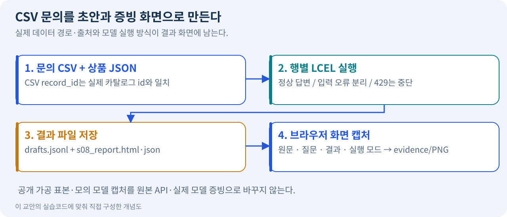
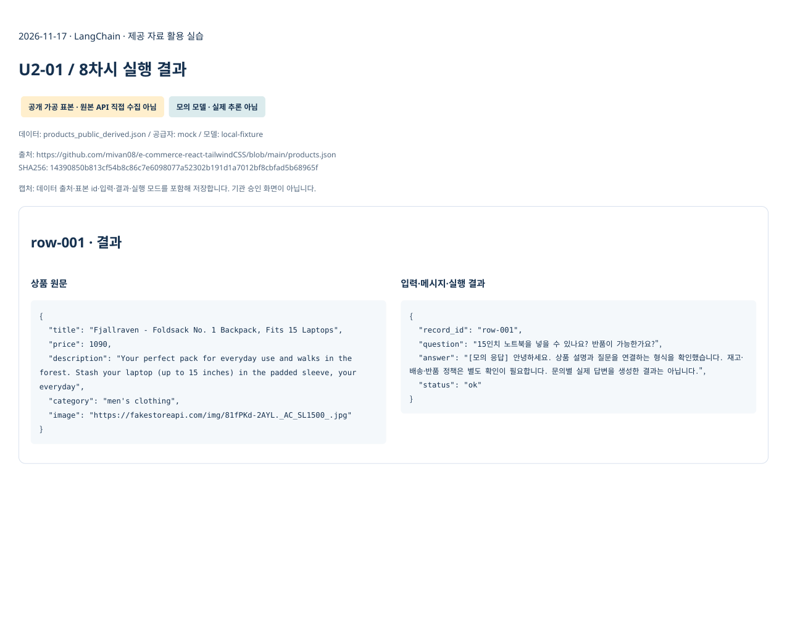

# 8차시. 상품 원문부터 결과 화면·증빙 저장까지 통합하기

> CSV 문의와 LCEL을 연결하고 실제 실행 화면을 남긴다.



| 구성 | 시간 |
|---|---:|
| 누적 코드·인터페이스 연결 | 5분 |
| CSV·오류 격리·출처 이론 | 15분 |
| 통합 실행·결과 저장 | 25분 |
| 캡처·다음 차시 연결 | 5분 |

## 서비스의 입력 경계가 바뀌어도 핵심 체인은 유지된다

앞에서는 코드 안의 상품 질문 목록을 사용했다. 실제 업무에서는 문의가 CSV·웹 UI·API에서 들어온다. 오늘은 CSV를 입력 경계로 연결하고 LCEL 체인은 재사용한다. 핵심 계약이 `record_id`, `question`으로 정해져 있으면 입력을 수집하는 방식과 답변 생성 로직을 나누기 쉽다.

파일 처리 함수와 보고서 코드는 보조 기능이며, 수업의 새 핵심은 상품 선택·질문 검증·프롬프트·모델·파서가 하나의 흐름으로 작동하도록 통합하는 것이다. FastAPI 서버, DB, 도구 자동 선택까지 이번 수업에 추가하지 않는다.

## CSV와 JSONL의 계약

| 파일 | 형식·역할 |
|---|---|
| 상품 JSON | 원문 목록과 상품 설명의 근거 |
| 요청 CSV | `record_id,question` 헤더 |
| 결과 JSONL | 한 줄에 문의 결과 JSON 하나 |
| 차시 보고서 JSON | 데이터 출처·모델·전체 결과 기록 |
| 차시 보고서 HTML | 원문과 처리 결과를 함께 확인하는 화면 |

CSV는 `csv.DictReader`로 읽는다. 쉼표가 질문 안에 있으면 CSV 규칙에 따라 큰따옴표로 묶어야 한다. `split(",")`로 나누면 문의 내용 때문에 열이 깨질 수 있다. Windows Excel의 BOM을 고려해 `utf-8-sig`를 사용한다.

가공 표본의 id는 `row-001` 형식이고 직접 API 파일에 id가 있으면 `api-1` 형식이다. 데이터 파일을 바꾸면 CSV의 id도 그 파일의 실제 목록에 맞춰 바꿔야 한다. 행 순번이 같은 상품이라는 보장도 파일 버전이 같을 때만 성립한다. 출처 파일과 해시를 같이 남기는 이유다.

## 오류를 항목별로 분리한다

없는 상품이나 빈 질문은 해당 문의만 오류로 기록한다. 정상 문의 결과를 지우지 않는다. 429는 계정 단위 제한일 수 있어 다음 행의 호출을 중단한다. 처리하지 못한 행이 남을 수 있으므로 선택 수와 성공/오류 수를 함께 확인하고, 원인을 해결한 뒤 필요한 대상만 재실행한다.

실습 코드는 같은 경로의 `outputs/drafts.jsonl`, `reports/s08_report.html`, `reports/s08_report.json`을 덮어쓴다. 이전 결과를 보존하려면 실행 전에 복사하거나 캡처를 별도 이름으로 저장한다. 실제 서비스라면 요청 id·중복 처리·발송 승인·원자적 저장 같은 요구를 더 설계해야 한다. 여기서는 자동 발송하지 않는다.

## 통합 실습

```bash
python -m sessions.s08 --mock
python -m sessions.s08 --mock --input data/requests_with_error.csv
```

첫 실행은 세 상품 질문을 처리한다. 둘째 입력에는 빈 질문이 하나 있어 성공 2/오류 1이 표시된다. 보고서에서 원문 상품은 읽었지만 질문 검증에서 멈춘 항목과 정상 생성 항목을 구별한다. 모의 모델의 응답은 실제 추론이 아니다.

실제 API는 한 건부터 확인한다.

```bash
python -m sessions.s08 --limit 1
python -m sessions.s08
```

두 명령을 모두 실행하면 정상 기준 최대 4회다. 기본 명령 하나는 3회이며 `--limit`은 1~5다. 직접 수집한 상품 파일은 `--data data/products_live.json`으로 지정한다. 기본 예제 CSV는 공개 가공본 기준이므로 API 파일에는 id를 맞춘 별도 CSV를 준비한다.

## 활용 결과 화면 캡처

브라우저에서 `reports/s08_report.html`을 연다. 화면 위쪽의 데이터 취득 방식과 모델 실행 방식, 상품 id, 원문 필드, 질문과 결과가 함께 보이게 배치한다. Windows는 Win+Shift+S로 필요한 창 영역을 캡처해 `evidence/U2-01_s08_D01_result.png`로 저장한다. 7차시 비교 화면은 세 버전의 차이가 읽히는 부분을 별도로 캡처한다.

현재 포함된 예시 화면은 **공개 가공 표본 + 모의 모델** 실행임을 표시한다. 원본 API 직접 수집이나 실제 모델 응답의 성공 증빙을 대신하지 않는다. 기관 제출에 실제 원본/원격 실행이 필요하면 해당 방식으로 실행한 후 학생 자신의 화면을 캡처한다. 원본에 접근하지 못한 상태를 완료로 바꾸지 않는다.

캡처 파일명은 교안의 제안이며 기관 공식 파일명 양식은 아니다. 비밀키가 있는 `.env`, 개인 정보, 인증 화면을 함께 캡처하지 않는다. 생성형 이미지나 목업을 실습 결과 화면으로 제출하지 않는다.

## 다음 날짜로 넘길 인터페이스

이번 수업의 결과는 데이터 로더, 요청 계약, 프롬프트 세 버전, LCEL 체인, 비교 기록, 캡처 가능한 결과 화면이다. 11월 18일에는 GSM8K 문제를 사용하되 같은 메시지·실행·기록 구조를 재사용해 추론 전략을 비교한다. 모델의 비공개 사고 대신 최종 답·간결한 근거·실제 계산 결과를 다룬다.
## 8차시 결과 화면 열기·캡처

실행 후 프로젝트 루트에서 `reports/s08_report.html`을 브라우저로 연다. Windows CMD는 `start reports\s08_report.html`, PowerShell은 `Start-Process .\reports\s08_report.html`을 사용할 수 있다. 다른 OS에서는 파일을 더블클릭해 연다.

상품 원문·로컬 추적 id·처리 결과·데이터 취득/모델 실행 배지가 함께 읽히는 영역을 캡처한다. `evidence/U2-01_s08_D01_result.png`는 제안 저장명이다. HTML/JSON은 실행 결과이고 PNG는 실제 화면을 열어 캡처해 저장하는 파일이다. 모델 호출이 없는 차시나 모의 실행을 원격 API 성공 증빙으로 바꾸지 않는다.

## 저장된 결과 화면의 구성 예시

다음 그림은 이 패키지의 `reports/s08_report.html`을 인쇄 렌더링한 예시다. 원문·질문·결과·데이터 출처와 실행 모드가 함께 보인다. 공개 가공 표본과 모의 모델의 실제 실행 기록을 표시한 것이며, 학생이 브라우저에서 직접 캡처한 증빙이나 실제 API 호출 성공 화면은 아니다. 학생은 앞의 안내대로 자신의 실행 화면을 열어 캡처한다.



## 차시 실행 코드

`sessions/s08.py`

```python
import csv
import json
from pathlib import Path
from app.catalog import read_catalog
from app.cli import parser
from app.config import ROOT, Settings
from app.providers import make_model, friendly_error
from app.pipeline import build_chain, sample_requests
from app.report import save_report

def main():
    p = parser(); p.add_argument("--input", type=Path); p.add_argument("--limit", type=int, default=3, choices=range(1,6)); args=p.parse_args()
    records=read_catalog(args.data)
    if args.input:
        with args.input.open(encoding="utf-8-sig",newline="") as f:
            reader=csv.DictReader(f)
            if not reader.fieldnames or not {"record_id","question"}<=set(reader.fieldnames):
                raise ValueError("CSV 헤더는 record_id,question을 포함해야 합니다.")
            requests=[]
            for i,row in enumerate(reader):
                if i>=args.limit: break
                requests.append(row)
    else: requests=sample_requests(records)[:args.limit]
    settings=Settings.read(args.mock); chain=build_chain(make_model(settings),records); rows=[]
    for request in requests:
        try: row={**request,"answer":chain.invoke(request),"status":"ok"}
        except Exception as error:
            row={**request,"error":friendly_error(error),"status":"error"}; rows.append(row)
            if getattr(error,"status_code",None)==429: break
            continue
        rows.append(row)
    out=ROOT/"outputs/drafts.jsonl"; out.parent.mkdir(exist_ok=True)
    out.write_text("".join(json.dumps(row,ensure_ascii=False)+"\n" for row in rows),encoding="utf-8")
    save_report(8,records,rows,args.data,settings)
    print("성공",sum(x["status"]=="ok" for x in rows),"/ 오류",sum(x["status"]=="error" for x in rows))
    print("데이터 결과:",out)

if __name__=="__main__":
    try: main()
    except Exception as error: raise SystemExit(friendly_error(error))

```
