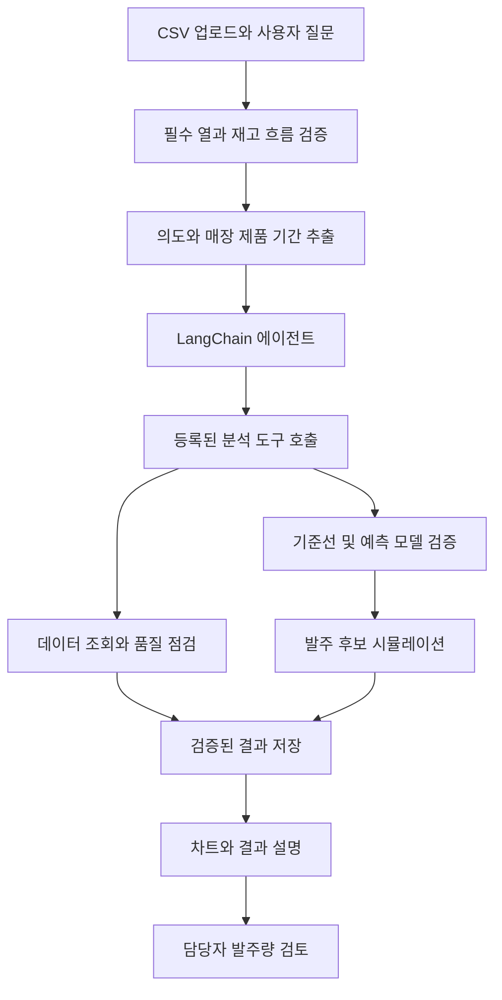

# 도넛 대시보드 개발 설계도

사용자는 판매 데이터를 넣고 질문하며, 시스템은 데이터 검증·수요 예측·발주 시뮬레이션 결과를 차트와 짧은 한국어 설명으로 제공한다. 첫 버전은 CSV 업로드와 일 단위 완제품 발주 추천을 대상으로 한다.

## 화면 구조

```text
[기간] [매장] [제품]                        [데이터 기준 시각]
질문 입력: 내일 글레이즈드 도넛을 몇 개 발주할까요?

[예상 수요] [권장 발주량] [예상 잔여율] [예상 수요 충족률]

실제 판매와 미래 수요 예측 그래프
실선: 실제 판매 / 점선: 예측 / 음영: 예측 범위

제품별 예상 잔여량 막대 | 발주 시나리오 비교표

추천 이유와 주의할 조건
[데이터 품질] [검증 오차] [도구 실행 기록] [상세 데이터]
```

‘목표 달성 불가’, ‘데이터 부족’, ‘품절 수요 추정’, ‘모의 데이터’는 관련 카드 옆에 문장으로 표시한다. 데이터가 없을 때 숫자 0을 대신 출력하지 않는다.

## 데이터 흐름



시각화만 요청하면 검증된 집계 데이터를 사용하고 예측 학습은 생략한다. 원인을 묻는 질문에는 관측된 연관성을 설명하며 인과관계로 단정하지 않는다.

## 구성 요소 제안

| 요소 | 제안 | 역할 |
| --- | --- | --- |
| 실습 UI | Streamlit과 Plotly | 파일 업로드, 필터, 차트, 결과 설명 |
| 데이터 처리 | pandas와 SQLite | 실습용 일별 집계와 결과 보관 |
| 모델 | scikit-learn, 필요 시 statsmodels | 회귀·머신러닝과 시계열 후보 검증 |
| 에이전트 | LangChain create_agent | 질문에 따라 도구를 선택하고 결과 통합 |
| 검증 | Pydantic | 의도·도구 입출력·최종 응답 타입 검사 |
| LLM 연결 | 선택한 공급자의 LangChain 통합 패키지 | 도구 호출을 지원하는 모델 연결 |

위 기술은 구현 제안이다. 도입 시 호환되는 버전을 함께 확인하고 고정한다. 기존 `providers.RemoteChat`은 LangChain 채팅 모델 인터페이스가 아니므로 `create_agent`에 그대로 전달하지 않는다.

## 결과 데이터 계약

예측 결과는 `date`, `store_id`, `product_id`, `point_forecast`, `lower`, `upper`, `interval_coverage`, `model_id`, `training_cutoff`를 보관한다. 예측 범위와 발주 시뮬레이션용 수요 시나리오는 구분하며, 분위수 세 개만으로 분포가 완전히 주어진 것으로 처리하지 않는다.

발주 결과는 `arrival_date`, `order_units`, `pack_size`, `expected_leftover_rate`, `expected_fill_rate`, `feasible`, `scenario_id`, `warnings`를 보관한다. `feasible`은 예측 분포와 제약 아래의 충족 여부이며 실제 성과 보장이 아니다.

LLM의 최종 응답에는 `summary`, `chart_specs`, `forecast_id`, `order_plan_id`, `evidence_ids`, `warnings`, `status`를 포함한다. 숫자는 도구 결과 ID와 연결한다. 각 결과에는 입력 데이터 버전·모델 버전·생성 시각을 남긴다.

## 개발 완료 판정

- CSV 누락·중복·음수 수량과 휴무/누락 차이를 검사한다.
- 매장·제품 필터를 바꾸면 카드·그래프·표가 같은 데이터 범위를 사용한다.
- 미래 데이터 없이 시간 순서 검증 결과를 재현할 수 있다.
- 기준선과 후보 모델의 오차·운영 성과를 비교할 수 있다.
- 잔여율 목표를 맞추기 위해 품절을 늘린 후보를 성공으로 판정하지 않는다.
- 입력이 같으면 수치 계산을 재현할 수 있고 LLM 설명의 숫자가 도구 결과와 일치한다.
- 추천량은 검토용으로 표시하고, 실제 구매 주문 연동은 별도 개발 범위로 둔다.
