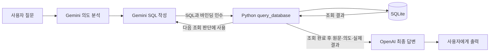

# Gemini SQL 조회 → OpenAI 답변 MVP

사용자의 질문을 Gemini가 분석하고, **질문과 DB 스키마를 보고 SQL을 직접 작성**하여 SQLite를 조회합니다. OpenAI는 사용자 원문과 실제 조회 결과를 받아 최종 답변을 작성합니다.

## 1. 전체 구성



모델 API 호출과 데이터 전달은 Python의 `run_pipeline()`이 조율합니다. Gemini는 Tool 호출을 요청하고, 실제 SQL 실행은 Python이 담당합니다.

| 구성 | 담당 역할 |
|---|---|
| Gemini | 의도·대상·기간·조건 분석, SQL 작성, 추가 조회 또는 SQL 수정 판단 |
| Python Tool | SQL 검증·실행 제한 적용, SQLite 조회, JSON으로 변환 가능한 결과 반환 |
| OpenAI | 실제 조회 결과를 종합하여 표·요약·설명 등 요청한 형식으로 최종 답변 생성 |
| SQLite | 가상 직원정보와 ERP 법인카드 사용내역 저장 |

질문이 모호하면 추가 확인 질문을 반환합니다. 일반 지식 질문은 DB 조회를 생략합니다. DB 조회가 실패하면 OpenAI 답변 생성을 진행하지 않습니다.

## 2. 기술 스택과 라이브러리

개발 환경은 **Windows + Python 3.13 + CMD + 가상환경**입니다. 별도 웹 서버나 에이전트 프레임워크는 사용하지 않습니다.

### 직접 설치하는 라이브러리

버전은 [requirements.txt](requirements.txt)에 고정되어 있습니다.

| 라이브러리 | 버전 | 사용 목적 |
|---|---|---|
| `openai` | `3.52.0` | Gemini와 OpenAI를 같은 SDK로 호출. 텍스트 생성, 구조화 출력, Tool Calling |
| `python-dotenv` | `1.2.4` | `.env`에서 API 키·모델·DB 경로·실행 제한 로딩 |
| `pydantic` | `2.14.3` | 의도 분석 JSON Schema 생성, 결과의 타입·필드 검증 |

### 주요 Python 표준 라이브러리

| 모듈 | 사용 목적 |
|---|---|
| `sqlite3` | 파일 DB 생성, SQL 실행, 조회 권한 제한 |
| `argparse` | CMD 실행 옵션 처리 |
| `json` | 의도·Tool 인수·조회 결과의 직렬화/역직렬화 |
| `datetime`, `calendar` | 한국 시간 기준일, 상대 기간, 월말·윤년 계산 |
| `pathlib`, `os` | 파일 경로와 환경 변수 관리 |
| `dataclasses` | `Settings`, `AgentClient` 구성 |
| `contextlib` | 모델 HTTP 클라이언트와 SQLite 연결 종료 |
| `inspect` | Tool 인수와 함수 시그니처 일치 여부 검증 |
| `random` | 시드 기반 가상 DB 데이터 생성 |
| `time` | SQL 실행 시간 제한 점검 |
| `unittest`, `unittest.mock`, `tempfile`, `subprocess` | 오프라인 테스트, 임시 DB, CLI 검증 |

테스트의 `httpx2.MockTransport`는 `openai` SDK의 간접 의존성인 `httpx2`를 이용합니다. 실제 모델 API 대신 모의 HTTP 응답으로 요청·응답 형식을 검증합니다.

### 제공사별 호출 방식

| 제공사 | SDK | 파이프라인에서 사용하는 API |
|---|---|---|
| Gemini | `openai.OpenAI` | `client.chat.completions.create(...)` |
| OpenAI | `openai.OpenAI` | `client.responses.create(...)` |

공통 클래스 `AgentClient`가 두 API의 입력·응답 차이를 처리합니다. 공통 Tool 루프는 두 형식을 지원하지만, 현재 파이프라인의 **Tool 호출 담당은 Gemini, 최종 답변 담당은 OpenAI**로 고정되어 있습니다.

## 3. 파일 구성

```text
agent_orchestration_mvp/
├── main.py                       # 모델 클라이언트, Tool 루프, 전체 파이프라인, CLI
├── intent_analysis.py            # 의도 분석 지침·모델·검증·기간 보정
├── custom_tools.py               # 단일 SQL Tool, 조회 제한, 테스트 DB 생성
├── requirements.txt              # 직접 의존하는 패키지와 버전
├── .env                          # 로컬 API/모델/실행 설정
├── company.sqlite3               # 직원 100명 + 카드 사용내역 1,000건
├── test_custom_tools.py          # 실제 임시 SQLite와 SQL 제한 테스트
├── test_intent_analysis.py       # 의도 구조·기간·식별자 검증 테스트
├── test_pipeline.py              # API 변환·모델 간 전달·CLI·실행 순서 테스트
├── dynamic_sql_test_report.json  # 현재 동적 SQL 방식의 실제 모델 검증 결과
├── *_report.json                # 이전 구현 단계의 검증 기록
└── README.md
```

실행 코드는 Python 파일 3개로 구성됩니다. `test_*.py`는 테스트 전용입니다. 이전 보고서에는 과거 Tool 이름이나 옵션이 남아 있을 수 있으며, 현재 실행 방식은 이 문서를 기준으로 합니다.

## 4. 핵심 함수와 호출 순서

### 파이프라인 호출 관계

```text
main.main()
├── load_settings()                         .env 로딩과 실행 설정 검증
└── run_pipeline()
    ├── create_agents(names=("gemini",))
    ├── analyze_intent()
    │   ├── relative_period_rules()
    │   ├── AgentClient.generate(response_schema=...)
    │   └── IntentAnalysis.model_validate_json()
    ├── AgentClient.run_with_tools()         조회가 필요한 경우
    │   ├── Gemini에 원문·의도·DB 스키마 전달
    │   ├── Gemini가 SQL과 Tool 인수 생성
    │   ├── execute_tool()
    │   │   └── query_database()
    │   │       └── sqlite3.Connection.execute(sql, parameters)
    │   └── 결과를 Gemini에 전달하고 필요하면 다음 조회
    ├── create_agents(names=("openai",))
    └── generate_final_answer()
        └── AgentClient.generate()
            └── OpenAI Responses API → 최종 답변
```

### `main.py`

| 함수·클래스 | 주요 기능 |
|---|---|
| `Settings` | 요청 제한 시간과 최대 Tool 라운드 보관 |
| `load_settings()` | 같은 폴더의 `.env` 로딩, 숫자 설정 검증. 기존 환경 변수가 `.env`보다 우선 |
| `create_agents()` | 제공사별 키·모델·API 종류·엔드포인트 검증 후 공통 `AgentClient` 생성. 생성만으로 API 요청하지 않음 |
| `AgentClient.generate()` | 텍스트/구조화 응답 생성. Responses의 `input`·`instructions`와 Chat Completions의 `messages`를 내부 변환 |
| `AgentClient.run_with_tools()` | Tool 명세 전달, 호출 요청 수신, 실행 결과 반환, 다음 조회 반복. 호출 ID와 Gemini thought signature/OpenAI reasoning 항목 유지 |
| `generate_final_answer()` | 원문·확정된 의도·실제 조회 결과를 OpenAI에 전달. Gemini의 중간 답변 문장은 근거로 전달하지 않음 |
| `run_pipeline()` | 분석 → 필요한 DB 조회 → OpenAI 최종 답변 순서 제어. 실패 시 조회 기록 보존 |
| `main()` | 질문 입력, 실행 모드 선택, 기본 답변 또는 전체 JSON 출력, 종료 코드 반환 |

`EXECUTOR_INSTRUCTIONS`는 Gemini의 SQL 작성 규칙, `FINAL_ANSWER_INSTRUCTIONS`는 OpenAI의 근거 기반 답변 규칙입니다.

### `intent_analysis.py`

| 함수·클래스 | 주요 기능 |
|---|---|
| `Subject`, `Period`, `IntentAnalysis` | 대상·기간·의도·조건·추가 질문의 Pydantic 모델 |
| `analyze_intent()` | Gemini를 1회 호출하고 JSON 구조, 원문에 있는 식별자, 기간, 누락 조건 검증 |
| `parse_reference_date()` | 유효한 `YYYY-MM-DD` 날짜 검증 |
| `relative_period_rules()` | 오늘·어제·이번 달·지난달·올해·작년의 날짜 범위 계산 |
| `intent_test_cases()` | 의도 분석 검증용 질문 8건과 기대값 제공 |
| `compare_intent()` | 분류·대상·기간·Tool 후보 등 지정 필드 비교 |
| `run_intent_suite()` | Gemini 예제 분석 실행과 결과 집계. API 오류 시 추가 호출 중단 |

의도는 `employee_info`, `card_usage`, `employee_and_card`, `general`, `unsupported`로 구분합니다. 조회가 필요한 의도의 Tool 후보는 모두 `query_database`입니다.

### `custom_tools.py`

| 함수·상수 | 주요 기능 |
|---|---|
| `database_path()` | `SQLITE_DB_PATH` 해석. 상대 경로는 프로젝트 폴더 기준 |
| `initialize_database()` | 재현 가능한 가상 직원 100명/사용내역 1,000건 최초 생성. 기존 데이터는 재생성하지 않음 |
| `DATABASE_SCHEMA` | Gemini에 전달하는 테이블·컬럼·연결 관계의 코드 명세. DB 자동 탐색 결과가 아니므로 스키마 변경 시 함께 수정 |
| `TOOL_DEFINITIONS` | 모델에 공개하는 `query_database`의 설명과 입력 JSON Schema |
| `TOOL_REGISTRY` | 공개 Tool 이름과 실제 함수 연결. 현재 `query_database` 하나만 등록 |
| `execute_tool()` | JSON 인수 파싱, 등록 함수명·인수명 검증, 선택 인수의 `null` 처리 후 실행 |
| `query_database()` | 모델이 전달한 SQL을 바인딩 값과 함께 읽기 전용으로 실행 |
| `_authorize()` | SQLite 작업 종류·대상 테이블·일부 함수에 대한 허용/차단 판정 |

`query_database(sql, parameters=None, row_limit=200)`의 `parameters`는 문자열·숫자·`null`의 배열입니다. 숫자는 JSON 숫자로 전달하여 `HAVING` 등 집계 비교에서도 타입을 유지합니다.

## 5. 데이터베이스와 조회 제한

실제 외부 ERP에 접속하는 대신 SQLite의 `card_transactions` 테이블로 가상 ERP 데이터를 재현합니다. 모든 인물·연봉·평가·거래는 테스트용 가상 데이터입니다.

| 테이블 | 주요 컬럼 | 최초 생성 건수 |
|---|---|---:|
| `employees` | `employee_id`, `name`, `hire_date`, `department`, `annual_salary_krw`, `evaluation`, `job_title`, `corporate_card_id` | 100 |
| `card_transactions` | `transaction_id`, `corporate_card_id`, `used_at`, `merchant`, `category`, `amount_krw`, `description` | 1,000 |

연결 키는 `employees.corporate_card_id = card_transactions.corporate_card_id`입니다. 날짜는 `YYYY-MM-DD`, 연봉과 사용액은 원(KRW) 단위 정수로 저장합니다.

최초 생성 시드와 거래 기준일은 각각 `20261119`, `2026-11-19`입니다. 현재 생성된 거래 기간은 `2026-08-22`부터 `2026-11-19`까지입니다. DB를 재초기화해도 기존 데이터가 있으면 덮어쓰지 않습니다.

사용자 질문의 조회 SQL은 모두 Gemini가 작성합니다. 코드에 있는 테이블 생성·시드 삽입·초기화 검증 SQL은 DB 준비용이며, 사용자 조회용 고정 SQL Tool은 없습니다.

조회 시 적용되는 제한:

- SQLite 연결은 `mode=ro`로 엽니다.
- `_authorize()`로 허용된 두 테이블의 읽기 작업만 허용하고 변경·삭제·테이블 변경·외부 DB 연결 등을 차단합니다.
- 한 번에 SQL 문장 하나만 실행합니다.
- 반환 행은 기본 및 최대 200행입니다. 초과하면 `truncated: true`를 반환합니다.
- 약 2초의 실행 예산을 두고, SQLite VM 명령 1,000개 간격으로 중단 여부를 점검합니다.
- Gemini의 Tool 라운드는 `MAX_TOOL_ROUNDS`로 제한합니다. 마지막에는 추가 Tool 호출 없이 완료 응답을 요청합니다.

초기 DB 생성은 별도 CLI `--init-db`로 실행하며 모델에 공개된 Tool이 아닙니다.

## 6. 기간 해석

기본 기준일은 한국 시간의 오늘이며, `--reference-date`로 고정할 수 있습니다.

- “이번 달”은 해당 월 1일부터 말일까지입니다. `calendar.monthrange()`로 28/29/30/31일과 윤년을 처리합니다.
- “지난달”은 이번 달 1일의 하루 전 날짜를 이용해 연도 변경도 처리합니다.
- “오늘까지/현재까지/지금까지”가 명시되면 상대 기간의 종료일을 기준일로 제한합니다.
- 기간이 없으면 날짜 조건이 없는 전체 내역으로 해석합니다.
- “최근”처럼 범위가 모호하면 임의 기간을 정하지 않고 추가 질문합니다.

현재 Python의 결정적 보정은 등록된 상대 기간 표현에 적용됩니다. “2026년 12월”처럼 **특정 월을 명시한 표현은 Gemini가 시작일·종료일을 해석**하고 Python이 날짜 유효성·순서를 검증합니다. 모든 특정 월 표현을 Python에서 다시 계산하는 기능은 아직 구현되어 있지 않습니다.

## 7. 설치와 실행 — Windows CMD

### 가상환경과 라이브러리

현재 작업 환경의 가상환경 폴더는 `C:\AI4_02\.venv`입니다. 이미 활성화되어 있으면 활성화 명령은 생략합니다. 폴더명이 `venv`라면 해당 경로로 바꿉니다.

```cmd
cd /d C:\AI4_02
.venv\Scripts\activate.bat
cd agent_orchestration_mvp
python -m pip install -r requirements.txt
```

### `.env` 설정

실제 키는 로컬 `.env`에만 입력합니다. 아래 예제에는 실제 키나 특정 모델을 포함하지 않습니다.

```dotenv
GEMINI_API_KEY=your_gemini_api_key
GEMINI_MODEL=your_available_gemini_model
GEMINI_API_KIND=chat_completions
GEMINI_BASE_URL=https://generativelanguage.googleapis.com/v1beta/openai/

OPENAI_API_KEY=your_openai_api_key
OPENAI_MODEL=your_available_openai_model
OPENAI_API_KIND=responses
OPENAI_BASE_URL=https://api.openai.com/v1

REQUEST_TIMEOUT_SECONDS=60
MAX_TOOL_ROUNDS=3
SQLITE_DB_PATH=company.sqlite3
```

API 종류·URL·시간·라운드·DB 경로에는 위 기본값이 있습니다. API 키와 모델명은 필수입니다. 일반 파이프라인은 두 제공사를 모두 사용하고, 의도 분석 진단 모드는 Gemini만 사용합니다. 기존 CMD/시스템 환경 변수는 `.env`보다 우선합니다.

### DB 생성과 사용자 질문

```cmd
python -X utf8 custom_tools.py --init-db
python -X utf8 main.py --question "김가온의 2026년 11월 카드 사용 건수와 총액을 표로 알려줘"
```

질문을 직접 입력하거나, 실행 기록·SQL까지 확인할 수 있습니다.

```cmd
python -X utf8 main.py
python -X utf8 main.py --question "부서별 카드 사용액 상위 3개를 알려줘" --json
python -X utf8 main.py --question "E001의 부서와 평가" --instructions "표로 답하고 한 문장으로 요약하세요."
```

`--pipeline`은 기본 실행과 동일합니다. 기존 실험용 `--agent`, `--executor`, `--finalizer` 옵션은 제거되었습니다.

### 의도 분석과 SQL 단독 검증

```cmd
python -X utf8 main.py --analyze-intent --question "E001의 이번 달 카드 사용액" --reference-date 2026-11-19
python -X utf8 main.py --test-intents --reference-date 2026-11-19
python -X utf8 custom_tools.py --sql "SELECT department, COUNT(*) AS count FROM employees GROUP BY department"
```

`--test-intents`는 실제 Gemini 요청을 수행합니다. SQL 단독 검증은 모델 API를 사용하지 않고 입력한 SQL만 실행합니다. `custom_tools.py --help`에서 `--parameters`, `--row-limit`, `--db-path`를 확인할 수 있습니다.

## 8. 출력과 테스트

기본 출력은 OpenAI가 작성한 최종 답변입니다. `--json`을 추가하면 다음 항목을 확인할 수 있습니다.

| 항목 | 의미 |
|---|---|
| `status` | `success`, `needs_clarification`, `unsupported`, `retrieval_failed`, `answer_generation_failed` |
| `answer` | 최종 답변 또는 확인 질문. 처리 실패 시 `null` |
| `intent` | 대상·기간·조건·기간 보정 내용을 포함한 Gemini 의도 분석 |
| `tool_trace` | 각 호출의 모델명, 라운드, Tool 이름, SQL 인수, 실제 조회 결과 |
| `executor` | DB 조회를 수행한 모델. 조회한 경우 `gemini` |
| `answer_generator` | 최종 답변 담당. 정상 답변 생성 단계는 `openai` |
| `openai_called` | OpenAI 답변 생성 요청을 시도했는지 여부 |
| `error` | 실패한 단계·제공사·오류 타입·HTTP 상태 |

`tool_trace[].arguments`는 JSON 문자열이며, 그 안의 `sql`과 `parameters`가 실제 실행에 전달된 값입니다. 분석 객체 내부의 `tool_execution: false`는 **의도 분석 단계 자체가 Tool을 실행하지 않았다는 의미**입니다. 전체 파이프라인의 실행 여부는 최상위 `tool_execution`과 `tool_trace`로 확인합니다.

### 오프라인 회귀 테스트

프로젝트 폴더에서 실행합니다. 실제 Gemini/OpenAI API를 호출하지 않습니다.

```cmd
python -X utf8 -m unittest discover -s . -p "test_*.py" -v
```

| 테스트 파일 | 검증 대상 |
|---|---|
| `test_custom_tools.py` | DB 건수·외래키·동적 SQL·숫자 바인딩·읽기 전용·실행 예산·행 제한 |
| `test_intent_analysis.py` | JSON 구조·식별자 추측 방지·기간 보정·누락 조건·API 입력 형식 |
| `test_pipeline.py` | Tool 호출 ID/결과 전달, Gemini → Tool → OpenAI 순서, 실패 시 중단, CLI 기본 동작 |

현재 동적 SQL 구현 기준으로 오프라인 테스트 **47개**가 통과했습니다.

### 실제 모델 검증 기록

[dynamic_sql_test_report.json](dynamic_sql_test_report.json)에 직원 ID 조회, 이름 기반 카드 집계, 부서별 순위의 실제 검증 **3건**이 저장되어 있습니다. 모든 조회가 Gemini의 `query_database` 호출인지, OpenAI 답변 수치가 별도 SQLite 정답 SQL과 일치하는지, DB가 변경되지 않았는지를 확인했습니다.

이 보고서는 저장 당시의 예제 검증 결과이며 모든 자연어 질문의 정확도를 보장하는 수치는 아닙니다. 현재 코드를 실제 API로 다시 확인하려면 위 사용자 질문 명령에 `--json`을 붙여 실행합니다.
