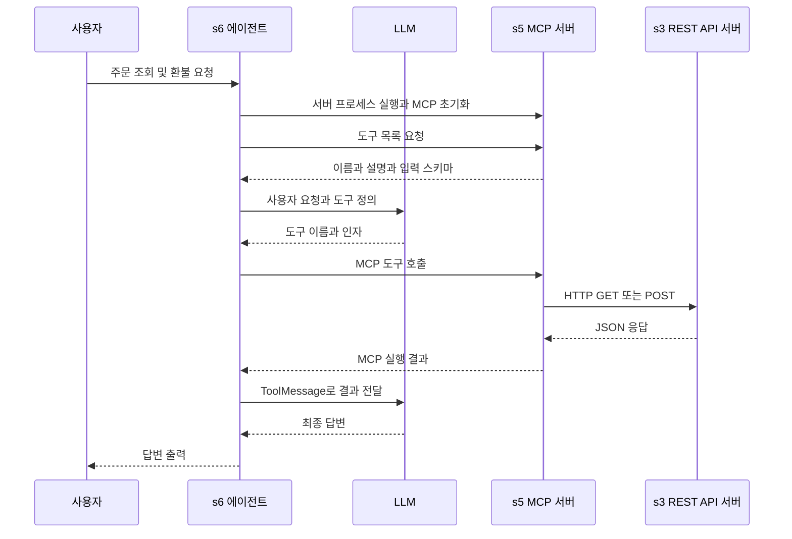

# Day28 MCP와 API 도구 호출 복습

Day28의 핵심은 **REST API를 호출하는 파이썬 함수를 만들고, 그 기능을 LLM이 직접 또는 MCP를 통해 사용하도록 연결하는 것**이다. LLM은 사용할 기능을 판단하고, 파이썬 프로그램은 선택된 기능을 실행하며, 서버는 데이터를 처리한다.

이 자료는 현재 `U2-07_MCP`의 s1부터 s6까지와 학습 중의 개념 질문을 정리한다. 설치 오류, 버전 충돌, 파일 경로 오류, 포트 충돌 등의 오류 문답은 포함하지 않는다.

## 1 소스 파일과 학습 순서

| 파일 | 역할 | 배우는 내용 | LLM 사용 |
|---|---|---|---|
| [s1_first_mcp_server.py](U2-07_MCP/s1_first_mcp_server.py) | 덧셈과 서비스 환경을 제공하는 MCP 서버 | 서버 생성, 도구 등록, stdio | 없음 |
| [s2_api_test.py](U2-07_MCP/s2_api_test.py) | 외부 게시글 API를 호출하는 클라이언트 | HTTP POST, JSON, 응답 객체 | 없음 |
| [s3_fastapi_server.py](U2-07_MCP/s3_fastapi_server.py) | 주문 조회와 환불 접수 API 서버 | FastAPI, GET, POST, 요청 모델 | 없음 |
| [s4_direct_at_tool_agent.py](U2-07_MCP/s4_direct_at_tool_agent.py) | REST API를 직접 사용하는 에이전트 | LangChain 도구, 함수 호출, 메시지 반복 | 있음 |
| [s5_order_mcp_server.py](U2-07_MCP/s5_order_mcp_server.py) | 주문 API를 MCP 기능으로 제공하는 서버 | Tool, Resource, Prompt | 없음 |
| [s6_langchain_mcp_agent.py](U2-07_MCP/s6_langchain_mcp_agent.py) | MCP 도구를 사용하는 에이전트 | MCP 클라이언트, 도구 발견, 비동기 호출 | 있음 |

s1과 s2는 서로 연결되지 않은 독립 실습이다. s4는 s3를 직접 호출한다. s6는 s5를 통해 s3를 호출한다. 현재 s6는 MCP SDK를 직접 사용하며 `langchain-mcp-adapters`를 import하지 않는다.

## 2 전체 구조

### 기본 실습

```text
Inspector나 Codex 같은 MCP 클라이언트
  → MCP 도구 호출 → s1의 덧셈 또는 환경 조회 → MCP 결과 응답

s2
  → HTTP POST → 외부 JSONPlaceholder API → HTTP 응답 → 화면 출력
```

### 직접 도구를 사용하는 구조

```text
사용자 요청
  → s4가 LLM 호출
  ← LLM이 도구 이름과 입력값 선택
  → s4가 파이썬 도구 실행
  → HTTP 요청 → s3
  ← HTTP 응답 ← s3
  → s4가 도구 결과를 LLM에 전달
  ← 최종 답변
```

### MCP를 사용하는 구조



**s6와 s5 사이는 MCP와 stdio, s5와 s3 사이는 HTTP와 JSON으로 통신한다.** LLM 호출은 s6에서 별도로 이루어진다.

## 3 기본 개념

| 개념 | 쉬운 정의 | 정확한 정의 또는 구분 |
|---|---|---|
| 서버 | 요청을 받아 처리하는 프로그램 | 클라이언트에 기능이나 데이터를 제공하는 프로그램. s3와 s5가 해당한다. |
| 클라이언트 | 요청을 보내는 프로그램 | 서버에 요청을 전송하고 응답을 받는 구성 요소. s6는 s5의 클라이언트다. |
| API | 다른 프로그램의 기능을 사용하는 약속 | 소프트웨어 사이의 기능, 입력·출력 형식과 사용 규칙을 정의한 인터페이스 |
| REST API | URL과 HTTP로 사용하는 API | 자원 식별, 일관된 인터페이스, 무상태 통신 등 REST 제약에 따르는 API |
| GET | 정보를 조회해 달라는 요청 | 대상 자원의 표현을 요청하는 HTTP 메서드 |
| POST | 보낸 데이터를 처리해 달라는 요청 | 대상 자원의 규칙에 따라 요청 데이터를 처리하도록 하는 HTTP 메서드 |
| JSON | 데이터를 주고받는 텍스트 형식 | 객체, 배열, 문자열, 숫자, 불리언, null을 표현하는 데이터 교환 형식 |
| 엔드포인트 | 기능을 요청할 주소 | API 자원 또는 기능에 접근하는 URL. 기능 구분에는 HTTP 메서드도 함께 쓰인다. |
| 헤더 | 요청에 붙이는 안내 정보 | 본문 형식 등 HTTP 메시지의 부가 정보를 담는 필드 |
| 객체 | 데이터와 기능을 묶은 구성품 | 상태와 동작을 가진 인스턴스. `mcp`, `app`, `response` 등이 객체다. |
| 데코레이터 | 함수 위에 붙여 역할을 추가하는 문법 | 함수나 클래스를 받아 처리한 결과를 원래 이름에 다시 바인딩하는 파이썬 문법 |
| 타입 힌트 | 입력과 출력의 종류 표시 | `order_id: str`, `-> dict` 같은 타입 정보. 일반 파이썬 자체가 이를 항상 강제하는 것은 아니다. |
| 스키마 | 데이터 입력 양식 | 데이터의 구조, 타입, 필수 항목 등을 정의한 명세 |
| LLM | 문맥을 읽고 답변을 만드는 모델 | 대규모 데이터로 학습하여 문맥에 따른 토큰 확률을 모델링하고 출력을 생성하는 언어 모델 |
| 도구 호출 | AI가 함수와 입력값을 선택하는 것 | 모델이 도구 이름과 구조화된 인자를 출력하고 실행 프로그램이 실제 도구를 실행하는 방식 |
| 에이전트 | 판단과 실행을 반복하는 프로그램 | 목표를 위해 모델의 판단, 도구 실행, 결과 관찰을 반복하는 시스템 |

### MCP 관련 개념

**MCP는 Model Context Protocol의 약자이며, AI 앱과 외부 도구·데이터의 연결을 표준화한 프로토콜이다.** 여러 장치를 공통 규격으로 연결하는 USB처럼 생각할 수 있다. 실제로 모든 서비스가 자동 연결되는 것은 아니며, MCP 서버와 클라이언트 구현이 필요하다.

| 개념 | 쉬운 정의 | 정확한 정의 |
|---|---|---|
| MCP 서버 | 도구와 자료를 제공하는 쪽 | MCP 요청을 받아 Tool, Resource, Prompt 등의 기능을 제공하는 프로그램 |
| MCP 클라이언트 | 서버에 요청하는 쪽 | 서버와 연결하여 MCP 요청과 응답을 처리하는 구성 요소 |
| Tool | 이 일을 해 줘 | 이름, 설명, 입력 스키마로 정의되어 호출할 수 있는 기능 |
| Resource | 이 자료를 읽어 줘 | URI로 식별되어 클라이언트가 읽을 수 있는 데이터 |
| Prompt | 이 지시문 틀을 만들어 줘 | 인자를 받아 메시지를 구성하는 서버 제공 프롬프트 템플릿 |
| stdio | 프로그램의 입력과 출력으로 통신 | 표준 입력과 표준 출력을 사용하는 전송 방식 |
| 세션 | 연결된 상대와 대화 관리 | 초기화와 요청·응답의 연결 관계 등을 관리하는 통신 객체 |
| 비동기 | 기다리는 동안 다른 작업 진행 가능 | 대기 지점에서 실행권을 이벤트 루프에 돌려주는 실행 방식 |

**함수 호출은 모델이 실행할 기능과 인자를 선택하는 능력이고, MCP는 외부 기능을 발견하고 호출하는 공통 통신 규칙이다.** 둘은 서로 대체하는 개념이 아니다.

## 4 패키지와 모듈 문법

패키지는 여러 모듈을 묶는 단위이고, 모듈은 import하여 사용하는 코드 단위다. 클래스는 객체를 만드는 정의이며, 메서드는 객체 등에 속한 함수다.

```python
import httpx                         # 모듈 이름으로 사용
resp = httpx.get(url)

from mcp.server.mcpserver import MCPServer  # 특정 클래스를 가져옴
mcp = MCPServer("MyHelper")                 # 인스턴스 생성
```

| 항목 | 역할 | 주요 문법 |
|---|---|---|
| `requests` | s2의 HTTP 요청 | `requests.post(url, json=data)` |
| `httpx` | s4와 s5의 HTTP 요청 | `httpx.get()`, `httpx.post()` |
| `fastapi` | s3의 HTTP API 구성 | `FastAPI()`, `@app.get()`, `@app.post()` |
| `pydantic` | 요청 데이터 구조와 검증 | `class RefundRequest(BaseModel)` |
| `uvicorn` | FastAPI 앱 실행 | `uvicorn.run(app, host=..., port=...)` |
| `mcp` | MCP 서버와 클라이언트 구성 | `MCPServer`, `ClientSession`, `stdio_client` |
| `langchain_core.tools` | s4의 함수를 LangChain 도구로 구성 | `@tool`, `tool.invoke(args)` |
| `langchain_core.messages` | 대화 기록 표현 | `SystemMessage`, `HumanMessage`, `ToolMessage` |
| `langchain_openai` | OpenAI 모델 연결 | `ChatOpenAI(...).bind_tools(...)` |
| `dotenv` | 환경변수 로드 | `load_dotenv(find_dotenv(), override=True)` |
| `json` | 파이썬 데이터를 JSON 문자열로 변환 | `json.dumps(data, ensure_ascii=False)` |
| `asyncio` | 비동기 작업 실행 | `asyncio.run(coroutine)` |
| `sys` | 현재 파이썬 실행 정보 | `sys.executable` |
| `pathlib` | 파일 경로 구성 | `Path(__file__).resolve().parent` |

`json`, `asyncio`, `sys`, `pathlib`는 파이썬 기본 제공 모듈이다.

## 5 s1 기본 MCP 서버

### 서버 객체 생성과 등록

```python
mcp = MCPServer("MyHelper")
```

MCP 서버를 관리할 객체를 만들고 `mcp`라는 변수에 담는다. 이후 이 객체의 메서드로 도구 등을 등록하고 서버를 실행한다. 객체 생성만으로 요청을 받기 시작하지는 않는다.

```python
@mcp.tool()
def add_number(a: int, b: int) -> dict:
    """두 정수 a,b를 더한 결과를 반환"""
    return {"a": a, "b": b, "sum": a + b}
```

`@mcp.tool()`은 함수를 MCP 도구로 등록한다. 등록 시점에 덧셈을 실행하는 것은 아니다. 클라이언트가 `a=10`, `b=20`으로 호출하면 함수는 `{"a": 10, "b": 20, "sum": 30}`을 반환하며 SDK가 이를 MCP 결과로 전달한다.

### 서비스 환경 조회의 반환값 흐름

입력값이 `"AUTH"`라면 다음처럼 진행된다.

```python
key = service_name.lower()  # "auth"라는 문자열
info = envs.get(key)        # {"env": "prod", "port": 8001}이라는 dict
result = {"service": key, **info}
# {"service": "auth", "env": "prod", "port": 8001}
```

`**info`는 딕셔너리의 키와 값을 펼쳐 넣는다. 현재 함수는 실제 운영 서버에 접속하지 않고, 코드 안에 정의된 `auth` 정보를 조회한다.

### 서버 실행

```python
if __name__ == "__main__":
    mcp.run(transport="stdio")
```

| 코드 | 의미 |
|---|---|
| `if __name__ == "__main__"` | 파일을 직접 실행했을 때 아래 코드를 실행 |
| `mcp` | 생성한 MCP 서버 객체 |
| `.run(...)` | 서버를 실행하고 요청을 처리하는 메서드 |
| `transport=` | 통신 방식을 지정하는 인자 |
| `"stdio"` | 표준 입력과 표준 출력으로 메시지 교환 |

s1은 HTTP 포트를 여는 서버가 아니다. Inspector나 Codex가 s1을 프로세스로 실행하고 입출력 통로를 연결해 사용한다. 작은 기능을 MCP 도구로 제공하는 연습에 적합하다.

## 6 s2 외부 REST API 호출

### 요청 준비와 전송

```python
base_url = "https://jsonplaceholder.typicode.com"
endpoint = f"{base_url}/posts"
payload = {
    "title": "window VScode api Test",
    "body": "Postman과 python 3.13을 활용한 외부 api 호출",
    "userId": 1,
}
header = {"Content-Type": "application/json; charset=UTF-8"}

response = requests.post(
    endpoint, json=payload, headers=header, timeout=10
)
```

`f"{base_url}/posts"`는 변수 값을 문자열에 넣는다. `payload`는 전송할 데이터를 담은 일반 변수 이름이다. `headers=`는 부가 정보를 전달하고, `timeout=10`은 연결·읽기 대기의 타임아웃을 지정한다. 전체 작업이 반드시 10초 이내에 끝난다는 의미는 아니다.

### 왜 json 인자를 쓰는가

`json=payload`는 딕셔너리를 JSON 본문으로 변환해 전송하도록 요청한다. Requests와 HTTPX는 이에 맞는 기본 Content-Type도 설정하므로 s2처럼 JSON 헤더만 지정한다면 보통 생략할 수 있다.

```text
파이썬 딕셔너리 → JSON 요청 본문 → 외부 API가 읽고 처리
```

POST 요청에서 필요한 제목·내용·사용자 ID를 서버에 전달하기 위해 사용한다. `json=`은 파이썬의 특별 문법이 아니라 HTTP 요청 함수가 제공하는 이름 있는 인자다.

### 응답을 다음 코드에 사용하는 방법

```python
response = requests.post(...)  # Response 객체
status = response.status_code  # 정수, 생성 성공 예: 201
data = response.json()         # 이 응답에서는 dict
created_id = data.get("id")    # 예: 101
print(f"생성된 id: {created_id}")
```

**HTTP 응답 객체와 JSON 딕셔너리는 다르다.** `.json()`이 응답 본문을 파이썬 데이터로 변환한다. JSON 내용에 따라 반환값은 dict 외에 list 등이 될 수도 있다.

`test_rest_api()`는 화면에 출력하지만 `return`이 없으므로 함수 자체의 반환값은 `None`이다.

### 생성된 ID가 101인 이유

JSONPlaceholder는 기본 게시글 100개를 제공한다. 게시글 생성 요청에는 다음 번호인 `101`을 넣어 생성된 것 같은 응답을 제공한다. **파이썬이 계산한 숫자가 아니라 서버의 응답값**이다.

```python
# 응답 본문 예시
{"title": "예시", "body": "내용", "userId": 1, "id": 101}
```

이 서비스는 테스트용 API이므로 실제 게시글을 영구 저장하지 않는다. 요청을 반복한다고 실제 데이터가 쌓여 ID가 계속 증가하는 것으로 이해하면 안 된다. [JSONPlaceholder 공식 안내](https://jsonplaceholder.typicode.com/#guide)

s2는 API의 입력 형식, 응답 구조, 상태 코드를 확인하거나 외부 API 연동을 연습할 때 사용한다.

## 7 s3 주문과 환불 API 서버

```python
app = FastAPI(title="external order & inventory api")
```

반환값은 FastAPI 앱 객체다. 여기에 URL별 처리 함수를 등록하고 Uvicorn으로 실행한다.

| 기능 | 메서드와 URL | 입력 | 정상 반환값 |
|---|---|---|---|
| 주문 조회 | `GET /api/orders/{order_id}` | URL의 주문 번호 | 상품명과 금액 등을 담은 dict |
| 환불 접수 | `POST /api/orders/refund` | 본문의 주문 번호와 사유 | 접수 결과와 환불 금액을 담은 dict |

### 주문 조회

```python
@app.get("/api/orders/{order_id}")
def get_order(order_id: str):
    order = ORDERS.get(order_id.upper())
    # 주문 존재 여부를 확인한 뒤
    return order
```

`"ord_1001"` → `.upper()` → `"ORD_1001"` → 딕셔너리 조회 → 주문 dict 반환 순서다. FastAPI가 반환한 데이터를 JSON HTTP 응답으로 구성한다.

```python
# 현재 ORD_1001 데이터
{"order-id": "ORD-1001", "item": "big bag", "amount_krw": 100}
```

### 환불 요청 데이터 검증

```python
class RefundRequest(BaseModel):
    order_id: str
    reason: str
```

FastAPI는 JSON 본문을 읽고 Pydantic으로 검증해 `RefundRequest` 객체로 제공한다.

```python
# 요청 본문
{"order_id": "ORD_1002", "reason": "중복 주문"}

# 함수 내부의 접근 방식
req.order_id  # "ORD_1002"
req.reason    # "중복 주문"
```

이전에 조회한 주문의 금액으로 다음 응답을 만든다.

```python
{
    "order_id": "ORD_1002",
    "refund_status": "ACCEPTED",
    "reason": "중복 주문",
    "refund_amount_krw": 200,
}
```

현재 s3는 메모리 안의 딕셔너리를 사용하며 실제 결제 취소나 환불 내역 저장은 하지 않는다. 주문 데이터에 배송 상태나 배송 날짜는 없다. 따라서 상품명과 금액은 조회할 수 있지만, 현재 데이터만으로 배송 상태나 정책에 따른 환불 가능 여부를 판정할 수는 없다.

### 실행과 확인

실습 폴더에서 다음 명령으로 실행한다.

```bash
python s3_fastapi_server.py
```

`uvicorn.run(app, host="127.0.0.1", port=8000)`이 앱을 실행한다. 브라우저의 `http://127.0.0.1:8000/docs`에서 API를 테스트할 수 있다. `127.0.0.1`은 현재 PC를 가리키는 루프백 주소다.

## 8 s4 직접 도구를 사용하는 에이전트

### 파이썬 함수를 LangChain 도구로 만들기

```python
@tool
def fetch_order_via_rest(order_id: str) -> dict:
    """주문 번호로 외부 REST API에서 주문을 조회합니다."""
    resp = httpx.get(f"{BASE_URL}/api/orders/{order_id}", timeout=5.0)
    # 응답 상태를 확인한 뒤
    return resp.json()
```

`@tool`이 적용된 함수는 LangChain 도구 객체가 된다. 도구 이름·설명·입력 정보를 모델에 제공할 수 있고, `.invoke({...})`로 실행한다. 이 도구가 실행될 때 s3에 HTTP 요청을 보낸다.

```python
tools = [fetch_order_via_rest, submit_refund_via_rest]
registry = {t.name: t for t in tools}
llm = ChatOpenAI(model="gpt-4o-mini", temperature=0).bind_tools(tools)
```

`registry`는 이름으로 도구를 찾는 사전이다. `bind_tools()`의 반환값은 도구 정의가 연결된 모델 실행 객체이며, 이 시점에 LLM이나 도구를 실제 호출하는 것은 아니다. `temperature=0`은 출력의 무작위성을 낮추는 설정이며 항상 동일한 답변을 보장하지는 않는다.

### 모델의 선택과 실제 실행은 별개

```python
ai_msg = llm.invoke(messages)  # LLM 호출과 AIMessage 수신
```

이 줄은 LLM을 호출한다. 주문 조회·환불 함수의 실제 실행은 다음 줄에서 이루어진다.

```python
out = registry[call["name"]].invoke(call["args"])
```

도구 호출 요청의 예시와 이어지는 코드는 다음과 같다.

```python
call = {
    "name": "submit_refund_via_rest",
    "args": {"order_id": "ORD_1002", "reason": "중복 주문"},
    "id": "call_123",
    "type": "tool_call",
}
selected_tool = registry[call["name"]]  # LangChain 도구 객체
out = selected_tool.invoke(call["args"])  # 이 도구에서는 결과 dict
```

결과를 모델에 다시 전달한다.

```python
messages.append(ai_msg)
messages.append(ToolMessage(
    content=json.dumps(out, ensure_ascii=False),
    tool_call_id=call["id"],
))
```

`json.dumps()`는 dict를 JSON 문자열로 만든다. `ensure_ascii=False`는 한글을 유니코드 이스케이프 대신 그대로 표현한다. `tool_call_id`는 어떤 호출에 대한 결과인지 연결한다. AI의 도구 호출 메시지도 기록에 있어야 모델이 호출과 결과의 관계를 이해할 수 있다.

다음 반복의 `llm.invoke(messages)`에서 모델이 결과를 읽는다. `ai_msg.tool_calls`가 비어 있으면 `ai_msg.content`를 최종 답변으로 반환한다. 반복문은 모델 호출을 최대 5회 진행하며, 도구가 반드시 5번 실행된다는 뜻은 아니다.

s4는 소수의 API를 한 AI 프로그램에 빠르게 연결할 때 적합하다.

## 9 s5 주문 API를 제공하는 MCP 서버

s5의 도구는 s4의 HTTP 요청 함수와 비슷하지만 `@tool` 대신 `@mcp.tool()`로 MCP에 등록한다.

```python
mcp = MCPServer("OrderManageMCP")

@mcp.tool()
def mcp_get_order(order_id: str) -> dict:
    """주문 번호로 외부 REST API에서 주문을 조회합니다."""
    resp = httpx.get(f"{BASE_URL}/api/orders/{order_id}", timeout=5.0)
    return resp.json() if resp.status_code == 200 else {"error": resp.text}
```

MCP 클라이언트는 s3의 URL을 알 필요 없이 `mcp_get_order`라는 도구 이름과 입력값을 보낸다. s5는 내부에서 HTTP API를 호출한다.

### 환불 데이터의 이동

```python
resp = httpx.post(
    f"{BASE_URL}/api/orders/refund",
    json={"order_id": order_id, "reason": reason},
    timeout=5.0,
)
```

`json=`이 필요한 이유는 s3가 처리할 주문 번호와 사유를 요청 본문으로 보내야 하기 때문이다.

```text
MCP 입력 인자
→ s5 함수의 order_id와 reason
→ json= 딕셔너리
→ HTTP JSON 본문
→ s3의 RefundRequest 객체
→ 환불 결과 JSON
→ s5의 resp.json() 결과 dict
→ MCP 결과
```

### Resource와 Prompt

| 등록 방식 | 현재 함수 | 제공하는 것 |
|---|---|---|
| `@mcp.tool()` | `mcp_get_order`, `submit_refund_via_rest` | 실행 가능한 주문·환불 기능 |
| `@mcp.resource("policy://refund-rules")` | `get_refund_policy` | 환불 정책 문자열 |
| `@mcp.prompt()` | `cs_response_template` | 주문 번호가 포함된 응대 지시문 |

`policy://refund-rules`는 자료 식별용 URI이며 일반 웹사이트 주소일 필요는 없다. Prompt 함수는 지시문을 만들 뿐, 자체적으로 LLM을 호출하지 않는다.

**등록만으로 자료가 모델에 자동 전달되거나 정책이 강제되는 것은 아니다.** 현재 s6는 Tool만 사용하며 Resource 읽기와 Prompt 가져오기를 수행하지 않는다. 환불 정책 문자열은 존재하지만 실제 환불 처리의 조건 검증으로 구현되어 있지 않다.

s5는 기존 주문 API를 여러 MCP 지원 앱에서 재사용할 수 있도록 제공할 때 적합하다.

## 10 s6 MCP 도구를 사용하는 에이전트

### 환경변수와 경로

```python
SCRIPT_DIR = Path(__file__).resolve().parent
load_dotenv(find_dotenv(), override=True)
```

첫 줄은 s6가 있는 폴더의 `Path` 객체를 만든다. `find_dotenv()`는 `.env` 경로를 찾고 `load_dotenv()`는 설정을 환경변수로 로드한다. `override=True`는 같은 이름의 기존 환경변수보다 파일 값을 우선하게 한다.

### 서버 실행 설정과 연결

```python
server_params = StdioServerParameters(
    command=sys.executable,
    args=[str(SCRIPT_DIR / "s5_order_mcp_server.py")],
)
```

반환값은 서버 실행 설정 객체다. `sys.executable`은 현재 파이썬 경로이며, Path의 `/`는 폴더와 파일명을 연결한다. `str(...)`은 경로 객체를 문자열로 변환한다. 아직 서버를 실행한 단계는 아니다.

```python
async with stdio_client(server_params) as (read_stream, write_stream):
    async with ClientSession(read_stream, write_stream) as session:
        await session.initialize()
```

`stdio_client`가 s5를 자식 프로세스로 실행하고 읽기·쓰기 스트림을 제공한다. `ClientSession`은 이 통로로 MCP 요청과 응답을 관리한다. `initialize()`는 프로토콜과 기능을 협의하며, 현재 코드는 반환된 초기화 결과를 변수에 저장하지 않는다. `async with`는 블록을 벗어날 때 연결과 프로세스 등의 정리도 관리한다.

s6를 실행할 때 s5를 Inspector로 미리 실행할 필요는 없다. s6가 s5를 직접 실행한다. 주문 도구가 사용하는 s3는 별도로 실행되어 있어야 한다.

### 도구 목록에서 모델용 스키마 만들기

```python
mcp_tools = (await session.list_tools()).tools
tool_map = {tool.name: tool for tool in mcp_tools}
```

`list_tools()`는 목록 응답 객체를 반환하고, `.tools`는 도구 객체 리스트다. 이름으로 도구를 찾을 수 있도록 `tool_map`을 만든다.

```python
tool_schemas = [
    {
        "type": "function",
        "function": {
            "name": tool.name,
            "description": tool.description or "",
            "parameters": tool.input_schema,
        },
    }
    for tool in mcp_tools
]
```

이 리스트 컴프리헨션은 각 MCP 도구의 이름·설명·입력 스키마를 모델이 이해하는 도구 정의로 변환한다. `or ""`는 설명이 없으면 빈 문자열을 쓰게 한다.

입력 스키마의 단순화된 예시는 다음과 같다.

```python
{
    "type": "object",
    "properties": {"order_id": {"type": "string"}},
    "required": ["order_id"],
}
```

이를 모델에 연결한다.

```python
llm = ChatOpenAI(model="gpt-4o-mini", temperature=0).bind_tools(tool_schemas)
```

### 모델 판단과 MCP 호출

```python
ai_msg = await llm.ainvoke(messages)
messages.append(ai_msg)
```

반환값은 `AIMessage`다. `.content`에는 답변 내용이, `.tool_calls`에는 도구 호출 요청 목록이 들어간다. 이 실습의 최종 답변은 텍스트이며, 메시지 콘텐츠는 일반적으로 모델과 설정에 따라 다른 구조를 가질 수도 있다.

```python
for call in ai_msg.tool_calls:
    tool = tool_map[call["name"]]
    result = await session.call_tool(tool.name, arguments=call["args"])
```

`call`은 이름·인자·호출 ID를 담은 dict다. `tool`은 선택한 도구의 메타데이터 객체이며 **이 객체의 함수를 로컬 실행하는 것은 아니다.** 실제 실행은 `session.call_tool()`로 s5에 요청한다.

정상 완료된 현재 도구의 `result`는 MCP 도구 실행 결과 객체다. s5의 반환 dict 자체와 구분해야 한다.

```python
tool_out = result.model_dump_json(by_alias=True, exclude_none=True)
messages.append(ToolMessage(content=tool_out, tool_call_id=call["id"]))
```

`model_dump_json()`은 결과 객체를 JSON 문자열로 직렬화한다. `by_alias=True`는 정의된 별칭을 출력 필드명으로 사용하고, `exclude_none=True`는 None 값을 제외한다. 그 결과를 다음 LLM 호출에 전달해 최종 답변을 만든다.

### 왜 비동기를 사용하는가

MCP 클라이언트는 비동기 API를 제공하며, s6는 MCP와 LLM의 응답을 기다리는 작업을 비동기로 구성한다.

| 문법 | 의미 |
|---|---|
| `async def` | 비동기 함수 정의 |
| `await 작업` | 결과를 기다리며 이벤트 루프에 실행권 양보 가능 |
| `async with` | 비동기 진입과 정리 동작을 가진 컨텍스트 사용 |
| `asyncio.run(...)` | 이벤트 루프를 실행하여 비동기 작업을 끝까지 진행 |

현재 코드는 `for` 안에서 도구마다 `await`하므로 도구를 순차 실행한다. 비동기라고 모든 도구를 동시에 실행하는 것은 아니다. s5의 HTTP 요청은 현재 동기식 `httpx.get/post`다.

## 11 반환값으로 다음 코드 작성하기

다음 코드를 짤 때는 **이전 값의 타입과 필요한 필드**를 먼저 확인한다.

| 이전 코드 | 반환값 또는 얻는 값 | 다음 코드 예시 |
|---|---|---|
| `MCPServer("MyHelper")` | 서버 객체 | `@mcp.tool()`, `mcp.run(...)` |
| `service_name.lower()` | 소문자 문자열 | `envs.get(key)` |
| `envs.get("auth")` | 환경 정보 dict | `{"service": key, **info}` |
| `requests.post(...)` | HTTP Response 객체 | `response.status_code`, `response.json()` |
| `httpx.get/post(...)` | HTTP Response 객체 | `resp.json()` |
| `response.json()` | 이 실습에서는 dict | `data.get("id")` |
| `data.get("id")` | ID 값 | `print(created_id)` |
| `find_dotenv()` | 파일 경로 문자열 | `load_dotenv(path)` |
| `Path(__file__).resolve().parent` | 폴더 Path 객체 | `SCRIPT_DIR / "s5_order_mcp_server.py"` |
| `StdioServerParameters(...)` | 실행 설정 객체 | `stdio_client(server_params)` |
| `await session.list_tools()` | 도구 목록 응답 객체 | `response.tools` |
| `response.tools` | 도구 객체 리스트 | 리스트 순회와 스키마 변환 |
| `llm.invoke/ainvoke(...)` | AIMessage 객체 | `.content`, `.tool_calls` |
| `ai_msg.tool_calls` | 호출 요청 dict들의 리스트 | `call["name"]`, `call["args"]`, `call["id"]` |
| s4의 `selected_tool.invoke(args)` | 현재 도구에서는 dict | `json.dumps(out)` |
| `await session.call_tool(...)` | 정상 완료 시 MCP 결과 객체 | `result.model_dump_json(...)` |
| `json.dumps()` / `model_dump_json()` | JSON 문자열 | `ToolMessage(content=...)` |
| `messages.append(message)` | None이며 리스트 자체가 변경됨 | 이후 `llm.invoke/ainvoke(messages)` |
| `asyncio.run(run_mcp_llm_agent(q))` | 비동기 함수의 최종 반환값 | `print(...)` |

### 주문 조회 한 건의 값 추적

```text
사용자 요청
  "ORD_1001의 상품명과 금액을 알려줘"
       ↓ LLM 응답
call
  {"name": "mcp_get_order", "args": {"order_id": "ORD_1001"}, "id": "call_123", ...}
       ↓ session.call_tool
s5의 함수 입력
  order_id = "ORD_1001"
       ↓ httpx.get
s3의 함수 반환
  {"order-id": "ORD-1001", "item": "big bag", "amount_krw": 100}
       ↓ HTTP JSON 응답과 resp.json()
s5의 함수 반환
  주문 dict
       ↓ MCP 결과로 포장
s6의 result
  MCP 도구 결과 객체
       ↓ model_dump_json
tool_out
  JSON 문자열
       ↓ ToolMessage 추가와 다음 LLM 호출
최종 답변 예시
  "상품은 big bag이며 금액은 100원입니다."
```

## 12 생성과 호출과 응답의 위치

| 구분 | 위치 | 코드 |
|---|---|---|
| MCP 서버 객체 생성 | s1, s5 | `mcp = MCPServer(...)` |
| MCP 도구 등록 | s1, s5 | `@mcp.tool()` |
| MCP 서버 실행과 대기 | s1, s5 | `mcp.run(transport="stdio")` |
| API 앱 객체 생성 | s3 | `app = FastAPI(...)` |
| API 경로 등록 | s3 | `@app.get(...)`, `@app.post(...)` |
| API 서버 실행 | s3 | `uvicorn.run(...)` |
| API 요청 전송과 응답 수신 | s2, s4, s5 | `response/resp = requests.post(...)` 또는 `httpx.get/post(...)` |
| API 응답 데이터 생성 | s3 | `return order`, `return {...}` |
| API 응답 본문을 파이썬 데이터로 변환 | s2, s4, s5 | `response/resp.json()` |
| MCP 서버 프로세스 실행과 연결 | s6 | `stdio_client(server_params)` |
| MCP 도구 목록 요청 | s6 | `await session.list_tools()` |
| LLM 호출과 응답 수신 | s4, s6 | `ai_msg = llm.invoke(...)` / `await llm.ainvoke(...)` |
| LLM의 도구 선택 결과 | s4, s6 | `ai_msg.tool_calls` |
| 로컬 LangChain 도구 실행 | s4 | `registry[name].invoke(args)` |
| MCP 도구 실행 요청과 결과 수신 | s6 | `result = await session.call_tool(...)` |
| 도구 결과를 다음 모델 입력에 추가 | s4, s6 | `messages.append(ToolMessage(...))` |
| 최종 LLM 답변 | s4, s6 | 도구 호출이 없을 때의 `ai_msg.content` |

## 13 MCP를 사용하는 이유와 직접 호출의 차이

**MCP의 목적은 연결 규칙을 공통화해 도구의 발견과 재사용을 쉽게 만드는 것이다.** 모델을 더 똑똑하게 하거나 요청을 반드시 빠르게 만드는 장치는 아니다.

| 비교 | s4 직접 도구 방식 | s5와 s6 MCP 방식 |
|---|---|---|
| 도구 목록 | s4에 직접 작성 | s6가 서버에서 조회 |
| HTTP 구현 위치 | s4 | s5 |
| 클라이언트가 알아야 할 것 | API를 호출하는 도구 함수 구현 | MCP 도구 이름과 입력 규격 |
| 재사용 | 앱마다 연결 코드가 필요할 수 있음 | 여러 MCP 클라이언트에서 서버 기능 활용 |
| API 내부 변경 | 해당 API를 직접 사용하는 앱에 영향 | MCP 도구 규격을 유지하면 s5에서 변경을 흡수 가능 |
| 적합한 상황 | 한 앱에 적은 수의 기능 연결 | 여러 앱이 같은 도구를 공유하거나 도구가 늘어나는 상황 |

예를 들어 주문 API 주소만 바뀌면 s5의 주소를 수정하고 s6의 도구 호출 방식은 유지할 수 있다. 도구 이름이나 입력 스키마까지 바뀌면 클라이언트 대응도 필요하다.

MCP 서버가 있다고 LLM이 반드시 필요한 것은 아니다. Inspector나 일반 MCP 클라이언트가 정해진 인자로 도구를 호출할 수도 있다. s1과 s5 자체에는 LLM 호출 코드가 없다.

## 14 학습 질문 핵심 답변

| 질문 | 기억할 답 |
|---|---|
| 서버 객체를 만든다는 뜻은 무엇인가 | 기능 등록과 실행을 관리할 인스턴스를 생성해 변수에 담는다는 뜻이다. |
| 도구를 등록하면 바로 실행되는가 | 아니다. 나중에 호출할 기능으로 준비한다. |
| json 인자를 왜 쓰는가 | 서버가 처리할 데이터를 JSON 요청 본문으로 보내기 위해서다. |
| Resource와 Prompt도 실행 도구인가 | MCP의 서로 다른 기능이다. Resource는 자료, Prompt는 메시지 템플릿을 제공한다. |
| stdio는 HTTP 주소인가 | 아니다. 프로그램의 표준 입출력으로 통신한다. |
| s6는 왜 비동기인가 | MCP 비동기 API와 LLM 대기 작업을 이벤트 루프에서 처리하기 위해서다. |
| LLM이 직접 함수를 실행하는가 | 이름과 인자를 선택하고, s4나 s6의 코드가 실행한다. |
| bind_tools가 LLM 호출인가 | 아니다. 도구 정의 연결이며 실제 호출은 invoke 또는 ainvoke다. |
| s2의 ID 101은 누가 만드는가 | 테스트 API가 응답에 넣는다. 파이썬은 이를 읽어 출력한다. |
| s5 정책이 s6에 자동 적용되는가 | 아니다. 현재 s6는 Tool만 사용하며 정책 자료를 읽거나 강제하지 않는다. |
| API 응답과 MCP 응답은 같은가 | s5가 받은 HTTP 응답을 파이썬 데이터로 바꾸고 다시 MCP 결과로 전달한다. 서로 다른 통신 계층이다. |

## 15 복습 문제와 정답

먼저 답을 떠올린 뒤 아래 정답을 확인한다.

1. s1과 s2 중 서버 역할을 하는 파일은 무엇인가?
2. `response.json()`과 `json.dumps(data)`의 방향은 어떻게 다른가?
3. s4의 `llm.invoke(messages)` 다음에 도구를 실행하려면 어느 값을 읽어야 하는가?
4. s6에서 MCP 도구 목록과 실제 도구 실행을 담당하는 메서드는 각각 무엇인가?
5. s5는 주문 번호와 환불 사유를 s3에 어떻게 보내는가?
6. ToolMessage에 호출 ID가 필요한 이유는 무엇인가?
7. s6가 비동기이면 도구 두 개가 반드시 동시에 실행되는가?
8. s5의 Resource를 등록하면 현재 s6가 환불 정책을 자동으로 읽는가?

**정답**

1. s1. s2는 외부 API에 요청하는 클라이언트다.
2. `.json()`은 응답 JSON을 파이썬 데이터로, `json.dumps()`는 파이썬 데이터를 JSON 문자열로 바꾼다.
3. `ai_msg.tool_calls`에서 이름과 인자를 읽고 `registry[name].invoke(args)`를 실행한다.
4. `session.list_tools()`와 `session.call_tool()`이다.
5. `httpx.post(..., json={"order_id": ..., "reason": ...})`로 JSON 요청 본문에 담아 보낸다.
6. 도구 호출 요청과 그 실행 결과를 서로 연결하기 위해서다.
7. 아니다. 현재 반복문은 호출마다 await하여 순차 실행한다.
8. 아니다. 별도의 Resource 읽기와 모델 입력 구성이 필요하다.

## 16 참고 자료

- [MCP 공식 저장소](https://github.com/modelcontextprotocol/modelcontextprotocol)
- [MCP Python SDK 공식 문서](https://py.sdk.modelcontextprotocol.io/)
- [FastAPI 요청 본문](https://fastapi.tiangolo.com/tutorial/body/)
- [HTTPX QuickStart](https://www.python-httpx.org/quickstart/)
- [LangChain 도구 호출 설명](https://www.langchain.com/blog/tool-calling-with-langchain)
- [JSONPlaceholder 안내와 생성 응답 예시](https://jsonplaceholder.typicode.com/#guide)
