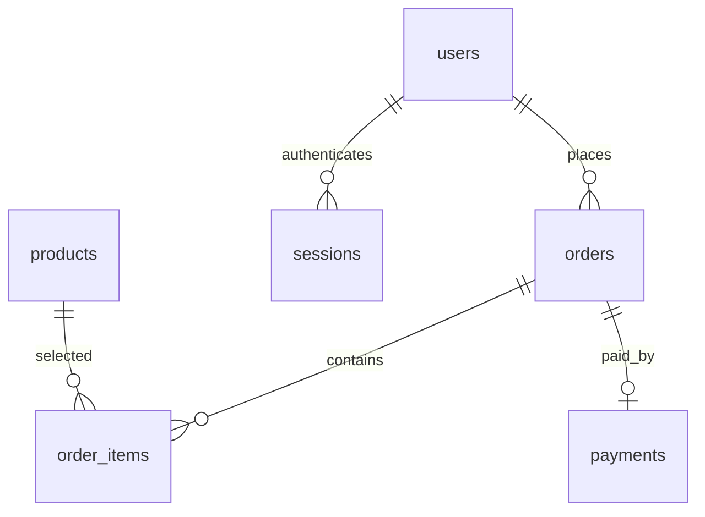

# 소소상점

Python / FastAPI / Uvicorn / Supabase PostgreSQL과 HTML·CSS·순수 JavaScript로 만든 반응형 학습용 쇼핑몰입니다. React·Node.js를 사용하지 않습니다.

## 설계와 학습 문서

- [ERD.mmd](ERD.mmd): Mermaid ERD 전용 파일, 테이블·키·관계
- [테이블정의.md](테이블정의.md): 각 열의 자료형·제약조건·역할
- [상품구매시뮬레이션.md](상품구매시뮬레이션.md): 회원가입부터 결제와 구매내역까지 테이블의 행이 바뀌는 과정
- [main코드설명.md](main코드설명.md): 서버 시작 시 데이터 생성 과정과 주요 함수별 역할

## 실행

`py313` 환경을 활성화한 터미널에서 실행합니다. day12의 다른 서버가 8000번 포트를 사용하고 있으면 먼저 종료하세요.

```bash
cd day12/shoppingmall
python -m pip install -r requirements.txt
```

`.env.example`을 참고해 이 폴더에 `.env`를 만들고 Supabase **Connect → Session pooler**의 실제 접속 정보를 입력하세요. 기존 프로젝트 최상위 `.env`에 소문자 `host`, `port`, `dbname`, `user`, `password`가 있으면 그것도 사용할 수 있습니다. 기존 실행 환경변수가 파일보다 우선합니다. `.env`는 Git에 올리지 마세요.

`DATABASE_URL` 환경변수를 사용하는 방법도 지원합니다. URL 안 비밀번호의 특수문자는 URL 인코딩이 필요합니다.

```bash
python main.py
```

- 쇼핑몰: http://127.0.0.1:8000
- API 문서: http://127.0.0.1:8000/docs
- 시작할 때 `schema.sql`로 `shoppingmall` 스키마와 테이블, 예시 상품 36개를 준비합니다. 기존 `kdt_api01`은 사용하지 않습니다.
- DB 계정에 스키마·테이블 생성 권한이 필요합니다. DB 연결은 백엔드에서만 이루어집니다.

## 사용 흐름

1. 로그인하지 않아도 상품을 조회하고 카테고리별로 볼 수 있습니다.
2. 담기·구매하기·장바구니·내 정보·구매내역은 로그인 화면으로 이어집니다.
3. 회원가입 후 로그인하면 이전 화면/선택 동작을 이어갑니다. 이름에는 공백 없이 한글·영문만, 비밀번호는 8~128자를 입력합니다.
4. 구매하기는 선택 상품을 장바구니에 추가하고 장바구니로 이동합니다. **결제는 장바구니 전체를 대상으로 합니다.** 수량을 바꾸려면 삭제 후 다시 담으세요.
5. 배송지를 입력해 모의 결제합니다. 실제 카드·계좌 청구나 배송은 발생하지 않습니다.
6. 구매내역에서 결제 당시 상품명·가격·수량을 확인합니다. 재고 부족 시 전체 결제를 취소하고 재고/결제 기록을 롤백합니다.
7. 내 정보에서 이름·배송지를 수정하거나 탈퇴합니다. 탈퇴는 개인정보 익명화와 세션 삭제를 수행하며 주문·결제 이력은 유지합니다.

이메일 중복 가입은 409, 인증 실패는 401, 입력 검증 실패는 422입니다. 비밀번호는 솔트와 PBKDF2 해시로 보관하고, 로그인 토큰은 HttpOnly 쿠키와 DB의 SHA-256 해시로 관리합니다. 세션 유효기간은 7일입니다.

## ERD



- `users`: 회원 정보와 비밀번호 해시
- `products`: 상품과 현재 가격·재고
- `orders`: 장바구니(`cart`) 또는 결제 완료 주문(`paid`). 회원당 활성 장바구니는 최대 1개
- `order_items`: 주문과 상품의 다대다 연결, 구매 수량과 결제 당시 가격·상품명
- `payments`: 주문당 1건의 모의 결제 기록
- `sessions`: 로그인 세션

## Render 배포 설정

저장소를 Render Web Service에 연결할 때 다음 값을 사용합니다. 배포는 자동으로 수행하지 않습니다.

| 항목 | 값 |
|---|---|
| Root Directory | `day12/shoppingmall` |
| Build Command | `pip install -r requirements.txt` |
| Start Command | `uvicorn main:app --host 0.0.0.0 --port $PORT --proxy-headers` |
| Health Check Path | `/health` |

환경변수에 `DATABASE_URL` 또는 DB 연결 항목 5개를 등록하고 `COOKIE_SECURE=true`를 설정하세요. HTTPS에서 접속합니다. lifespan에서 DB 초기화를 수행하므로 Uvicorn 명령으로 실행할 때도 초기화됩니다.

실제 결제를 제공하려면 별도의 결제사 연동, 결제 검증, 취소·환불 처리가 필요합니다. 공개 서비스 운영 전에는 로그인 시도 제한, 비밀번호 재설정·이메일 소유 확인, 운영 환경 보안 설정도 준비해야 합니다.

## 검증 상태

사용자 요청에 따라 코드 작성 후 실행·자동 테스트·브라우저 검토·Supabase 접속은 하지 않았습니다. 검증은 사용자 동의를 받은 뒤 진행합니다.
