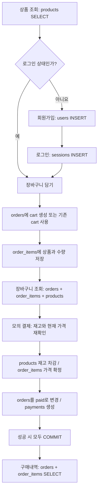

# 상품 구매를 테이블 관점에서 따라가기

아래는 현재 코드에 따른 **설명용 시뮬레이션**입니다. 실제 DB에서 실행한 결과가 아니며, ID·회원·주소는 모두 예시입니다. 가격 변경이나 다른 회원의 동시 구매가 없다고 가정합니다. 실제 결제는 없는 모의 결제입니다.

## 구매 시나리오

김하늘 회원이 데일리 머그 2개와 포켓 노트 1개를 구매합니다.

| 상품 ID | 상품 | 개당 가격 | 구매 수량 | 금액 | 구매 전 재고 |
|---|---|---:|---:|---:|---:|
| 1 | 데일리 머그 | 18,000원 | 2 | 36,000원 | 50 |
| 3 | 포켓 노트 | 6,500원 | 1 | 6,500원 | 100 |
| | 합계 | | 3개 | **42,500원** | |



## 1. 상품을 둘러본다 — products 조회

화면이 `GET /api/products`를 호출하고, 서버가 `products`를 SELECT합니다. 상품 목록만 볼 때는 로그인할 필요가 없고, 어떤 테이블에도 구매 데이터를 추가하지 않습니다.

상품 목록과 구매 버튼은 `static/app.js`, 서버 API는 `main.py`에 있습니다.

## 2. 회원가입한다 — users에 1행 추가

`POST /api/signup`으로 이름·이메일·비밀번호를 보냅니다. 검증 후 비밀번호를 해시로 바꾸어 저장합니다.

**users 예시**

| id | name | email | password_hash | address | active |
|---|---|---|---|---|---|
| 10 | 김하늘 | hana@example.com | 솔트와 해시값 | 빈 문자열 | true |

아직 주문·주문상품·결제 기록은 없습니다. 회원가입만으로 로그인되지는 않으므로 다음 단계에서 로그인합니다.

## 3. 로그인한다 — sessions에 1행 추가

`POST /api/login`에서 이메일로 회원을 찾고 비밀번호 해시를 비교합니다. 성공하면 세션을 생성합니다.

**sessions 예시**

| token_hash | user_id | expires_at |
|---|---:|---|
| 토큰의 SHA-256 해시 | 10 | 로그인 시점부터 7일 뒤 |

브라우저는 응답의 HttpOnly 쿠키를 보관합니다. 이후 장바구니·결제 요청에 쿠키가 전달되고, 서버는 세션을 조회해 회원 번호 `10`을 알아냅니다. 화면에서 임의로 보낸 회원 번호로 구매자를 결정하지 않습니다.

로그인하지 않고 구매 버튼을 눌렀다면 로그인 창이 열립니다. 로그인 완료 후 선택한 상품과 수량으로 담기 동작을 이어갑니다.

## 4. 머그 2개를 담는다 — orders와 order_items 생성

```http
POST /api/cart
Content-Type: application/json

{"product_id":1,"quantity":2}
```

서버는 회원의 기존 장바구니를 찾습니다. 없으면 `orders`에 `cart` 주문을 만들고 상품을 담습니다.

**orders 예시**

| id | user_id | status | total | shipping_address | paid_at |
|---|---:|---|---:|---|---|
| 100 | 10 | cart | 0 | 빈 문자열 | NULL |

**order_items 예시**

| id | order_id | product_id | product_name | unit_price | quantity |
|---|---:|---:|---|---:|---:|
| 1000 | 100 | 1 | 데일리 머그 | 18000 | 2 |

이 시점의 `products.stock`은 여전히 50입니다. 장바구니는 재고 예약이 아닙니다. `orders.total`도 아직 0이며, 화면의 합계는 현재 상품 가격과 수량으로 계산합니다.

## 5. 노트 1개를 담는다 — 같은 주문에 주문상품 추가

```http
POST /api/cart
Content-Type: application/json

{"product_id":3,"quantity":1}
```

기존 `cart` 주문 `100`을 사용합니다. 주문을 새로 생성하지 않습니다.

**order_items 예시**

| id | order_id | product_id | product_name | unit_price | quantity |
|---|---:|---:|---|---:|---:|
| 1000 | 100 | 1 | 데일리 머그 | 18000 | 2 |
| 1001 | 100 | 3 | 포켓 노트 | 6500 | 1 |

같은 머그를 다시 1개 담는다면 `(order_id=100, product_id=1)` 행의 수량을 3으로 UPDATE합니다. 이 예시는 추가로 담지 않고 머그 2개를 유지합니다.

## 6. 장바구니를 본다 — 테이블을 연결해서 조회

`GET /api/cart`는 다음 정보를 연결합니다.

| 테이블 | 가져올 정보 |
|---|---|
| orders | 현재 회원의 status가 cart인 주문 |
| order_items | 그 주문의 상품 번호와 수량 |
| products | 현재 상품명·가격·재고·이모지 |

연결 기준은 `orders.id = order_items.order_id`, `order_items.product_id = products.id`입니다. 조회만 하므로 행을 추가하지 않습니다.

화면에는 `18,000 × 2 + 6,500 × 1 = 42,500원`이 표시됩니다. **구매하기 버튼도 선택 상품을 장바구니에 추가하고 이 화면으로 이동하며, 결제는 장바구니 전체를 대상으로 합니다.**

## 7. 결제한다 — 여러 테이블을 한 번에 변경

```http
POST /api/checkout
Content-Type: application/json

{"address":"서울시 예시구 예시로 10"}
```

서버는 같은 회원의 동시 변경을 막기 위해 회원 행을 잠그고, 대상 상품도 `FOR UPDATE`로 잠근 뒤 재고를 확인합니다. 가격과 상품명은 결제 시점의 값으로 확정합니다.

**products 변경**

| id | name | price | stock 변경 |
|---|---|---:|---|
| 1 | 데일리 머그 | 18000 | 50 → **48** |
| 3 | 포켓 노트 | 6500 | 100 → **99** |

**order_items 확정**

| order_id | product_id | product_name | unit_price | quantity |
|---|---:|---|---:|---:|
| 100 | 1 | 데일리 머그 | 18000 | 2 |
| 100 | 3 | 포켓 노트 | 6500 | 1 |

이 예시는 가격 변동이 없어 담을 때와 값이 같습니다. 담은 뒤 가격이 바뀌었다면 현재 코드에서는 **결제 시점의 새 가격**으로 구매합니다.

**orders 변경**

| id | user_id | status | total | shipping_address | paid_at |
|---|---:|---|---:|---|---|
| 100 | 10 | cart → **paid** | 0 → **42500** | 서울시 예시구 예시로 10 | 결제 시각 |

장바구니 행을 삭제하고 별도 주문을 만드는 것이 아니라, **같은 orders 행의 상태를 바꿉니다.**

**payments 생성**

| id | order_id | amount | method | status |
|---|---:|---:|---|---|
| 500 | 100 | 42500 | demo | completed |

이 변경은 하나의 트랜잭션입니다. 모두 성공하면 COMMIT합니다. 중간에 재고 부족 등의 예외가 발생하면 전체 ROLLBACK하여 일부 상품만 차감되거나 결제 기록만 남는 것을 방지합니다. 성공 응답은 201입니다.

예를 들어 노트 재고가 부족하다면, 앞에서 수행한 머그 재고 차감도 되돌립니다. 장바구니는 `cart`로 유지되고 결제 기록은 생기지 않습니다. 재고 부족 응답은 409입니다.

## 8. 구매내역을 본다 — 확정된 주문을 조회

`GET /api/orders`는 회원 `10`의 `status='paid'`인 주문을 찾고, 각 주문의 `order_items`를 조회합니다.

| 주문 번호 | 상품 | 수량 | 개당 구매 가격 | 상품 금액 |
|---|---|---:|---:|---:|
| 100 | 데일리 머그 | 2 | 18,000원 | 36,000원 |
| 100 | 포켓 노트 | 1 | 6,500원 | 6,500원 |

화면의 주문 합계는 42,500원입니다. 이 API는 `payments`를 직접 조회하지 않고, 주문의 확정 총액과 주문상품을 사용합니다. 상품의 현재 가격이 바뀌더라도 구매내역은 `order_items.unit_price`를 사용하므로 그대로 유지됩니다.

결제 후에는 활성 장바구니가 없으므로 장바구니 조회 결과는 빈 목록입니다. 다음 상품을 담는 순간 새 `cart` 주문이 생성됩니다.

## 구매 외 기능은 어떤 테이블을 바꾸나요?

| 기능 | 관련 테이블 | 변경 |
|---|---|---|
| 회원정보 수정 | users | 이름·기본 배송지 UPDATE |
| 장바구니 상품 삭제 | order_items | 현재 cart 주문의 해당 상품 행 DELETE |
| 로그아웃 | sessions | 현재 쿠키에 해당하는 세션 DELETE, 쿠키 제거 |
| 회원탈퇴 | users | active=false, 이름·이메일·비밀번호 해시·주소 익명화 |
| 회원탈퇴 | sessions | 해당 회원의 모든 세션 DELETE |
| 회원탈퇴 | orders, order_items | cart 주문 삭제 및 연관 주문상품 자동 삭제 |
| 회원탈퇴 | orders | 구매 완료 주문은 유지하되 배송지를 빈 문자열로 변경 |
| 회원탈퇴 | payments | 기존 결제 기록 유지 |

테이블의 전체 열과 제약조건은 [테이블정의.md](테이블정의.md), 관계도 원본은 [ERD.mmd](ERD.mmd)를 참고하세요.
