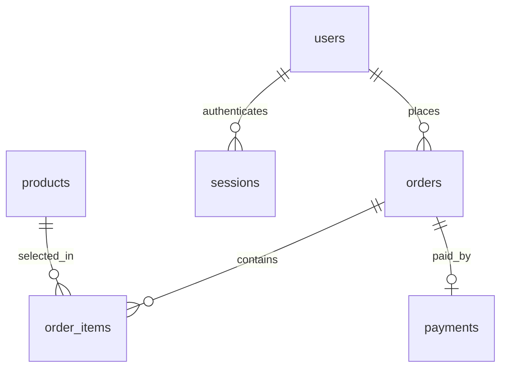

# 쇼핑몰 테이블 정의

현재 `schema.sql`과 `main.py`를 기준으로 작성한 문서입니다. DB 스키마 이름은 `shoppingmall`입니다. 이 문서 작성 과정에서 DB 접속이나 실행 검증은 하지 않았습니다.

## 최소 구매 구조와 관계

구매를 이해하는 데 필요한 핵심 테이블은 **회원, 상품, 주문, 주문상품, 결제**입니다. 실제 구현에는 로그인 상태를 보관하는 **세션** 테이블도 있습니다.

| 테이블 | 의미 | 핵심 질문 |
|---|---|---|
| `users` | 회원 | 누가 구매했나? |
| `products` | 상품 | 무엇을 판매하며 현재 가격과 재고는 얼마인가? |
| `orders` | 장바구니 또는 구매 완료 주문 | 누구의 주문이고 현재 어떤 상태인가? |
| `order_items` | 주문에 담긴 개별 상품 | 어떤 상품을 몇 개, 얼마에 구매했나? |
| `payments` | 모의 결제 | 어떤 주문을 얼마에 결제했나? |
| `sessions` | 로그인 상태 | 현재 요청이 어느 회원의 요청인가? |

ERD 원본은 [ERD.mmd](ERD.mmd)입니다. Mermaid ERD 형식으로 작성했으며, VS Code의 Mermaid 지원 미리보기에서 볼 수 있습니다. 간단한 관계는 아래와 같습니다.

- `||`: 정확히 1개, `o{`: 0개 이상, `o|`: 0개 또는 1개입니다.
- 회원 한 명은 여러 주문과 로그인 세션을 가질 수 있습니다.
- 주문 하나는 여러 주문상품을 담습니다. 빈 장바구니는 주문상품이 0개일 수 있습니다.
- 상품 하나는 여러 주문의 주문상품에 등장할 수 있습니다.
- 주문 하나의 결제 기록은 최대 1개입니다. 장바구니 상태에서는 없습니다.
- 현재 코드는 결제 완료 주문에 결제 기록을 만듭니다. DB의 외래 키만으로 모든 `paid` 주문에 결제 기록이 반드시 존재한다고 강제하는 구조는 아닙니다.

`order_items`가 필요한 이유는 주문 하나에 상품 여러 종류를 담기 때문입니다. `orders`에는 주문 전체의 정보를, `order_items`에는 각 상품의 수량과 가격을 보관합니다.

## 표 읽는 방법

- **PK**: 기본 키. 한 행을 유일하게 구분합니다.
- **FK**: 외래 키. 다른 테이블의 행을 가리킵니다.
- **UNIQUE**: 같은 값을 중복 저장할 수 없습니다.
- **NOT NULL**: 값이 반드시 있어야 합니다. 빈 문자열까지 금지한다는 뜻은 아닙니다.
- **CHECK**: DB에 저장할 값의 조건입니다.
- 숫자 `id`는 DB가 자동 생성합니다. 모든 `id`는 PK이며, 세션만 문자열 `token_hash`가 PK입니다.
- `TIMESTAMPTZ`는 시간대 정보를 반영하는 일시 타입입니다.

## 1. users — 회원

| 열 | 자료형 | NULL 허용 | 기본값·제약 | 의미 |
|---|---|---|---|---|
| `id` | BIGINT | 아니요 | PK, 자동 생성 | 회원 번호 |
| `name` | VARCHAR(50) | 아니요 | — | 이름 |
| `email` | VARCHAR(100) | 아니요 | UNIQUE | 로그인 이메일 |
| `password_hash` | TEXT | 아니요 | — | 솔트와 PBKDF2 비밀번호 해시 |
| `address` | VARCHAR(300) | 아니요 | 빈 문자열 | 기본 배송지 |
| `active` | BOOLEAN | 아니요 | TRUE | 사용 가능한 회원인지 |
| `created_at` | TIMESTAMPTZ | 아니요 | NOW() | 가입 시각 |

API는 이름에 공백 없이 한글·영문만 허용하고, 이메일 형식과 가입 비밀번호 길이 8~128자를 검사합니다. 이 규칙 전체가 DB 제약으로 등록된 것은 아닙니다. 비밀번호 원문은 저장하지 않습니다.

## 2. products — 상품

| 열 | 자료형 | NULL 허용 | 기본값·제약 | 의미 |
|---|---|---|---|---|
| `id` | BIGINT | 아니요 | PK, 자동 생성 | 상품 번호 |
| `name` | TEXT | 아니요 | UNIQUE | 상품명 |
| `description` | TEXT | 아니요 | — | 상품 설명 |
| `category` | TEXT | 아니요 | — | 리빙·패션·문구 등 |
| `price` | INTEGER | 아니요 | CHECK: 0보다 큼 | 현재 판매가, 원 단위 |
| `stock` | INTEGER | 아니요 | CHECK: 0 이상 | 현재 재고 |
| `emoji` | TEXT | 아니요 | — | 화면에서 사용하는 상품 이모지 |

장바구니에 담을 때는 재고를 차감하지 않습니다. 모의 결제가 성공할 때 차감합니다.

## 3. orders — 장바구니와 주문

| 열 | 자료형 | NULL 허용 | 기본값·제약 | 의미 |
|---|---|---|---|---|
| `id` | BIGINT | 아니요 | PK, 자동 생성 | 주문 번호 |
| `user_id` | BIGINT | 아니요 | FK → users.id | 주문한 회원 |
| `status` | TEXT | 아니요 | 기본 cart, CHECK: cart 또는 paid | 장바구니 / 결제 완료 |
| `total` | INTEGER | 아니요 | 0 | 결제 시 확정한 총액 |
| `shipping_address` | VARCHAR(300) | 아니요 | 빈 문자열 | 해당 주문의 배송지 |
| `created_at` | TIMESTAMPTZ | 아니요 | NOW() | 장바구니 생성 시각 |
| `paid_at` | TIMESTAMPTZ | 예 | 없음 | 결제 완료 시각 |

`status='cart'`인 행에만 적용되는 UNIQUE 인덱스로 **회원당 장바구니를 최대 1개**로 제한합니다. `paid` 주문은 여러 개 가질 수 있습니다.

장바구니 합계는 조회된 현재 상품 가격으로 계산합니다. DB의 `orders.total`은 결제 전에는 0이고, 결제 성공 시 최종 금액으로 바뀝니다. 기본 배송지를 수정해도 과거 주문 배송지는 바뀌지 않습니다.

## 4. order_items — 주문상품

| 열 | 자료형 | NULL 허용 | 기본값·제약 | 의미 |
|---|---|---|---|---|
| `id` | BIGINT | 아니요 | PK, 자동 생성 | 주문상품 번호 |
| `order_id` | BIGINT | 아니요 | FK → orders.id, ON DELETE CASCADE | 소속 주문 |
| `product_id` | BIGINT | 아니요 | FK → products.id | 선택한 상품 |
| `product_name` | TEXT | 아니요 | — | 저장한 상품명 |
| `unit_price` | INTEGER | 아니요 | — | 저장한 개당 가격 |
| `quantity` | INTEGER | 아니요 | CHECK: 1~99 | 수량 |

`(order_id, product_id)` 조합은 UNIQUE입니다. 같은 장바구니에 같은 상품을 다시 담으면 행을 추가하지 않고 수량을 합산합니다.

상품명과 가격은 담을 때 우선 저장하고, **결제 시 현재 상품명·가격으로 다시 확정**합니다. 이후 상품 가격이 바뀌어도 구매내역은 이 저장값을 사용합니다. 주문을 삭제하면 해당 주문상품도 함께 삭제됩니다.

## 5. payments — 모의 결제

| 열 | 자료형 | NULL 허용 | 기본값·제약 | 의미 |
|---|---|---|---|---|
| `id` | BIGINT | 아니요 | PK, 자동 생성 | 결제 번호 |
| `order_id` | BIGINT | 아니요 | FK → orders.id, UNIQUE | 결제 대상 주문 |
| `amount` | INTEGER | 아니요 | CHECK: 0보다 큼 | 결제 금액, 원 단위 |
| `method` | TEXT | 아니요 | demo | 모의 결제 방식 |
| `status` | TEXT | 아니요 | completed | 결제 상태 |
| `created_at` | TIMESTAMPTZ | 아니요 | NOW() | 결제 시각 |

실제 결제사 요청이나 카드 청구는 없습니다. 현재 결제 API는 성공 기록만 생성합니다. `method`와 `status`는 기본값이 있을 뿐, 허용 값을 제한하는 CHECK는 없습니다.

## 6. sessions — 로그인 세션

| 열 | 자료형 | NULL 허용 | 기본값·제약 | 의미 |
|---|---|---|---|---|
| `token_hash` | TEXT | 아니요 | PK | 로그인 토큰의 SHA-256 해시 |
| `user_id` | BIGINT | 아니요 | FK → users.id | 로그인 회원 |
| `expires_at` | TIMESTAMPTZ | 아니요 | NOW() + 7일 | 만료 시각 |

브라우저 쿠키에는 랜덤 토큰을, DB에는 그 해시를 저장합니다. 인증 요청에서 쿠키의 토큰을 해시로 바꿔 세션과 회원을 조회합니다. 로그아웃 시 현재 세션을 삭제하며, 탈퇴 시 회원의 모든 세션을 삭제합니다.

구매 단계별 데이터 예시는 [상품구매시뮬레이션.md](상품구매시뮬레이션.md)를 참고하세요.
